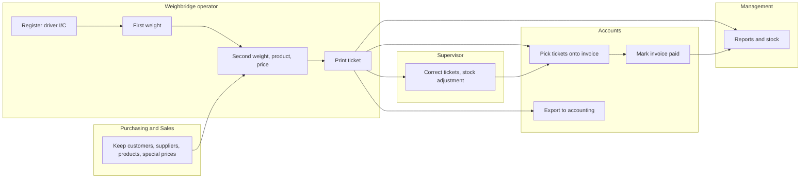
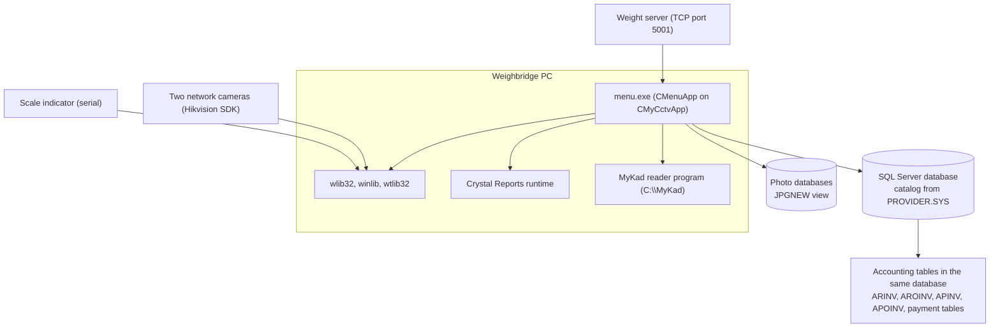
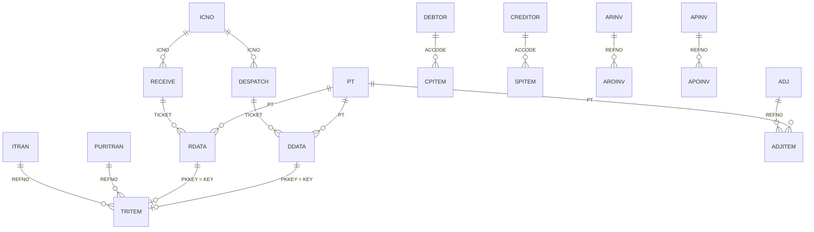
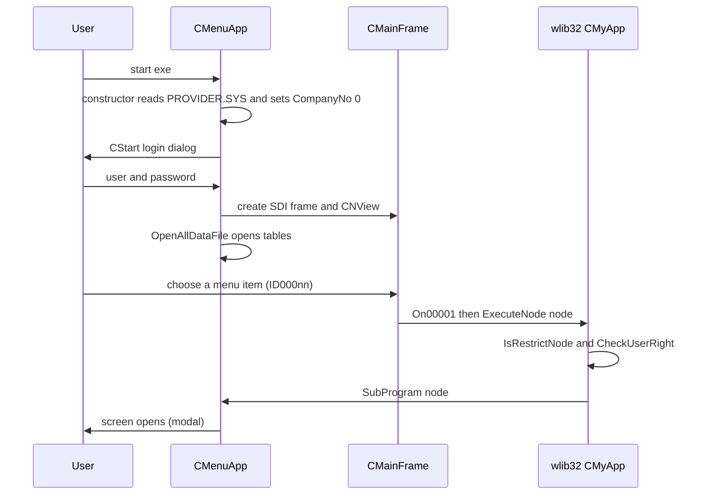
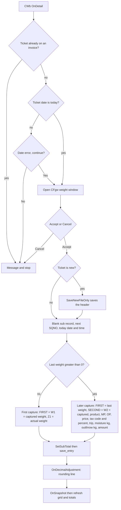
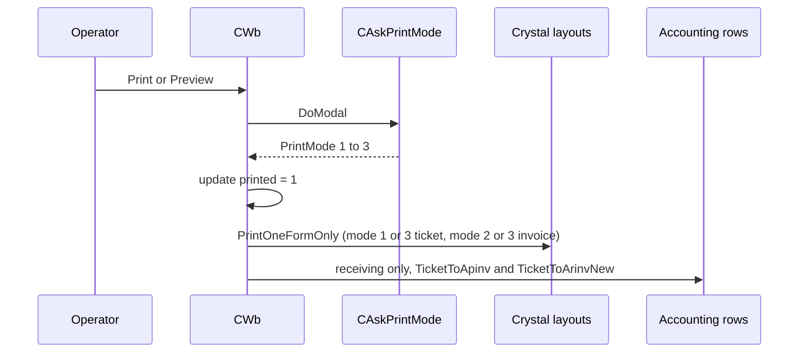
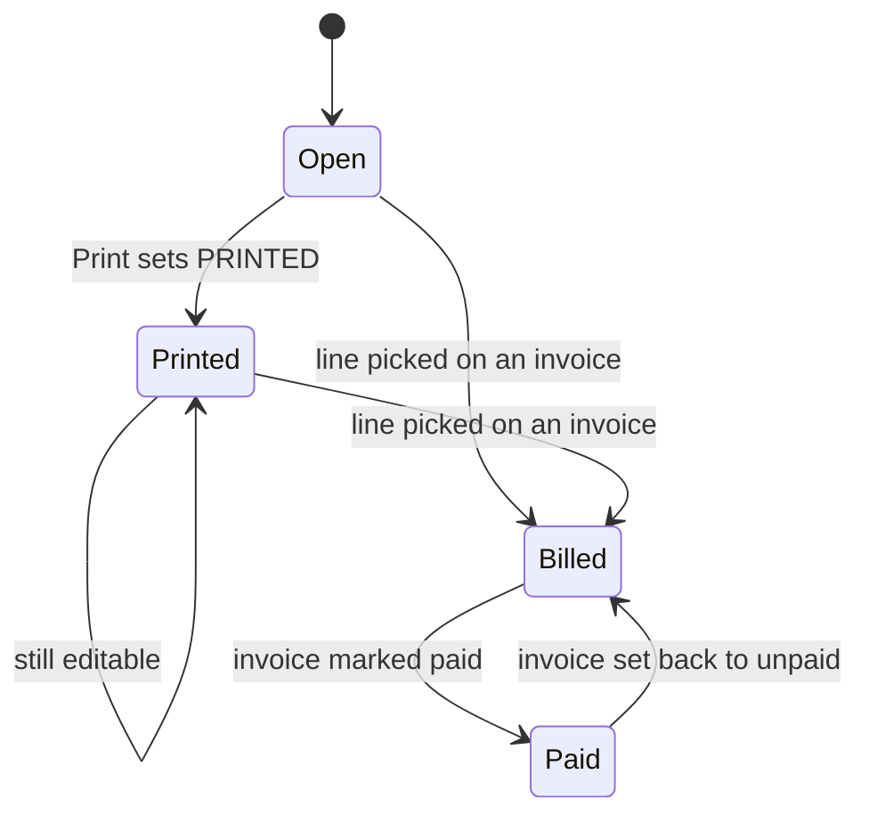
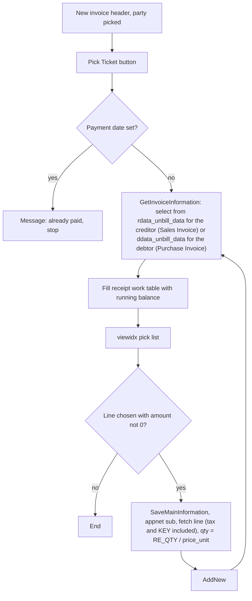
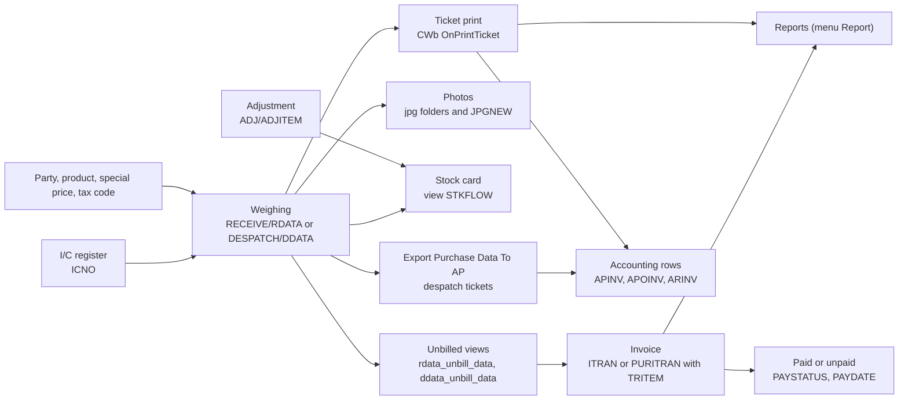

# Expert Plastic weighbridge - Module reference

The single reference for this application. **Part 1** explains how to use the program in plain words, for people who do not know it. **Part 2** explains where everything is in the code, for programmers and support. It is one file because the program is small (45 compiled source files).

- Repo: `Domain-Application/Application_Expert_Plastic`, default branch `main`. There is **no schema repo** (no `SQL_Expert_Plastic`) and no `.sql` file in the repo (`.gitignore` lists `*.sql`), so table and column types are marked as hints or as unverified, see [2.3](#23-master-data-catalogue).
- Last verified against commit `bc639ea` ("first commit", 2026-02-25).
- Translation status: zh-CN copy in [MODULE_REFERENCE.zh-CN.md](MODULE_REFERENCE.zh-CN.md), synced 2026-10-28 (commit 908014f).
- Rule: any change to behaviour, tables, fields, screens, reports or calculations must update this reference in the same commit.
- The repo has no `User_Guide` and no other `docs/` file, so there are no screenshots to link; none are invented here.
- **Cluster:** the repo shares 82% of its source file names with `Application_WangLian`, but it is an older and different code line: no e-invoice, no product grades, no split-products form, no "other invoices", no public-purchase table, and three extra areas (an I/C register with identity-card reading, camera photos through a CCTV base class, and invoices with a paid/unpaid status). Everything in this file was checked against this repo's own code; see [Differences from Application_WangLian](#differences-from-application_wanglian).
- **Build state:** the committed source does not look compilable as it stands, because the message map of the main window is damaged in one file (see [Code findings](#code-findings), item 1). This is stated here so nobody relies on a fresh build of this commit.

## Contents

- [Menu map and coverage](#menu-map-and-coverage)
- [Part 1 - Business view](#part-1---business-view)
  - [1.1 In plain words](#11-in-plain-words)
  - [1.2 Who uses what](#12-who-uses-what)
  - [1.3 A day in the life](#13-a-day-in-the-life)
  - [1.4 User levels and approvals](#14-user-levels-and-approvals)
  - [1.5 Worked example](#15-worked-example)
  - [1.6 Screen tour](#16-screen-tour)
  - [1.7 Where does this number come from?](#17-where-does-this-number-come-from)
  - [1.8 Status meanings](#18-status-meanings)
  - [1.9 What happens if](#19-what-happens-if)
  - [1.10 Messages you may see](#110-messages-you-may-see)
  - [1.11 Do and don't](#111-do-and-dont)
  - [1.12 Before you start](#112-before-you-start)
  - [1.13 Glossary](#113-glossary)
  - [1.14 Ask the AI](#114-ask-the-ai)
- [Part 2 - Technical view](#part-2---technical-view)
  - [Differences from Application_WangLian](#differences-from-application_wanglian)
  - [2.1 Overview](#21-overview)
  - [2.2 Architecture and dependencies](#22-architecture-and-dependencies)
  - [2.3 Master data catalogue](#23-master-data-catalogue)
  - [2.4 Sub-table hierarchy](#24-sub-table-hierarchy)
  - [2.5 Modules and process flows](#25-modules-and-process-flows)
  - [2.6 End-to-end flows](#26-end-to-end-flows)
  - [2.7 Report catalogue](#27-report-catalogue)
  - [2.8 Integrations](#28-integrations)
  - [2.9 Configuration](#29-configuration)
  - [2.10 Maintenance](#210-maintenance)
- [Dormant code](#dormant-code)
- [User rights](#user-rights)
- [Not yet documented](#not-yet-documented)
- [Code findings](#code-findings)

## Menu map and coverage

Menu resource `IDR_MAINMENU` in `menu.rc` (lines 123 to 175): 5 top-level entries, **32 items** (3 + 3 + 17 + 1 + 8). The menu ID `ID000nn` is node `nn`; `CMenuApp::SubProgram` (MAIN.CPP:73) switches on the node. Nodes are built from `enum menu {M_NORMAL=1, M_ADJ, M_CTRL, M_REPORT, M_OTHER}` (MAIN.CPP:19), so "Weighing" is 1x, "Adjustment/Invoicing" 2x, "Table" 3x, "Report" 4, "Utility" 5x; the two sub-menus of "Table" are 38x and 39x. The menu IDs are defined in `resource.h` (for example `ID00011`, line 335). Every item below is covered in this file. The project has one build target (`menu.dsp` in `Menu.dsw`, the target is `menu.exe`).

| Menu path (caption in `menu.rc`) | Node | Handler | Where documented |
|---|---|---|---|
| 1. Weighing > 1. Receiving | 11 | `OpenAPData(); STCR=1; Receive_Capacity()` (MAIN.CPP:78-81) | [2.5.2](#252-receiving-and-despatch-weighing) |
| 1. Weighing > 2. Despatch | 12 | `OpenARData(); STCR=2; Despatch_Capacity()` (MAIN.CPP:83-86) | [2.5.2](#252-receiving-and-despatch-weighing) |
| 1. Weighing > 3. Public | 13 | `STCR=3; SingleWeighing()` (MAIN.CPP:88-90) | [2.5.3](#253-public-weighing) |
| 2. Adjustment/Invoicing > 1. Adjustment Entry | 21 | `AdjustmentEntry()` (MAIN.CPP:92-93) | [2.5.4](#254-stock-adjustment) |
| 2. Adjustment/Invoicing > 2. Purchase Invoice | 22 | `OpenAPData(); STCR=3; PurchaseInvoice()` (MAIN.CPP:95-98) | [2.5.5](#255-sales-and-purchase-invoices) |
| 2. Adjustment/Invoicing > 3. Sales Invoice | 23 | `OpenARData(); STCR=2; SalesInvoice()` (MAIN.CPP:100-103) | [2.5.5](#255-sales-and-purchase-invoices) |
| 3. Table > 1. Customer | 31 | `OpenARData(); CustomerMaintenance()` (MAIN.CPP:111-113) | [2.5.8](#258-control-tables) |
| 3. Table > 2. Supplier | 32 | `OpenAPData(); SupplierMaintenance()` (MAIN.CPP:115-117) | [2.5.8](#258-control-tables) |
| 3. Table > 3. Item | 33 | `Prodtype()` (MAIN.CPP:119-120) | [2.5.8](#258-control-tables) |
| 3. Table > 4. I/C No. | 34 | `icno.Run()` (MAIN.CPP:122-123) | [2.5.8](#258-control-tables) |
| 3. Table > 5. Driver | 35 | `AdminDb(&driver)` (MAIN.CPP:125-126) | [2.5.8](#258-control-tables) |
| 3. Table > 6. Transporter | 36 | `AdminDb(&transp)` (MAIN.CPP:128-129) | [2.5.8](#258-control-tables) |
| 3. Table > 7. Vehicle | 37 | `AdminDb(&lorry)` (MAIN.CPP:131-132) | [2.5.8](#258-control-tables) |
| 3. Table > 8. more > 1. Payment Type | 381 | `AdminDb(&ptype)` (MAIN.CPP:134-135) | [2.5.8](#258-control-tables) |
| 3. Table > 8. more > 2. Function Code | 382 | `AdminDb(&gst)` (MAIN.CPP:137-138) | [2.5.8](#258-control-tables) |
| 3. Table > 8. more > 3. Reason | 383 | `AdminDb(&reason)` (MAIN.CPP:140-141) | [2.5.8](#258-control-tables) |
| 3. Table > 8. more > 4. Tender | 384 | `AdminDb(&tender)` (MAIN.CPP:143-144) | [2.5.8](#258-control-tables) |
| 3. Table > 8. more > 5. Gender | 385 | `AdminDb(&gender)` (MAIN.CPP:146-147) | [2.5.8](#258-control-tables) |
| 3. Table > 8. more > 6. Nationality | 386 | `AdminDb(&nationality)` (MAIN.CPP:149-150) | [2.5.8](#258-control-tables) |
| 3. Table > 8. more > 7. TType | 387 | `AdminDb(&ttype)` (MAIN.CPP:152-153) | [2.5.8](#258-control-tables) |
| 3. Table > 8. more > 8. Bussiness Type | 388 | `AdminDb(&btype)` (MAIN.CPP:155-156) | [2.5.8](#258-control-tables) |
| 3. Table > 8. more > 9. Risk Type | 389 | `AdminDb(&risktype)` (MAIN.CPP:158-159) | [2.5.8](#258-control-tables) |
| 3. Table > 9. more2 > 1. Twin No | 391 | `AdminDb(&ticno)` (MAIN.CPP:161-162) | [2.5.8](#258-control-tables) |
| 4. Report | 4 | `TableContainer("wbctn")` (MAIN.CPP:108-109) | [2.5.9](#259-report) |
| 5. Utility > 1. Set Password | 51 | `ON_COMMAND(ID00051, OnPassword)` in `CMainFrame` (MAINFRM.CPP:28), library `ChangeProgramPassword` | [2.5.10](#2510-utility) |
| 5. Utility > 2. Company Profile | 52 | `ProfileData(&profile)` (MAIN.CPP:164-165) | [2.5.10](#2510-utility) |
| 5. Utility > 3. Operator Information | 53 | `SetUser()` (MAIN.CPP:167-168) | [2.5.10](#2510-utility) |
| 5. Utility > 4. Backup Data | 54 | `BackupProcess()` (MAIN.CPP:170-171) | [2.5.10](#2510-utility) |
| 5. Utility > 5. Create new image database | 55 | `CreateNewImageDatabase()` (MAIN.CPP:173-174, defined MAIN.CPP:9) | [2.5.10](#2510-utility) |
| 5. Utility > 6. Reset Data | 56 | `ResetDatabase()` (MAIN.CPP:176-177) | [2.5.10](#2510-utility) |
| 5. Utility > 7. Export Purchase Data To AP | 57 | `ExportPurchaseInvoiceTransactions()` (MAIN.CPP:179-180) | [2.5.7](#257-export-to-accounting) |
| 5. Utility > 8. Period Control | 58 | `PeriodControl(&period)` (MAIN.CPP:182-183) | [2.5.10](#2510-utility) |

There is no node 14 (no second public-weighing item), no node 24 and no node 25 item: `SubProgram` has a `case M_ADJ*10+5` for `ExportInvoiceTransactions()` (MAIN.CPP:105-106) with no menu entry (see [Dormant code](#dormant-code)). The file-change cases 1001 to 1005 (MAIN.CPP:185-199) are never produced because the report picker in this repo has no "Object" entries. The generated inventory in `_inventory/Application_Expert_Plastic` was used as a lead only: its sub-table list matched the code, but it lists no menu and it misses the multi-line declarations of some tables (for example `driver`, `lorry`).

---

# Part 1 - Business view

## 1.1 In plain words

- This program runs the **weighbridge** of Expert Plastic Sdn Bhd, a company that buys and sells plastic material. Lorries bring material in (**receiving**), collect material (**despatch**), or only use the scale for a fee (**public weighing**).
- A lorry is weighed more than once. The program reads the scale, saves each weight, works out the net weight after rubbish is deducted, prices it, and prints a **ticket** (also called a docket). Cameras at the weighbridge can take photos of each weighing, and the people who deliver material can be recorded in an **I/C register** (identity card or passport number, name, address, photo, risk type), which can be filled by reading the Malaysian identity card (MyKad) with a card reader.
- Tickets are billed on **invoices**. Each invoice has a **paid / unpaid** status and a payment date. Invoice and ticket data can also be copied into the **accounting tables** (purchase invoice rows) that a separate accounting program uses.
- Lists such as customers, suppliers, products, lorries, drivers and the I/C register are kept in **control tables**. A customer or supplier can have its own price for a product (a **special price**), and tax is **SST** (the program still says GST in a few places).
- **Reports** show daily and monthly listings and summaries of receiving and despatch, public weighing, stock, adjustments and invoices. **Stock** is worked out from receiving tickets, despatch tickets and stock adjustments.
- If the daily routine is skipped, tickets are missing or wrong, invoices are late or wrongly marked as unpaid, and the reports and accounting tables are out of date.

## 1.2 Who uses what

| Department | Modules | Main tasks |
|---|---|---|
| Weighbridge operator | Weighing (Receiving, Despatch, Public), I/C No. | Weigh lorries, choose the product, register the driver's I/C, print tickets |
| Weighbridge supervisor | Weighing, Table menu, Adjustment Entry | Correct tickets, keep lorries, drivers and transporters, stock adjustments |
| Purchasing / Sales | Table menu (Customer, Supplier, Item) | Keep customers, suppliers, special prices, product prices and tax codes |
| Accounts / Finance | Sales Invoice, Purchase Invoice, Export Purchase Data To AP, Report | Bill tickets, record payments, move tickets to accounting, month-end reports |
| Management | Report, main window alert | Daily and monthly totals, stock, unbilled tickets |
| IT / Admin | Utility | Company profile, users, passwords, period lock, backup, photo database, reset |

**Start here (one line per department)**
- Operator: Weighing > Receiving or Despatch (or Public); I/C No. to register a new person.
- Supervisor: reopen the ticket from the same Weighing screen; Adjustment Entry for stock corrections.
- Purchasing / Sales: Table > Customer or Supplier, Item.
- Accounts: Adjustment/Invoicing > Sales Invoice or Purchase Invoice; Utility > Export Purchase Data To AP.
- Management: Report; the "Unbill Sales Ticket" button on the main window.
- IT: Utility > Company Profile, Backup Data, Period Control.

Daily, weekly and month-end duties:

| When | Who | What |
|---|---|---|
| Every weighing | Operator | Weigh in, weigh out, check product and price, print the ticket |
| Daily, end of day (typical) | Supervisor | Check tickets with hand-typed weights (shown in a different colour) before they are billed |
| Weekly or as agreed (typical) | Accounts | Create invoices from unbilled tickets, mark paid invoices |
| Month-end (typical) | Accounts | Run the export to accounting, print listings and summaries |
| Month-end (typical) | IT | Lock the closed period (Period Control), back up the data |
| When the photo database is nearly full | IT | Create a new image database |

## 1.3 A day in the life

Morning: IT or the supervisor checks the scale and the company profile (standard weight, scale connection). During the day: lorries arrive. The operator opens **Receiving** or **Despatch**, enters the vehicle, the other party and the driver's I/C, weighs the lorry (first weight), the lorry unloads or loads, and the operator weighs again (second weight). For each product the program calculates the net weight and the amount, and the cameras take photos at each weighing. The operator prints the ticket. Evening and week-end: accounts pick the unbilled tickets onto an invoice, record the payment when it arrives, and export tickets to the accounting tables. Management prints the reports.

Swimlane of the whole flow:



*Caption: customer, supplier and price lists feed weighing; the printed ticket goes to supervisor corrections, invoices, the accounting tables and reports; an invoice ends as paid.*

## 1.4 User levels and approvals

Each user has a number called the **level**. The levels that matter in this program:

| Level | What it allows |
|---|---|
| any user | Weigh, print, reprint, and edit a ticket (printing does not lock it in this program) as long as it is not on an invoice, not in a locked period and not already paid in accounting |
| below 9 | The invoice date cannot be changed (it is shown but locked) |
| 9 and above | Can change the invoice date |
| 999 | Can edit an invoice that already exists in the accounting tables (no normal user has this level) |

Besides the level, each user can be blocked from menu items by a list kept on the user record (see [User rights](#user-rights)), and the user's rights on each table (view, edit, add, delete) are kept in the library's rights tables. The "Scan IC" button of the I/C register is shown only to users who are not view-only. The Reset Data and Import functions ask for a separate password that is built into the program.

## 1.5 Worked example

All values are made up. Company profile: price unit is per kg (this program always prices per kg), rounding factor 50, a rounding product is set for receiving. Supplier S0001 "Sample Plastic Seller" has tax code NR (0%). Product PET01 "PET bottles (sample)" has a default buying price RM 1.000 per kg, and supplier S0001 has a special price for PET01 of RM 1.235 per kg. Vehicle WXY1234 and a driver with a made-up I/C number are registered.

**Step 1 - Receiving ticket.** Operator opens Weighing > Receiving, clicks New. The program fills ticket number T000123, today's date and time. Operator picks vehicle WXY1234; because it is a new receiving ticket, the program offers the trailer, container, seller, transporter, I/C and tender of the last completed ticket of the same vehicle, then the vehicle's own transporter. Operator checks the seller S0001. "Cash Bill" and "Auto Rounding" are ticked by default.

**Step 2 - First weight.** Operator presses the weighing button. The weight window shows the live scale reading, 12,000 kg (lorry loaded). Operator presses Accept weight. A first line is saved with 1st weight 12,000 and no product. If photos are switched on, the two cameras take a picture.

**Step 3 - Second weight.** After unloading, the operator weighs again and the window shows 5,000 kg. The product list is now active; operator picks PET01. The window shows the price RM 1.235, taken from the supplier's special price. Outthrow 2 (percent) is typed. Accept weight.

| Item | Value | How |
|---|---|---|
| 1st weight | 12,000 kg | previous weight on the ticket |
| 2nd weight | 5,000 kg | scale |
| Gross | 7,000 kg | 12,000 minus 5,000 |
| Outthrow | 140 kg | 7,000 x 2 / 100 (not rounded) |
| Net weight | 6,860 kg | 7,000 minus 140 |
| Amount | RM 8,472.10 | 1.235 x 6,860 |
| Tax | RM 0.00 | tax code NR is 0% |
| Sub-total | RM 8,472.10 | amount plus tax |

**Step 4 - Auto rounding.** The ticket sum is 8,472.10. The cents part is 10, which is below the rounding factor 50, so the program rounds down and adds a rounding line for the rounding product with amount -0.10. Ticket total is RM 8,472.00.

**Step 5 - Print.** Operator clicks Print. A small window asks "Print Weiging Ticket", "Print Invoice" or both; operator chooses the ticket. The ticket is printed and "Ticket Printed" is ticked. The program also copies the ticket into the accounting purchase rows (read from the code, not run).

**Step 6 - Invoice.** Accounts open Adjustment/Invoicing > Sales Invoice (this menu item bills the receiving side, see the note in [1.6](#16-screen-tour)), click New, pick A/C code S0001 and a payment type. Pick Ticket lists the unbilled lines of S0001 with a running balance. Accounts pick the PET01 line: an invoice line appears with ticket T000123, quantity 6,860, price 1.235 and amount 8,472.10, with the tax columns copied from the ticket line. The ticket screen now shows the invoice number and the pay status "Unpaid". From now on no weighing line can be added to that ticket.

**Step 7 - Payment.** When the supplier is paid, accounts open the invoice, type the payment date, press Update Payment Status and answer Yes. The status becomes "Paid" with that date. The invoice and its tickets can no longer be changed until someone sets it back to unpaid.

**Despatch variant.** A despatch ticket works the same way, but the price comes from the buyer's special price (else the product's sales price), the tax code comes from the product's sales tax code, and no rounding product is applied to the load weight. Its tickets are billed in Adjustment/Invoicing > Purchase Invoice, and the month-end export of despatch tickets is Utility > Export Purchase Data To AP.

## 1.6 Screen tour

No screenshots exist in the repo; the descriptions below come from the screen definitions and the code.

**Naming note.** In this program the menu item **Sales Invoice** bills *receiving* tickets and asks for a *supplier*, and the menu item **Purchase Invoice** bills *despatch* tickets and asks for a *customer*. The names are the other way round from what the words suggest. This was read from the code (the pick lists and the party lists); ask the site which meaning they use before relying on the labels.

### Main window

Purpose: the window that stays open behind all screens. It has three large buttons for Receiving, Despatch and Public weighing (the same as the first three menu items), a button **Unbill Sales Ticket (21 days rule)** with a box for the number of days (filled from the company profile), and two picture areas reserved for camera views. The button opens a browse list of unbilled despatch lines; the number of days is shown but the program does not use it to filter the list (see [Code findings](#code-findings)).

### Receiving and Despatch ticket (Weighing > 1 and 2)

Purpose: one ticket per lorry visit, with one line per weighing. Receiving is for material bought (the other party is called the **Seller**); Despatch is for material sold (the other party is the **Buyer**). The two screens are almost identical.

| Field | Meaning | Required? | Where the value comes from |
|---|---|---|---|
| Ticket No | The ticket number | automatic | calculated by the program (running number) |
| Vehicle No | The lorry | optional | typed or picked from the Vehicle list; picking fills the transporter and I/C from the vehicle, and on a new receiving ticket first the values of the last completed ticket of that vehicle |
| Trailer No, Container No | Extra identification | optional | typed |
| Seller / Buyer | The other party | optional, but price and tax depend on it | picked from the Supplier or Customer list |
| Transporter | The haulage company | optional | picked, or filled from the vehicle |
| Driver | The driver's I/C or passport number (the box is labelled Driver) | optional | picked from the I/C register; the name is shown beside it |
| Tender | Contract reference | optional | picked from the Tender list |
| Ticket Date, Ticket Time | When the ticket was made | automatic | system date and time |
| DO No, DO Date | Delivery order number and date | optional | typed |
| Remarks (two lines) | Free notes | optional | typed |
| Ticket Printed | The ticket has been printed | automatic | set when you print; read-only |
| Cash Bill | The ticket is paid in cash | optional | ticked by default for receiving, not ticked for despatch |
| Auto Rounding | Add a rounding line to whole ringgit | optional | ticked by default |
| Pay By, Cheque No., Cheque Date | Payment type, cheque number and date | optional | Pay By is picked from the Payment Type list; the others are typed |
| User | The operator who created the ticket | automatic | from the login |
| Total Net Weight (kg), Total Amount, SST AMT | Sums of the lines | automatic | calculated |
| Invoice No., Pay Status | The invoice this ticket is billed on and its status (Paid or Unpaid) | automatic | looked up from the invoice |
| A/C Amount, Variance (receiving) | Boxes for an accounting amount | - | exist on the screen but are never filled by this program |

Line grid columns: No, Date, Time, Bales, 1st Wt, 2nd Wt, Gross Wt, Product, Description, Out throw, Nett Wt, U/Price, Trip, Amount, Tax Code, Inc Tax, %, SST, Sub Total. The moisture columns are hidden in this program. Lines whose first or second weight was typed by hand instead of read from the scale are shown in a different colour (see [1.8](#18-status-meanings)).

Buttons:
- New, Save, Delete, Print, Search: the standard record buttons of the screen. There is a second print button captioned **Preview**, and the library adds a PDF export of the ticket.
- The weighing button (add a line): opens the weight window, see below.
- Wizard (edit a line by hand): opens the line form so the columns can be typed.
- Search: opens the small window "Vehicle In Yard": pick a date, optionally tick "Unprint Only", and the tickets of that day are listed; pick one to open it. The Advance button opens the normal search.
- **Last Transaction** (receiving only): shows the last completed receiving ticket of the same vehicle.
- **Export To A/C**: present in the window design but hidden and not connected to any action.
- **View Snapshot**: appears when photos were taken for this ticket; opens the folder of photos.

### Weight window

Purpose: read the scale and accept a weight.

| Field | Meaning | Where the value comes from |
|---|---|---|
| Current Weight | Live scale reading in kg | the scale (or the weight server) |
| Last Weight | Previous weight on this ticket | the second weight of the last line, or its first weight if the second is empty |
| Product | The material | picked from the product list (second weight onward); "Select Product" opens the browse list |
| Moisture, Outthrow | Percent to deduct for moisture and rubbish | typed (receiving only) |
| U/Price | Unit price per kg | filled from the special price or the product price, can be typed (receiving only) |
| Trip Expense | Extra amount added to the line | hidden in this build |

Buttons: Accept weight, Cancel. On the first weight of a ticket the product, price and deduction boxes are switched off. The program does not insist that the reading is steady or that the scale returned to zero, so the operator must watch the reading. For receiving, a percentage or fixed-kg deduction held in the database can be applied to every captured weight (see [1.7](#17-where-does-this-number-come-from)).

### Line form (Wizard)

Purpose: type a line by hand. Fields: Date, Time, Product, Bales Qty, Out Throw (kg), First Weight, Second Weight, Net Qty, U/Price, Trip Amt, Amount, Tax Code, Include Tax, Tax %, SST Amt, Sub-Total. The moisture boxes and the Split Products button are hidden in this program.

### Public Weighing (Weighing > 3)

Purpose: weigh a lorry for a fee, with no product. There is one public-weighing table (no separate purchase and sales versions).

| Field | Meaning | Source |
|---|---|---|
| Ticket No, Ticket Date, Time | Ticket number, date, time | automatic |
| A/C NAME | The party | typed (free text, not a list) |
| Vehicle No | The lorry | typed or picked |
| Gross Weight (kg), Tare Weight (kg) | The two weights | the two Capture Weight buttons read the scale |
| Net Weight (kg) | Net weight | calculated: gross minus tare (not stored) |
| Charge | The weighing fee | typed |
| Tax Code, Inclusive Tax, Tax (%), Tax Amt, Total | Tax on the fee | tax code picked, rest calculated |
| Remarks | Notes | typed |

Print offers the choices of the public-weighing list: "Public Sales Invoice" and "Public Sales Ticket".

### Adjustment Entry (stock adjustment)

Purpose: correct stock for loss, gain or count differences. Header: Ref.no, Date, Reason (picked from the Reason list), Remarks. Lines: Item Code (picked), Quantity (kg), U/Price (kg), Amount (calculated, quantity times price). Typing a reference number that does not exist does not create an entry ("Data Not found"); use the New button. The date cannot be changed once lines exist.

### Sales Invoice and Purchase Invoice

Purpose: bill tickets to one party. Sales Invoice: supplier, receiving tickets. Purchase Invoice: customer, despatch tickets (see the naming note above).

| Field | Meaning | Source |
|---|---|---|
| Invoice No | Invoice number | automatic |
| Date of Invoice | Invoice date | system date; only level 9 and above can change it |
| Due Date | Payment due | typed |
| A/C Code | The supplier (Sales Invoice) or customer (Purchase Invoice) | picked |
| Staff | Salesman | picked |
| Terms | Credit days | typed |
| Remarks (two lines) | Notes | typed |
| Payment Type | How it is paid | picked from the Payment Type list |
| Pay Status, Payment Date | Paid or Unpaid, and the payment date | set by the Update Payment Status button |

Buttons: **Pick Ticket** lists the party's unbilled ticket lines (with a running balance) and adds the one you choose as an invoice line, then lists again until you close the list. **Pick By Date** asks for a date range, lists the party's unbilled lines in it, and after you confirm the list adds all of them (it stops quietly at the first line whose amount is 0). **Update Payment Status** (the caption changes to Set Unpaid Payment when the invoice is paid) switches paid and unpaid. Totals at the bottom: Total Qty, Total RM, Total SST.

Invoice line grid: No, Ticket No, D/O No, Date, Description, Qty(MT), U/Price, Amount (RM), Tax Code, Inc Tax, SST %, SST Amt, Sub Total. The popup line form shows Ticket No, DO No, Date, Vehicle No, Product, Name, Qty, Price, Gross Amt, Tax Code, SST Inclusive, %, Tax Amt, Sub-Total. A hidden button "Export Sales Invoice To AR" exists on both invoice screens but does nothing.

### Customer and Supplier (Table > 1 and 2)

Purpose: the party master. Fields: A/C Code, Full Name, Short Name, Address (3 lines), four telephone numbers, Fax No., E-mail, Area, Service/Business Type, Currency, Salesman, Contact, Debtor and Creditor G/L accounts, Payment Scheme, Terms (days), Credit Limit, Balance Amt., Open A/C Date, "Don't print monthly statement", "Print zero balance statement", Remarks (2 lines), SST register No., Verify Date, Tax Code. A new customer starts with tax code SR and a new supplier with NR.

Grid: **Special price data entry**: Item Code, Description, U/Price. The price of the product for this party; the price unit is kg.

### Item (Product)

Purpose: the product master. Fields: Product Code, Description, Category, Unit, Credit G.L Code (Purchase and Sales G/L), Cash Bill G.L Code (Purchase and Sales G/L), Cost price, Sales Price, Remarks, Tax Code for Purchase and for Sales. The Cost price is the default buying price and the Sales Price the default selling price used when a party has no special price. There are no product grades and no price grid in this program.

### I/C No. (identity register)

Purpose: keep a record of every person who delivers or collects material, identified by identity card or passport number. Fields: IC / Passport No, Name, Gender, Date Of Birth, Place Of Birth, Ethnicity, Citizenship, Religion, Residential Address (3 lines), Mailing Address (3 lines), Town, Post code, State, Date of Issue, Date of Expiry, Old IC Number, Contact No 1 and 2, Fax Number, Email Address, Bank, A/C No, Ttype, P/C Code, Occupation, Bussiness Type, Employer, Alert Message, Risk Type, Payment Type, Twin Code, Nationality, Remarks. The button **Same as mailling address** copies the mailing address into the residential address. The **Scan IC** button (shown to users who are not view-only) starts the card-reader program, waits for the card data and picture, fills the record and saves the picture under the name of the I/C number. The record can also be found by its second key (the A/C No column).

### Other control tables

| Menu item | What it keeps |
|---|---|
| Driver | I/C No., name and three more text lines |
| Transporter | Code, name, short name, phone, 3 address lines, remarks |
| Vehicle | Vehicle number, transporter, driver, tare weight, black-listed flag (Y/N), remarks |
| Payment Type | Code, payment type, remarks |
| Function Code | One row of 26 numbers (A to Z). Not used by the current program (see [Dormant code](#dormant-code)) |
| Reason | Code, description, remarks (used by stock adjustment) |
| Tender | Code, name, short name, phone, 3 address lines, remarks |
| Gender, Nationality, TType, Bussiness Type, Risk Type, Twin No | Code, description, remarks: pick lists for the I/C register |

### Report

Purpose: pick a report from a list of groups (Receiving, Despatch, Public Weighing, Adjustment, Inventory, Invoice), set the date range and other filters, preview or print. See [2.7](#27-report-catalogue) for the list.

### Utility

| Menu item | What it does |
|---|---|
| Set Password | Change the program password |
| Company Profile | Company registration number, address, purchase invoice prefix, standard (minimum) weight, scale connection (direct or TCP/IP and weight server name), branch, rounding products for receiving and despatch, rounding factor, GST registration number, effective date and version, the 21-day alert, camera photo switch, PDF folder, I/C picture folder |
| Operator Information | Users, levels and menu rights |
| Backup Data | Back up the database |
| Create new image database | Make a new database for photos when the old one is nearly full |
| Reset Data | Delete transaction data and some master data after typing the reset password |
| Export Purchase Data To AP | Copy the despatch tickets of a date range into the accounting purchase rows |
| Period Control | Lock accounting periods: No, Date Begin, Date End, Status (L = locked); asks the program password first |

## 1.7 Where does this number come from?

**Gross weight of a line** = first weight minus second weight, always positive. Example: 12,000 and 5,000 give 7,000 kg.

**Outthrow kg and moisture kg** (receiving). If you type a percent and leave the kg box empty, the program fills it: gross x percent / 100. It is not rounded in this program. Example: gross 7,000 kg at 2 percent is 140 kg. If you type the kg yourself, your figure is kept. The moisture boxes are hidden on the line form and grid, but the weight window still has a moisture percent and it is deducted.

**Net weight** = gross minus moisture kg minus outthrow kg. A line with no second weight has net weight 0.

**Amount of a line** = unit price x net weight + trip amount. This program always uses a price unit of 1 (price per kg). Example: price 1.235 per kg, net 6,860 kg: 1.235 x 6,860 = 8,472.10. A five-sen rounding is tried when the second weight is accepted, but the amount is recalculated straight afterwards, so it has no effect (see [Code findings](#code-findings)).

**Where the unit price comes from.** When you pick a product on a ticket, the program looks first at the special price of the party for that product (customer table for despatch, supplier table for receiving). If the party has none, the product's default price is used (Sales Price for despatch, Cost price for receiving). If the price on the line is empty or equals the product's default, the special price replaces it; a different price you typed is kept.

**Tax of a line.** For receiving, the tax code is the supplier's tax code (NR if blank); for despatch it is the product's sales tax code. The percent comes from the Tax Code table. If the ticket date is earlier than the company's GST effective date, the percent is zero. Tax = amount x percent / 100 when tax is not included; tax = amount x percent / (100 + percent) when "Inc Tax" is ticked. Sub-total = amount + tax when tax is not included, and = amount when it is included. On invoice lines and on the public weighing screen the percent is only filled for dates after the effective date.

**Ticket totals.** Total Net Weight, Total Amount (the sum of the sub-totals) and SST AMT are the sums of the lines.

**Decimal (auto) rounding.** If "Auto Rounding" is ticked, the program adds the amounts of all lines except the rounding product, looks at the cents, and writes one rounding line for the rounding product (the receiving or despatch code in the company profile). If the cents are equal to or above the rounding factor, the rounding line brings the total up to the next whole ringgit; otherwise it brings it down to the whole ringgit. A total under RM 0.50 is not rounded. Example: total 8,472.10 with factor 50: cents 10 is below 50, so the line is -0.10 and the total is 8,472.00. Total 1,234.56: the line is +0.44 and the total is 1,235.00.

**Deduction on captured weight (receiving only).** The database can hold a deduction that the program applies to every weight read from the scale in the Receiving screen, once the reading reaches the standard (minimum) weight of the company profile: either a percentage or a fixed number of kg. Only one of the two may be filled. The fixed kg counts only when it is more than 10. The percentage is stored in hundredths (500 means 5 percent). There is no screen for these two values, and this program does not create them: IT must set them in the database, otherwise nothing is deducted.

**Public weighing.** Net weight = gross minus tare (shown on the screen, not stored). Tax is on the Charge: not included means tax = charge x percent / 100 and total = charge + tax; included means tax = charge x percent / (100 + percent) and total = charge.

**Stock adjustment line.** Amount = quantity x price.

**Invoice line.** The line is copied from the ticket line with its quantity, price, amount and tax. Quantity is the ticket net weight divided by the program's price unit (1). If you retype a line, the amount becomes quantity x price (the quantity is multiplied by 1,000 when the price unit is 1), and tax is added as above.

**Stock balance.** Stock in = net weight of receiving lines + adjustment quantities. Stock out = net weight of despatch lines. The stock card lists them by date and shows the running balance.

## 1.8 Status meanings

The program has no status column on tickets; these are the states you will meet.

| Document | State | Meaning | Who or what sets it | What can still be edited |
|---|---|---|---|---|
| Receiving or despatch ticket | Open | Not printed yet | Created by the operator | Everything |
| Receiving or despatch ticket | Printed | "Ticket Printed" is ticked | Print button | Still editable by every user (there is no print lock in this program) |
| Receiving ticket | Paid in accounting | The accounting purchase invoice of this ticket already has a payment | Accounting system | Nothing (a "Block" message appears) |
| Ticket (any) | In a locked period | The ticket date is in a period with status L | IT in Period Control | Nothing |
| Ticket line | Typed by hand | First or second weight was typed, not read from the scale; line shown in a different colour (magenta when the first weight was typed and there is no second weight yet, reddish when the second weight was typed) | Wizard form or edit of the grid | Everything while the ticket is not on an invoice |
| Ticket | Changed mark | A letter is stored on the ticket: * second weight edited, # first weight edited, m moisture edited, o outthrow edited, @ price edited | Program, when a line is edited after it was saved | Read-only mark |
| Ticket line | Unbilled | Not on any invoice yet | Program | Appears in Pick Ticket and in the Unbill button list |
| Ticket line | Billed | Picked onto an invoice | Pick Ticket | No more lines can be added or saved on that ticket; line delete is refused |
| Invoice | Unpaid | Default when created | Program | Everything |
| Invoice | Paid | Has a payment date | Update Payment Status | Nothing: no new lines, no pick, no edit of lines |
| Invoice | Posted to accounting | A row with the same number exists in the accounting invoice table | Accounting side | Nothing below level 999 ("Invoice Already Post to ACC System, cannot edit") |
| Period | Locked (L) | No edit of tickets with dates in the period | IT | Unlock by changing the status |

## 1.9 What happens if

- **A wrong ticket must be cancelled.** There is no cancel status. Fix the lines, or delete the ticket with the Delete button. If the ticket is already on an invoice, the program says "The invoice is exist. Press ok to continue." and asks "Confirm delete ticket?"; a line delete is refused. Fix the invoice first (delete the invoice line, or set the invoice back to unpaid).
- **You print again.** Printing a ticket twice is allowed; the print counter on the record increases. Printing does not lock a ticket.
- **You edit a ticket after it was invoiced.** Weighing lines cannot be added or saved ("The invoice is exist. Weighing process cannot be conducted"). The invoice line keeps its own copy of the quantity, price and amount from the moment it was picked. To correct it, delete the invoice line, fix the ticket, and pick the ticket again. If the invoice is paid, set it back to unpaid first.
- **You picked the wrong supplier or buyer.** Change it before billing; the price and tax of existing lines are not recalculated automatically, so re-select the product on each line or edit the line.
- **Power or network is cut while weighing.** Each accepted weight is saved at once, so lines already accepted are safe. If the cut comes before Accept, nothing is saved; re-weigh the lorry and add the line again. If the scale is read through the weight server and the server cannot be reached, the window keeps showing the last weight it received, so check the reading before accepting. If the scale signal is lost the window refuses to accept ("Weight signal lost").
- **The same ticket is entered twice.** Ticket numbers are automatic and unique. Each ticket line can be on only one invoice.
- **The date on the ticket is not today when you add a weight.** The program asks "Do you want to continue ?" and continues only if you say yes.
- **The weight is below 10 kg on a first weight.** The window refuses it ("Please double confirm your weight!!"). The standard (minimum) weight of the company profile is used for the receiving deduction only.
- **The period is locked.** Editing a ticket in that period shows a message that the period is closed. Ask IT to change the period status.
- **Reset Data.** Deletes the receiving, despatch and public tickets, stock adjustments, the special prices of customers and suppliers, products, drivers, transporters, payment types and the old simple invoices, and sets every running number back to 1. It keeps customers, suppliers, vehicles, the I/C register and the invoices made with Sales Invoice and Purchase Invoice. Call IT only; take a backup first.
- **When to call IT:** scale shows 0 or a frozen weight, "Data Not found" on a number that should exist, a locked period, a photo database that is full, any export that stops.

## 1.10 Messages you may see

| Message | Meaning | What to do |
|---|---|---|
| Do you want to continue ? (title "Date error") | The ticket date is not today | Choose Yes only if the date is right |
| The invoice is exist. Weighing process cannot be conducted | The ticket is already on an invoice | Fix the invoice first |
| Please double confirm your weight!! (title "--- Weight too low ---") | First weight under 10 kg | Check the scale; press Accept again only if correct |
| Weight signal lost. Please check indicator/cable/computer com port!! (title "Signal Lost") | The scale gives no reading | Check the cable, call IT |
| Goods Despatch / Second weight must greater than first weigh. Click yes to exit, Click no to continue (title "Incorrect weighing step") | On despatch the second weight is below the first | Yes returns to the screen, No keeps the weight |
| Goods receiving / Second weight must less than first weigh. Click yes to exit, Click no to continue | On receiving the second weight is above the first | Same as above |
| Please key in product (title "Data Incompleted") | Accept pressed on a second weight without a product | Select the product |
| Block | The purchase invoice of the ticket already has a payment in accounting | Cannot be edited here |
| The invoice is exist. Press ok to continue. / Confirm delete ticket? | Delete of a ticket that is on an invoice | Yes only if you really want to delete |
| The invoice for this ticket has already paid. Ticket cannot be deleted. | Delete of a line whose ticket is on an invoice (the wording says paid, but any invoice triggers it) | Fix the invoice first |
| Confirm Delete Ticket? | Delete of a ticket line or an invoice line | Yes to delete |
| Ticket without ticket no cannot be added | An invoice line without ticket number | Use Pick Ticket |
| This invoice already paid. New ticket are not able to add. | Add line on a paid invoice | Set the invoice to unpaid first |
| This invoice already paid, cannot pick ticket. | Pick Ticket or Pick By Date on a paid invoice | Same |
| This invoice already paid. Please change to unpaid to edit the ticket | Double-click on a line of a paid invoice | Same |
| Confirm update payment status to PAID? | Update Payment Status on an unpaid invoice | Yes to mark paid |
| Confirm set payment status to UNPAID? | Update Payment Status on a paid invoice | Yes to reopen |
| Cannot update invoice with empty ticket | Marking paid an invoice with no lines | Pick tickets first |
| Invoice Already Post to ACC System, cannot edit | The invoice is already in accounting | Cannot be changed |
| Database not open | A table failed to open | Call IT |
| Data Not found | You typed a number that does not exist and new entries are blocked | Use the New button |
| Can not create pdf file | The PDF export failed | Check the PDF folder in the company profile |
| Please key in reset password: (Reset Data window) / Incorret password | Wrong reset password | Ask IT |
| Reset database completed | Reset Data finished | None |

## 1.11 Do and don't

**Weighing**
- Do check the vehicle number, the other party and the driver's I/C before the first weight.
- Do print the ticket as soon as the lorry has left.
- Do not accept a weight while the reading is still moving.
- Do not edit weights after printing unless a supervisor agrees (a mark is left on the ticket); the program does not stop you.

**Invoices**
- Do pick tickets onto the invoice of the right party only.
- Do mark an invoice paid only when the payment is received; it freezes the invoice and its tickets.
- Do not edit an invoice after it has been posted to accounting.

**Master data**
- Do keep the special prices of customers and suppliers and the default prices of products, otherwise prices come out as zero.
- Do not delete products that were used on tickets.

**Utility**
- Do back up before Reset Data or a period change.
- Do not share the reset or import passwords.

## 1.12 Before you start

- The company profile is filled: company number, address, standard weight, scale connection, GST number and effective date, rounding products and factor.
- The scale is connected and set up (serial connection on the PC, or the weight server named in the profile).
- If photos are wanted: the camera switch in the company profile is on, the two cameras are reachable, and the photo database has room.
- Products exist with G/L codes, tax codes and default prices; special prices exist for customers and suppliers that get them.
- Customers and suppliers exist with a tax code.
- Vehicles, drivers, transporters and the I/C register records exist (optional but speeds up the ticket).
- Payment types exist if the payment type is used on tickets and invoices.
- Tax codes exist (output codes for sales, input codes for purchases); they are kept by the accounting program, not here.
- The I/C pick lists (Gender, Nationality, TType, Bussiness Type, Risk Type, Twin No) have their codes.
- Users exist with the right level (Utility > Operator Information).
- The database holds the procedures for the receiving deduction if a deduction is wanted.

## 1.13 Glossary

| Term | English | Malay | Chinese |
|---|---|---|---|
| Weighbridge | Truck scale | Jambatan timbang | 地磅 |
| Ticket / docket | Weighing document | Tiket | 磅单 |
| Receiving | Goods bought in | Terimaan | 收货 |
| Despatch | Goods sold out | Penghantaran | 发货 |
| Public weighing | Weighing service for outsiders | Timbang awam | 公众过磅 |
| First / second weight | Weight in and out | Berat pertama / kedua | 第一次 / 第二次重量 |
| Gross | Weight difference of the two weighings | Berat kasar | 毛重 |
| Net weight | Weight after deductions | Berat bersih | 净重 |
| Outthrow | Rubbish deduction | Bahan buangan | 杂质 |
| Special price | Price of a product for one customer or supplier | Harga khas | 特价 |
| Tender | Contract reference | Tender | 招标 |
| DO | Delivery order | Pesanan penghantaran | 送货单 |
| Cash bill | Paid in cash at the weighbridge | Bil tunai | 现金单 |
| Invoice | Bill | Invois | 发票 |
| Paid / unpaid | Payment status of an invoice | Dibayar / belum dibayar | 已付 / 未付 |
| I/C, MyKad | Malaysian identity card | Kad pengenalan | 身份证 |
| Risk type | Risk class of a person in the I/C register | Jenis risiko | 风险类别 |
| Twin code | Second code that identifies the same person | Kod berkembar | 孪生代码 |
| Adjustment | Stock correction | Pelarasan | 调整 |
| Period lock | Closing a date range | Kunci tempoh | 锁定期间 |
| SST / tax code | Sales and service tax and its percent | Kod cukai | 税码 |
| Unbilled | Not yet on an invoice | Belum diinvois | 未开票 |

## 1.14 Ask the AI

1. How do I weigh a lorry that delivers material and register the driver's I/C?
2. Why is the price on my ticket zero?
3. What does the Auto Rounding option do and how is the rounding line worked out?
4. How do I correct a ticket that is already on an invoice?
5. How do I bill the unbilled tickets of one supplier, and how do I mark the invoice paid?
6. Why does the program say "The invoice is exist. Weighing process cannot be conducted"?
7. What must I do at month-end to move tickets to accounting?
8. How do I lock a closed month so nobody can change old tickets?
9. Where do I set the standard weight and the scale connection?
10. How do I read an identity card into the I/C register?

---

# Part 2 - Technical view

## Differences from Application_WangLian

This repo sits in the WangLian cluster by file names, but it is an **older, different code line**, not a lightly edited copy. Of its 51 `.cpp` files, 46 have a namesake in `Application_WangLian` and only 16 of those are byte-identical; 30 differ, and `menu.rc`, `menu.dsp`, `MENU.H` and `resource.h` differ heavily. The reference of `Application_WangLian` was used as the template; every statement here was re-checked in this repo. Comparison method: byte comparison of the two folders (case-insensitive names), line diffs of the differing files, then a read of this repo's code.

**Files**

| Group | Files |
|---|---|
| Only in WangLian (source) | `Exportacc.cpp/.h` (Export To Accounting), `IREQ.CPP`, `Ireq.h` (other invoices and e-invoice panel), `SPLITPT.CPP/.H` (split products), `STAFF.CPP`, `PARENT----.CPP` (old library copies); also the 124 `.rpt` layouts sit in WangLian's root, `docs/`, `CLAUDE.md`, `README.md`, `HQ.SYS`, `RUNBTN.dat` |
| Only here | `ICNO.CPP/.H` (I/C register), `NVIEW.CPP/.H` (main window), `PURPICKBYDATE.CPP`, `PurPickByDate.h`, `SLIP_KS.CPP`, `ExpAR.cpp`, `EXPAR.H`, `Exp_AR.h`, `TRITEM.H`, the report folder `report\` (120 `.rpt` files), the folder `sql\` (two `.rpt` files only, no SQL), the camera SDK DLLs and libraries (`HCNetSDK.*`, `HCCore.*`, `PlayCtrl.*`, `JCSDK.dll`, `JvClient.dll` and others), `DeviceCfg.json`, `PURITRAN.set`, `swb.set`, `menu.scr`, `GRID.SCR`, `WBCTN_bak.SET/.GRP`, `HQ1 (2).SYS`, `USER_OLD.DBF`, `Update step 20230630.docx` |
| Identical in both | 16 of 46 `.cpp` (for example `ADJITEM.CPP`, `AutoInv.cpp`, `CLIENT.CPP`, `FGFTP.CPP`, `FastSearch.cpp`, `Logerr.cpp`, `SIC.CPP`, `STKFLOW.CPP`, `Two.cpp`, `TRCV.CPP`, `PR.CPP`) and 16 of 29 headers |
| Different | the other 30 `.cpp` (all the business modules), `menu.rc`, `menu.dsp`, `MENU.H`, `resource.h`, `test.rc` |
| In the folder but not in `menu.dsp` (6) | `DoSnapshot.cpp`, `PR.CPP`, `REQITEM.CPP`, `ScrollDialog.cpp`, `TRCV.CPP`, `TableContainer.cpp`. The project also compiles the library file `..\..\..\wlib32\MYFRM.CPP` (menu.dsp). `ICNO.CPP`, `NVIEW.CPP`, `PURPICKBYDATE.CPP`, `SLIP_KS.CPP`, `ExpAR.cpp` are compiled |

**Menu (32 items, WangLian 31)**

| Area | WangLian | This repo |
|---|---|---|
| Weighing | 1 Receiving, 2 Despatch, 3 Purchase Public Weighting, 4 Sales Public Weighting | 1 Receiving, 2 Despatch, **3 Public** (one table) |
| Adjustment/Invoicing | 21 Adjustment, 23 Sales Invoice, 24 Purchase Invoice, 25 Export To Accounting, 26 and 27 Other invoices | 21 Adjustment, **22 Purchase Invoice, 23 Sales Invoice**; no export item (node 25 case exists, no menu entry), no other invoices |
| Table | Table 1 (31-39) and Table 2 (40-42): Customer, Supplier, Item, Payment Type, Driver, Transporter, Vehicle, Function Code, Reason, Tender, Product Grade, Product Unit | 31 Customer, 32 Supplier, 33 Item, **34 I/C No.**, 35 Driver, 36 Transporter, 37 Vehicle, sub-menu **38 more** (Payment Type, Function Code, Reason, Tender, **Gender, Nationality, TType, Bussiness Type, Risk Type**), sub-menu **39 more2** (**Twin No**); no Product Grade, no Product Unit |
| Utility | 51-56, 58 (System Update at 55), 59 E-Invoice Profile | 51-54, **55 Create new image database**, 56 Reset Data, **57 Export Purchase Data To AP** (on the menu here, hidden in WangLian), 58 Period Control; no System Update, no E-Invoice Profile |

**Company identity.** `CompanyNo` is forced to 0 (MENU.CPP:63-65; WangLian forces 12) and the company list has one entry (MENU.CPP:51-54, source comment "EXPERT PLASTIC SDN BHD"). `price_unit` is always 1 (MENU.CPP:67) so every price is per kg (WangLian sets it by company number). The program class derives from `CMyCctvApp` (camera support in wlib32) instead of `CMyApp`, and the main window is `CNView` (a CCTV view) instead of `CMenuView`.

**Data model (`MENU.H` enums, tables).** No `PTSUB`, `PRODGRADE`, `CATEGORY` (no product grades), no `PWB`, no `PITRAN`/`PTRITEM` (the purchase invoice is `PURITRAN`, and **both invoice types share one line table `TRITEM`**), no `IREQ`/`SIREQ`/`REQITEM`/`SREQITEM`, no `SPLIT_PT`, no `CLASSIFICATION` column, no e-invoice lookup tables (`malaysia_state`, `malaysia_city`, `postcode`, `tt`), no `profile_einv` view. New: `ICNO` (37 columns, with `icno_imp` as the card-import buffer), `GENDER`, `NATIONALITY`, `TTYPE`, `BTYPE`, `RISKTYPE`, `TICNO`. Changed: `DESPATCH`/`RECEIVE` have `ICNO`, `CHEQUE`, `CQ_DATE` instead of `DRIVER` and the audit status; `SWB` has 14 columns with a free-text account name instead of a debtor and no net or wastage column; `SPITEM`/`CPITEM` hold a price per product instead of a grade; `ITRAN`/`PURITRAN` have `PYTYPE`, `PAYSTATUS`, `PAYDATE` and no prefix or period columns; the profile view has the 21-day alert, GST version, photo, PDF and I/C folders; `LORRY` has an `ICNO` column.

**`OpenAllDataFile`** (MENU.CPP:160-238) makes 59 open calls (tables, views and the `receipt.rep` buffer), runs **no start-up fix-up SQL** (WangLian alters `PROFILE` and creates the deduction procedures at every start), and `SetDBRelations` (MENU.CPP:240-275) only sets print flags and icons, no `sub` links.

**Weighing behaviour.**
- Not rounded: moisture and outthrow kg from a percent are plain `gross x percent / 100` (DDATA.CPP:20-58; WangLian rounds to 10 kg).
- Moisture is hidden on the grid and the line form (change comment dated 2023-05-30 at WB.CPP:166 and 207) but the weight window still takes a moisture percent.
- The weight window (FGW.CPP) has no video-capture window; photos are taken by the camera SDK at the end of `CWb::OnDetail` (WB.CPP:400, 436-469) and stored both as files and in the photo database.
- No print lock: the level 99 test of `CWb::BlockByOtherCondition` is commented out (WB.CPP:120-136); printing a ticket does not stop edits.
- A ticket that is on an invoice cannot get new or saved lines (WB.CPP:310-317, DDATA.CPP:212-221) and a ticket line cannot be deleted (DDATA.CPP:240-258); deleting the ticket header asks twice (RECEIVE.CPP:183-201, DESPATCH.CPP:58-76).
- New: "Last Transaction" button and vehicle pre-fill on receiving (RECEIVE.CPP:73-92, 133-167), PDF export `CWb::OnPDF` (WB.CPP:577-609), Invoice No. and Pay Status boxes (WB.CPP:243-268).
- No split-products form (the button is hidden and the code is absent), no `WeighingMode`.
- Same as WangLian: the weight-server client (CLIENT.CPP, FGFTP.CPP byte-identical), the receiving deduction branch (FGW.CPP:230-256 compared with WangLian's), the decimal rounding line (`CWb::OnDecimalAdjustment`, WB.CPP:64-107).

**Public weighing** is one screen on one table with a different layout (see [2.5.3](#253-public-weighing)); the `pswb_*` dot-matrix routines are not hooked.

**Print.** `CAskPrintMode` has three buttons (Print Weiging Ticket, Print Invoice, both); the print path is Crystal only (`report\despatch.rpt`, `report\despatch_inv.rpt`, `report\receive.rpt`, `report\receive_sr.rpt`, WB.CPP:611-653). The dot-matrix routines (`PRintReceiveSlip`, `PRintDespatchSlip`, the `_AK`/`_KS` variants) are still compiled but the ticket screen no longer calls them. Printing a receiving ticket now also writes accounting rows (WB.CPP:645-649).

**Invoicing.** No e-invoice (no panel, no `SetTransactionType`, no `CLASSIFICATION`, no E-Invoices button, no menu 59). Invoices carry a payment type and a paid/unpaid status with a date, a "Pick By Date" button that is visible, and an "Update Payment Status" button. The invoice header table for sales is `ITRAN`, for purchases `PURITRAN`; the sales invoice bills receiving tickets and the purchase invoice bills despatch tickets (the reverse of the WangLian naming). The sub-total of an invoice line follows the "Inc Tax" flag (TRITEM.CPP:88-98) where WangLian always adds the tax.

**Export to accounting.** `Exportacc.cpp` (the four-step month-end export) does not exist here. What exists: `CExpAP` (Utility 57: a date range of despatch tickets into the accounting purchase rows, EXPAP.CPP:49-85), `TicketToApinv` and `TicketToArinvNew` (SLIP.CPP:239-327) called when a receiving ticket is printed, and dormant older routines ([Dormant code](#dormant-code)).

**Reports.** `WBCTN.SET` has 37 entries (WangLian 46) in `wbctn.GRP` with 6 groups (WangLian 7); the group "Other Rcv" is used by two entries but missing from the group list; there are no "Object"/file-change entries; the layouts are in `report\` (`TableContainer` reads `report\`, MENU.CPP:84). Public weighing reports do name the `swb` table (WangLian's do not).

**Utility and security.** `PROVIDER.SYS` has five connection strings (lines 1, 3, 5, 7, 9; the first is used; its catalog is `EXPERT_PLASTIC_SDN_BHD`); `HQ.SYS` is absent but `HQ1.SYS`, `HQ1 (2).SYS` and `IFOLDER.SYS` exist; `LOGIN.DBF`, `USER.DBF` and the camera file `DeviceCfg.json` are tracked. Reset Data and Import use one fixed password for both (ResetPassword.cpp:64, 235). No System Update, no `OnSystemUpgrade`.

**Integrations.** Camera SDK (Hikvision, JCSDK) and the MyKad card reader program; no `QR.exe`, no `DomainMail.exe`, no e-invoice procedures; stored procedures called: only `dt_dwPercent` and `dt_dwWeight` (FGW.CPP:232-233), which this repo never creates.

**Dormant code** differs too (see [Dormant code](#dormant-code)): the dot-matrix print routines are now dormant, the old `CMenuView`, `CExpAR`, the `purcinv` tables and the `INV`/`PINV` tables are new or changed entries, and `ExportPurchaseInvoiceTransactions` is live here.

**Code findings.** The 18 findings of the WangLian reference were re-checked: 1 and 2 are the same (secrets in committed files, fixed passwords), 4, 5 and 17 are the same code, 3, 9, 11, 13 and 15 do not apply (no e-invoice, other table layouts, no `Exportacc`), 6, 7, 8 and 14 are fixed or different, 12 does not apply, 16 is fixed, 10 is partly present, 18 is present in new wording. New findings are listed in [Code findings](#code-findings).

**How to re-check.** After a code change, run `git diff --no-index --stat` between this folder and `Application_WangLian` and look first at `MENU.CPP`, `MAIN.CPP`, `MENU.H`, `menu.rc`, `menu.dsp`, `WB.CPP`, `RECEIVE.CPP`, `DESPATCH.CPP`, `DDATA.CPP`, `SWB.CPP`, `INV.CPP`, `PINV.CPP`, `TRITEM.CPP`, `SLIP.CPP`; re-count the menu items in `IDR_MAINMENU` against [Menu map](#menu-map-and-coverage); compare the 29 enums of `MENU.H` against [2.3](#23-master-data-catalogue) (and, if a schema script for this app ever appears, replace the type hints); re-parse `WBCTN.SET` and `wbctn.GRP` against [2.7](#27-report-catalogue); re-check each item of [Dormant code](#dormant-code) and [Code findings](#code-findings); then refresh the line numbers by running `check_doc.py`.

## 2.1 Overview

- **What it is:** the weighbridge program of Expert Plastic Sdn Bhd (plastics), a Visual C++ 6 / MFC application on the shared libraries wlib32, winlib and wtlib32. Main exe `menu.exe` from `menu.dsp` (single project in `Menu.dsw`; Release builds with `/MD`, `_AFXDLL` (menu.dsp:46), links `wlib32.lib` and `wtrlib32.lib` (menu.dsp:56); Debug links `dlib32.lib` and `wtdlib32.lib` (menu.dsp:83)). `menu.rc` carries file version 1.0.0.1 (menu.rc:1994). There is no update routine in this program.
- **Code size:** 51 `.cpp` files (10,402 lines) of which 45 are in `menu.dsp` (7,890 lines) plus the library file `MYFRM.CPP`; 35 headers; 50 dialog templates in `menu.rc` (3,147 lines); 29 enum blocks in `MENU.H` plus `enum menu` (MAIN.CPP:19). The 6 files not compiled are `DoSnapshot.cpp`, `PR.CPP`, `REQITEM.CPP`, `ScrollDialog.cpp`, `TRCV.CPP` and `TableContainer.cpp`.
- **Company:** `CompanyNo` is read by `getCompanyNo()` and then forced to 0 (MENU.CPP:63-65). The company table `tcompany` (MENU.CPP:51-54) holds one obfuscated name (source comment "EXPERT PLASTIC SDN BHD"). `price_unit` is 1 (MENU.CPP:67). The constructor also sets `m_manifest = TRUE`, `m_TableNameStyle = 1` (table names upper case) and `m_ReportFolder = "report\\"` (MENU.CPP:80-84), so Crystal layouts are looked for in `report\` unless a path is given.
- **Start-up:** `CMenuApp::Domain` (MENU.CPP:105) shows the login dialog `CStart` with `INIT_ROUND`, `INIT_CANNOTCREATENEWITEM`, `INIT_ADO_USER`, `INIT_ADO_PROGRAM_PASSWORD`, `INIT_LOCAL_REPORT`, `INIT_ADO_USER_WITH_CRYPT` and `INIT_ENCRYPT_PROGRAM_PASSWORD` (MENU.CPP:110-115), then `UserLogin`, then creates the SDI frame with document `CMenuDoc`, frame `CMainFrame` and view `CNView` (MENU.CPP:120-125). `HideStaffMenu = 99990` and `m_useDropDownBtnInsteadSrollbar = TRUE` are set at the end, and in a Release build `level_Adoarange_Advance_Button = 99990` (MENU.CPP:136-141). `CMenuApp::Profile` sets `AikhaPercent = 0` and the registry key name (MENU.CPP:95-103).
- **Frame:** `CMainFrame` (MAINFRM.CPP:36) builds the window title from the company title and the profile branch, sets `bCommOpen = TRUE` when `Pro_TCPIP` is off (MAINFRM.CPP:51) and `m_auto_purge_logfiles_after_days = 14` (MAINFRM.CPP:53); `OnOpenOtherFiles` opens the dBASE screen files `one.scr` and `two.scr` (MAINFRM.CPP:56-60) and `OnOpenSettingFiles` starts the serial comm thread with `SetCommThread` (MAINFRM.CPP:62-69).
- **Main window:** `CNView` (NVIEW.CPP, base `CCctvView` of wlib32) on the template `IDD_MENU_FORM` (NVIEW.H:34): three buttons whose IDs are the menu nodes 11, 12 and 13, the button "Unbill Sales Ticket (21 days rule)" (`OnButton2`, NVIEW.CPP:95-119), a days box filled from `Pro_ALERT21RULE` (NVIEW.CPP:32), and two picture areas. `TotalCameras` is 0 here (NVIEW.CPP:35), so no preview is started. `OnInitialUpdate` starts the video timer and two timers whose handlers do nothing (NVIEW.CPP:47-93). The old `CMenuView` (MENUVIEW.CPP) is compiled but not used by the document template.
- **Menu dispatch:** `CMyFrame::OnCommand` (wlib32) turns the menu ID into node `ID - ID00000`; `CMyFrame::On00001` calls `CMyApp::ExecuteNode`, which applies the user restrictions (`IsRestrictNode`, message "no right") and `CheckUserRight`, then calls `CMenuApp::SubProgram` (MAIN.CPP:73). The app frame maps only `ID00051` itself (MAINFRM.CPP:28); every other ID goes through the base map.
- **Open data:** `CMenuApp::OpenAllDataFile` (MENU.CPP:160-238) opens every table; see [2.3](#23-master-data-catalogue). `ado()` opens a table or view in full for lookup; `tado()` opens it in transaction mode with an empty cursor that the screen fills. Lookup of a field to its table is by column name: `GetMatchTable` (wlib32 MATCH.CPP) finds the opened table whose name equals the column alias, which is why a ticket column called `ICNO` picks from the `icno` table and a column `CREDITOR` from `creditor`.
- **Global state:** `STCR` is set by the menu before a screen opens: 1 receiving (MAIN.CPP:80), 2 despatch and Sales Invoice (MAIN.CPP:85, 102), 3 public weighing and Purchase Invoice (MAIN.CPP:89, 97). It decides the tax-code source in `FindTaxCode` (DDATA.CPP:79), the report file in `CWb::OnPrintTicket` (WB.CPP:636, 640, 645) and the caption colour in `CMenuApp::SetTitleColor` (MENU.CPP:325-362: receiving red, despatch blue, public green). `accode` points to `debtor` or `creditor` (`OpenARData`, `OpenAPData`, MENU.CPP:277-289) and the same two functions filter the `taxcode` table to output (`TAX_TYPE='O'`) or input (`'I'`) codes.

## 2.2 Architecture and dependencies



*Caption: the exe reads the scale directly or through a weight server, takes photos from two cameras into a photo database, reads identity cards through an external program, and uses one SQL Server database that also holds the accounting tables.*

- **Libraries:** wlib32 (DB class and field-number access, screen bases `CStaff`, `CParent`, `CFEdit`, `CTio`, `CBrowse`, ticket numbering from `TICKETNO`, comm thread, table container for the report picker, backup, user and password dialogs, and the CCTV classes `CMyCctvApp`/`CCctvView` with the Hikvision and JCSDK wrappers), winlib, and wtlib32 (`CConfirmWeight`, the weight window base). The repo carries the camera vendor DLLs and libraries next to the exe sources.
- **Database:** SQL Server, selected by `PROVIDER.SYS`. The file has five connection strings (lines 1, 3, 5, 7 and 9, each followed by a blank line); wlib32 `GetSystemProviderString` takes the first non-blank line, whose catalog is `EXPERT_PLASTIC_SDN_BHD`; the other lines name other hosts and catalogs of the same company family (one of them `NU_GST`), which shows the file was copied from other sites. The credentials in it are plain text (see [Code findings](#code-findings)); values are not copied here. **No schema repo and no `.sql` file exist for this app**; `.gitignore` excludes `*.sql`.
- **Photo databases:** photos are also stored in a table `JPGNEW` (a view that unions the photo databases `<company word>_JPG<name>` created by Utility 55); a ticket line carries the key `JPGKEY` and each camera writes one image column (`jpg11`, `jpg12`) through `CMyJpg::textcopy` (WB.CPP:406-434).
- **Accounting tables in the same database:** `ARINV`, `AROINV`, `APINV`, `APOINV` are written by `TicketToApinv`, `TicketToArinvNew` and `CExpAP`; the programs read `appaydat`, `apcrdat`, `arpaydat`, `arcrdat` to detect payments (SLIP.CPP:253-261, 298-306, RECEIVE.CPP:52). The payment, credit note, ledger and report tables belong to an accounting program that shares the database; this program also opens `aripay`, `arpaydat`, `apipay`, `appaydat` (MENU.CPP:233-236) but only the dormant `TicketToArinv` (PDES_AK.CPP:74-150) writes to the first two.
- **Reports:** Crystal `.rpt` (120 files in `report\`, 37 of them in the report picker), dot-matrix `.FMT`/`.REP` forms (legacy), no `.rdl`.
- **External services:** weight server over TCP (CLIENT.CPP:21, 26), the serial scale (library comm thread, `GetCurrenctCommWeight(1)`, FGW.CPP:211), two network cameras (WB.CPP:15, 444-466), the MyKad reader (ICNO.CPP:114-126), PDF export through Crystal (WB.CPP:577-609). No MyInvois, no e-mail helper, no vendor API.
- **Hardware:** scale indicator (win.ini `device=` mask, wlib32 `COMM.CPP`), cameras, MyKad card reader, dot-matrix printer on LPT1 (legacy routines) and A4 printers for Crystal.

### Relationship to other applications and systems

| System | Relationship | Evidence |
|---|---|---|
| Application_WangLian, Application_Rakan_Kertas_WB, Application_Kent_Soon | Same family by file names; this repo is an older line with its own modules | file comparison above |
| Accounting program (same database) | Owns payments, credit notes, ledgers; this program writes the invoice rows it bills | SLIP.CPP:253-306; `TicketToApinv`, `TicketToArinvNew` |
| Weight server | Another PC that reads the indicator and answers a TCP request | CLIENT.CPP:21-29 (port 5001, command `W1`, FGW.CPP:218) |
| Hikvision cameras | Two cameras per weighbridge, snapshot per weighing | WB.CPP:15, 444-466; `DeviceCfg.json` |
| MyKad reader | External program that writes the card data and picture to files | ICNO.CPP:114-126, 194-299 |
| Crystal Reports | All printed reports | `.rpt` files, `WBCTN.SET` |
| ReportEngine / SSRS (`.rdl`) | Not used | no `.rdl` files, no ReportEngine call |

## 2.3 Master data catalogue

**No schema is available for this app.** The column lists below follow the enums in `MENU.H` and the dialog control numbers in `menu.rc` (a dialog control `IDC_EDITn` edits field `n`). Where a table and column match the sister app by name and position, the type is given as a hint, labelled in the heading of each table: **type from SQL_WangLian (sister app), unverified for Expert_Plastic**. Where they do not match, the type is `type: unverified`. Legacy `.dbf` files in the repo (`RECEIPT.REP`, `ONE.SCR`, `TWO.SCR`, `pswb_inv.DBF`, `SPITEM.DBF`) give the layouts of print buffers only and are named where used.

Common audit block on most tables (from SQL_WangLian, unverified here): `REC_STATUS`, `NEWUSER`, `NEWTIME`, `MODIFYUSER`, `MODIFYTIME`, `Print Counter`. The code reads `NEWUSER` (WB.CPP:243) and `printed` (WB.CPP:627, FastSearch.cpp:80). The audit block is not repeated below.

**Field numbering rule (wlib32):** a field number is the position of the column in the result set, so the enums in `MENU.H` only work when the table column order matches. Known drifts in this repo are listed in [Code findings](#code-findings).

Index of the tables the program opens (`OpenAllDataFile`, MENU.CPP:160-238):

| Table or view | Opened with | Role | Section |
|---|---|---|---|
| `receive`, `rdata`, `despatch`, `ddata` | `tado` with `init_receive`, `init_ddata`, `init_despatch` (MENU.CPP:178-182) | receiving and despatch tickets | [2.4](#24-sub-table-hierarchy) |
| `swb` | `tado` with `init_swb` (MENU.CPP:178) | public weighing tickets | [2.4](#24-sub-table-hierarchy) |
| `itran`, `puritran`, `tritem` | `tado` with `init_inv`, `init_purinv`, `init_tritem` (MENU.CPP:221-223) | sales and purchase invoices and their shared lines | [2.4](#24-sub-table-hierarchy) |
| `adj`, `adjitem` | `tado` (MENU.CPP:207-208) | stock adjustment | [2.4](#24-sub-table-hierarchy) |
| `inv`, `invitem`, `pinv`, `pinvitem`, `purinv` (table `purcinv`), `purinvitem` (table `purcinvitem`) | `tado` (MENU.CPP:213-218) | old simple invoices (only the reset code, old reports and dormant code use them) | [Dormant code](#dormant-code) |
| `trcv`, `trdata` | `tado` (MENU.CPP:183-184) | "other receiving" tables (screen not compiled) | [Dormant code](#dormant-code) |
| `arinv`, `aroinv`, `apinv`, `apoinv` | `tado` (MENU.CPP:224-227) | accounting invoices written by the ticket routines | [2.5.7](#257-export-to-accounting) |
| `aripay`, `arpaydat`, `apipay`, `appaydat` | `tado` (MENU.CPP:233-236) | accounting payment tables | [2.5.7](#257-export-to-accounting) |
| `pt`, `unit` | `ado` (MENU.CPP:186, 177) | product master and unit lookup | below |
| `debtor`, `creditor`, `cpitem`, `spitem` | `ado` with `init_customer`, `init_supplier`; `tado` (MENU.CPP:205-206, 209-210) | party masters and special prices | below |
| `icno` | `ado` with `init_icno` (MENU.CPP:175) | I/C register | below |
| `gender`, `nationality`, `ttype`, `btype`, `risktype`, `ticno` | `ado` (MENU.CPP:193-198) | I/C pick lists | below |
| `lorry`, `driver`, `transp`, `tender`, `ptype`, `gst`, `reason`, `taxcode`, `period_wb` | `ado` (MENU.CPP:187-190, 199-203, 211, 176, 230) | other masters | below |
| `wbprofile` (as `profile`), `profile` (as `accpf`), `logo` | `ado` (MENU.CPP:162-171) | company settings | below |
| `staff`, `area`, `stype`, `status`, `glcode`, `glgroup` | `ado` (MENU.CPP:191-192, 202, 204, 212, 231) | lookups and legacy | below |
| `logerr` | `tado` (MENU.CPP:219) | approval log | below |
| `receipt` | `dopen("receipt.rep")` (MENU.CPP:229) | in-memory work table used by the invoice pick list | [2.5.5](#255-sales-and-purchase-invoices) |
| `ticketno` | by wlib32 | running numbers | below |
| `user`, `login`, `TableUserControl`, `FieldUserControl` | by wlib32 | users and rights | [User rights](#user-rights) |
| `receive_completed`, `rdata_unbill_data`, `ddata_unbill_data`, `stkflow`, `jpgnew` | views read by SQL text | last completed ticket, unbilled lines, stock card, photos; **definitions are not in this repo** | where used |

`sg`, `currency`, `tscr`, `vtype`, `ldo`, `doitem`, `item`, `prefix` are declared (MENU.CPP:23-42) but never opened; the dialogs `IDD_TAXCODE`, `IDD_GLCODE`, `IDD_GLGROUP`, `IDD_STAFF`, `IDD_AREA` exist but no menu item opens them.

### PT (product, "Item")

- **Purpose:** the products bought and sold. Maintained by purchasing or the supervisor.
- **Screen:** Table > Item, node 33, dialog `IDD_PT` "Product Data Entry", class `CProdtype` (`CStaff`, PRODTYPE.CPP:18), `Prodtype()` PRODTYPE.CPP:50. There is **no sub-grid and no Stock Flow button** on this dialog: `CProdtype::OnStockFlow` (PRODTYPE.CPP:45) is bound to `IDC_BUTTON1`, which the template does not contain, so `ViewStockFlow` is not reachable from here.
- Types: type from SQL_WangLian (sister app), unverified for Expert_Plastic (enum and dialog agree with the sister table at all 13 positions).

| # | field (enum) | SQL column | type | key | meaning |
|---|---|---|---|---|---|
| 1 | `PT_ITEM` | CODE | nvarchar(11) NN | PK | product code |
| 2 | `PT_DES` | NAME | nvarchar(60) | | description |
| 3 | `PT_CAT` | CATEGORY | nvarchar(5) | lookup | category (no `CATEGORY` table is opened; the box is free) |
| 4 | `PT_UNIT` | UNIT | nvarchar(6) | lookup `unit` | unit; not used for pricing here (price unit is fixed at 1) |
| 5 | `PT_GLCODE_PURCHASE` | GLCODE1 | int | lookup `glcode` | credit G/L, purchase (dialog "Credit G.L Code" > Purchase Glcode) |
| 6 | `PT_GLCODE_SALE` | GLCODE2 | int | lookup `glcode` | credit G/L, sales |
| 7 | `PT_GLCODE_CASHPURCHASE` | GLCODE3 | int | lookup | cash bill G/L, purchase |
| 8 | `PT_GLCODE_CASHSALE` | GLCODE4 | int | lookup | cash bill G/L, sales |
| 9 | `PT_BUY` | COST | float | | default buying price per kg (dialog "Cost price") |
| 10 | `PT_SALE` | PRICE | float | | default selling price per kg (dialog "Sales Price") |
| 11 | `PT_REM` | REMARKS | nvarchar(40) | | remarks |
| 12 | `PT_TAXCODE1` | TAXCODE1 | nvarchar(10) | lookup `taxcode` | purchase tax code |
| 13 | `PT_TAXCODE2` | TAXCODE2 | nvarchar(10) | lookup `taxcode` | sales tax code; unlike the sister app nothing fills it with `SR` at start |

Used by: every ticket line (`RDATA.PT`, `DDATA.PT`), adjustment items, invoice lines. A product named in the company profile (`Pro_RA`, `Pro_RA2`) is the rounding product and must exist here.

### UNIT, TAXCODE, PERIOD_WB

| Table | Screen (menu) | Columns | Notes |
|---|---|---|---|
| `UNIT` | none (opened by `ado`, MENU.CPP:177; `IDD_UNIT` is only a constant) | CODE, UNIT, REMARKS, PRICE_UNIT (type from SQL_WangLian, unverified for Expert_Plastic: nvarchar(6), nvarchar(12), nvarchar(12), int) | not used for pricing: `price_unit` is a constant 1 |
| `TAXCODE` | none (the dialog `IDD_TAXCODE` is not opened by any code); `OpenARData`/`OpenAPData` reopen it filtered by `TAX_TYPE` and `ISNULL(INACTIVE,0)<>1` (MENU.CPP:277-289) | CODE nvarchar(10), DESCRIPTION, PERCEN (read as `taxcode.val(3)`), TAX_GRP, REMARK, GLCODE, TAX_TYPE (`O` output, `I` input), GST03, INACTIVE, TAXTYPE, EXEMPT_RATE (types from SQL_WangLian, unverified for Expert_Plastic) | maintained by the accounting program |
| `PERIOD_WB` | Utility > Period Control (58), `PeriodControl(&period)` (MAIN.CPP:45-51): asks the program password with `CAskPassword`, then `AdminDb`; dialog `IDD_PERIOD` (menu.rc:434-451) | NO nvarchar(2), D1 smalldatetime, D2 smalldatetime, STATUS nvarchar(1) (`L` = locked); type from SQL_WangLian, unverified for Expert_Plastic | `Receive_Capacity` and `Despatch_Capacity` pass `period`, `fldPeriod = D_DATE` and the column numbers to the screen (RECEIVE.CPP:240-244, DESPATCH.CPP:35-39); wlib32 `CStaff::IsOldPeriodLock` refuses edits in a locked row. Only receiving and despatch use it |

### DEBTOR (customer) and CREDITOR (supplier)

- **Purpose:** the other party on tickets and invoices; `DEBTOR` for despatch (and for the Purchase Invoice here), `CREDITOR` for receiving (and for the Sales Invoice here). Same layout. Maintained by purchasing or sales.
- **Screen:** Table > Customer (31) / Supplier (32), dialog `IDD_DEBTOR` "DEBTOR DATA MAINTENANCE", class `CSpitem` (`CParent`, SPITEM.CPP), `CustomerMaintenance()` (SPITEM.CPP:78) and `SupplierMaintenance()` (SPITEM.CPP:86); both open the dialog `IDD_DEBTOR` and differ in the sub-table (`cpitem` / `spitem`). Hooks: `init_customer` and `init_supplier` (CUSTOMER.CPP:44, 50): a new customer gets tax code `SR` (CUSTOMER.CPP:26-33), a new supplier `NR` (CUSTOMER.CPP:35-42), and changing the short name runs `GetShortName` (CUSTOMER.CPP:16-24). Buttons View Balance and Outstanding Invoice exist but are hidden. There is no e-invoice button.
- **Column positions come from the dialog, not from the enum.** The dialog has one more telephone box at control 11 than the sister dialog, so the controls from "Fax No." onward are numbered one higher than the `BU_*` enum members (`BU_FAX` = 11 but "Fax No." is control 12, `BU_AREA` = 13 but "Area" is control 14, and so on). Positions 1 to 10 agree.

| # (dialog) | field | meaning | type |
|---|---|---|---|
| 1 | `BU_CODE` CODE | account code | nvarchar(6) NN PK (hint) |
| 2 | `BU_NAME` NAME | full name | nvarchar(60) (hint) |
| 3 | `BU_SNAME` SNAME | short name | nvarchar(20) (hint) |
| 4-6 | `BU_ADD1`..`BU_ADD3` | address lines | nvarchar(40) (hint) |
| 7-11 | `BU_TEL0`, `BU_TEL1`, `BU_RESTEL`, `BU_HTEL` and one more box | four labelled telephone boxes (the control 11 box has no label) | 7-10 nvarchar(15) (hint); 11: type: unverified |
| 12 | `BU_FAX` | fax | type: unverified |
| 13 | `BU_EMAIL` | e-mail | type: unverified |
| 14 | `BU_AREA` | area, lookup `area` | type: unverified |
| 15 | `BU_TYPE` | service / business type (lookup `sg`, never opened) | type: unverified |
| 16 | `BU_CURRENCY` | currency | type: unverified |
| 17 | `BU_STAFF` | salesman, lookup `staff` | type: unverified |
| 18 | `BU_CONTACT` | contact person | type: unverified |
| 19-20 | `BU_GLCODE`, `BU_GLCODE2` | debtor and creditor G/L accounts | type: unverified |
| 21 | `BU_SCHEME` | payment scheme | type: unverified |
| 22-23 | `BU_PREFIX`, `BU_TERMS` | prefix and credit days (box 22 is the prefix lookup, box 23 the days) | type: unverified |
| 24-26 | `BU_LIMIT`, `BU_BAL`, `BU_ODATE` | credit limit, balance, open date | type: unverified |
| 27-28 | `BU_STATEMENT`, `BU_ZERO` | statement flags | type: unverified |
| 29-30 | `BU_REM`, `BU_REM2` | remarks | type: unverified |
| 47 | `GST_NO` (read by name: `GetDbFieldNo(accode,"GST_NO")`, SLIP.CPP:56-59, SLIP_AK.CPP:31-34) | SST register number, printed on tickets | type: unverified |
| 48 | `TAXCODE` (read by name, DDATA.CPP:81) | default tax code | type: unverified |
| 49 | verify date | date the party was verified | type: unverified |

Sub-table: `CPITEM` (for `DEBTOR`) and `SPITEM` (for `CREDITOR`), see [2.4](#24-sub-table-hierarchy). The enum also has `BU_CUST_BAL` (30) and the dormant export code reads `BU_PREFIX` and `BU_STAFF` by enum value (Exp_inv.cpp:100-101, EXP_AP.CPP:90-91), which are one position low (see [Code findings](#code-findings)). Used by: ticket headers (`DESPATCH.DEBTOR`, `RECEIVE.CREDITOR`), invoice headers, price lookups, print layouts.

### ICNO (I/C register) and its pick lists

- **Purpose:** one record per person identified by identity card or passport number: identity data read from a MyKad, address, bank, occupation, business type, employer, risk type, alert message. Maintained by operators; used on tickets (the "Driver" box), in the vehicle table and in print layouts.
- **Screen:** Table > I/C No. (34), `icno.Run()` (MAIN.CPP:122-123) → `icno_AdminDb` → `AdminDbicno` (ICNO.CPP:302-323), which opens `icno_imp` and then the dialog `IDD_ICNO` "ICNO", class `Cicno` (`CStaff`, ICNO.H, ICNO.CPP:29). `init_icno` (ICNO.CPP:382-394) sets the picture folder `ic`, `TwinField = 26` (a failed key search falls back to the column at position 26 in wlib32 `sp_search.cpp`) and `NodeNo = 55`.
- **Card reading:** the toolbar caption "Scan IC" appears when `RIGHT_POWER != 3` (not view-only, ICNO.CPP:36-39). `Cicno::OnInternalMail` (ICNO.CPP:114-126) deletes `c:\MyKad\mykaddata.txt` and `c:\MyKad\mykadpicture.bmp`, starts `c:\MyKad\mykad.exe` and sets timer 1. `Cicno::OnTimer` (ICNO.CPP:194-299) waits for the data file and a picture, reads the tab-separated text into `icno_imp` through `OnImportData` (ICNO.CPP:153-192: tab-separated values in field order, dates converted with `Cdate`), adds the record or updates it, converts the picture to `ic\<IC no>.jpg` with `Dib2Jpg` and copies it to the folder named by the profile column `WEBPHOTOFOLDER` when that column exists. If the card number already exists, the record is shown and the function returns at once (ICNO.CPP:227-230); the picture-refresh code written after that `return` (ICNO.CPP:231-258) can never run, so an existing person's picture is not replaced.
- Types: **type: unverified** for every column (no schema; the enum below is from ICNO.CPP:17-24, the dialog controls agree with the enum at all 37 positions, menu.rc:212-322).

| # | field (enum) | dialog label | note |
|---|---|---|---|
| 1 | `ICNO_CODE` | IC / Passport No | key |
| 2 | `ICNO_NAME` | Name | |
| 3 | `ICNO_GENDER` | Gender | lookup `gender` |
| 4-8 | `ICNO_DOB`, `ICNO_POB`, `ICNO_ETHNICITY`, `ICNO_CITIZENSHIP`, `ICNO_RELIGION` | Date Of Birth, Place Of Birth, Ethnicity, Citizenship, Religion | |
| 9-11 | `ICNO_RADD1..3` | Residential Address | |
| 12-14 | `ICNO_ADD1..3` | Mailing Address | the "Same as mailling address" button copies it |
| 15-17 | `ICNO_TOWN`, `ICNO_POSTCODE`, `ICNO_STATE` | Town, Post code, State | |
| 18-19 | `ICNO_JOIN`, `ICNO_EXPIRY` | Date of Issue, Date of Expiry | |
| 20-24 | `ICNO_OLDIC`, `ICNO_TEL`, `ICNO_TEL2`, `ICNO_FAX`, `ICNO_EMAIL` | Old IC Number, Contact No 1 and 2, Fax Number, Email Address | |
| 25-26 | `ICNO_BANK`, `ICNO_ACNO` | Bank, A/C No | position 26 is the twin (second search) field |
| 27 | `ICNO_TTYPE` | Ttype | lookup `ttype` |
| 28 | `ICNO_PCCODE` | P/C Code | |
| 29 | `ICNO_POSITION` | Occupation | |
| 30 | `ICNO_BTYPE` | Bussiness Type | lookup `btype` |
| 31 | `ICNO_EMPLOYER` | Employer | |
| 32 | `ICNO_ALERTMSG` | Alert Message | stored; no code in this repo displays it |
| 33 | `ICNO_RISKTYPE` | Risk Type | lookup `risktype` |
| 34 | `ICNO_PTYPE` | Payment Type | lookup `ptype` |
| 35 | `ICNO_TICNO` | Twin Code | lookup `ticno` |
| 36 | `ICNO_NATIONALITY` | Nationality | lookup `nationality` |
| 37 | `ICNO_REMARKS` | Remarks | |

Pick lists `GENDER`, `NATIONALITY`, `TTYPE`, `BTYPE`, `RISKTYPE`, `TICNO` (screens `IDD_GENDER`, `IDD_NTLY`, `IDD_TTYPE`, `IDD_BTYPE`, `IDD_RISKTYPE`, `IDD_TICNO`, all opened by `AdminDb`, MAIN.CPP:146-162): three columns each, Code (key), Description, Remarks (type: unverified). The import buffer `icno_imp` is opened on demand (ICNO.CPP:309); a helper `IsValidPhoneNumber` (ICNO.CPP:343-362) exists but is not called.

### LORRY, DRIVER, TRANSP, TENDER, PTYPE, REASON, GST

Types: type from SQL_WangLian (sister app), unverified for Expert_Plastic, where the table has the same name and the dialog the same controls; otherwise type: unverified.

| Table (screen, node) | Columns (type, key) | Notes |
|---|---|---|
| `LORRY` (Vehicle, 37; `AdminDb`, `CStaff`, `IDD_LORRY`) | `Lo_LORRY` LORRY nvarchar(15) PK; `Lo_TRANSP` TRANSP nvarchar(5); `Lo_DRIVER` DRIVER nvarchar(10); `Lo_TARE` TARE float; `Lo_BLACKLIST` BACKLIST char(1) (typo in the sister column name); `Lo_REMARKS`/`REMARK2`/`REMARK3` nvarchar(50); `Lo_ICNO` (position 9): type: unverified, no control on the dialog | Picking a vehicle on a ticket copies its columns with matching names (`tell_receive`, RECEIVE.CPP:155-159) |
| `DRIVER` (Driver, 35; `IDD_DRIVER`) | dialog controls 1, 2, 4, 5, 6: I/C No. (key), Name, three more text boxes (labelled for the address): type: unverified for 4-6 (sister table: NRIC nvarchar(14), NAME nvarchar(25), NERIC, REMARKS) | the ticket's "Driver" box picks from `icno`, not from this table; the dot-matrix routines look the name up here (SLIP.CPP:46, SLIP_AK.CPP:38) |
| `TRANSP` (Transporter, 36; `IDD_TRANSP`) | CODE nvarchar(5) PK; NAME nvarchar(40); SNAME nvarchar(20); TEL nvarchar(15); ADD1..ADD3 nvarchar(60); REMARKS nvarchar(30) | |
| `TENDER` (Tender, 384; `IDD_TENDER`) | CODE nvarchar(5) PK; NAME; SNAME; TEL nvarchar(10); ADD1..ADD3 nvarchar(30); REMARKS | |
| `PTYPE` (Payment Type, 381; `IDD_PTYPE`) | CODE nvarchar(5) PK; DECRIBE nvarchar(30) (typo in the sister column name); REMARKS nvarchar(30) | used on ticket headers, invoice headers and the I/C register |
| `REASON` (Reason, 383; `IDD_REASON`) | CODE nvarchar(5) PK; DESCRIPT nvarchar(50); REMARK nvarchar(200) | used by stock adjustment |
| `GST` (Function Code, 382; no dialog id of its own) | MODULE nvarchar(10); A..Z float (26 columns) | read only by `CFgw::OnGw` (FGW.CPP:252) in a branch that cannot run (see [Dormant code](#dormant-code)) |

### PROFILE and the company views

- Opened twice: as `profile` from the view `WBPROFILE` (MENU.CPP:165-172) and as `accpf` from the full table `PROFILE` (MENU.CPP:162-164). `ProfileData(&profile)` (MAIN.CPP:33-43, node 52) edits the view row one-record-only in `CStaff`, dialog `IDD_PROFILE` "Company Profile" (menu.rc:964-1020). `SetStdCompanyLogo` (MENU.CPP:149-158) copies the name and address into the `logo` row at every start.
- Types: positions 1 to 12 agree with the sister view (hint); positions 13 to 21 differ: **type: unverified**.

Enum `profile` (MENU.H:157-162) with dialog labels:

| # | field (enum) | dialog label | type | meaning |
|---|---|---|---|---|
| 1 | `Pro_CODE` | Company Reg. No. | nvarchar(15) (hint) | company registration number |
| 2-4 | `Pro_ADD1`..`Pro_ADD3` | address boxes | nvarchar(60) (hint) | address |
| 5 | `Pro_PREFIX` | Purchase Invoice Prefix | nvarchar(20) (hint) | prefix put before the ticket number to build the accounting invoice number (SLIP.CPP:247-248, RECEIVE.CPP:47-50) |
| 6 | `Pro_WT` | Std. Weight | float (hint) | standard (minimum) weight in kg, used by the receiving deduction (FGW.CPP:230) |
| 7 | `Pro_TCPIP` | Use TCP/IP capture weight. | bit (hint) | checked = read weights through the weight server |
| 8 | `Pro_WTSERVER` | Weight Server Name | nvarchar(40) (hint) | weight server host |
| 9 | `Pro_BRANCH` | Branch | nvarchar(60) (hint) | branch name, appended to the window title |
| 10 | `Pro_RA` | Receiving Adj. code | nvarchar(11) (hint) | receiving rounding product |
| 11 | `Pro_RA2` | Despatch Adj. code | nvarchar(11) (hint) | despatch rounding product |
| 12 | `Pro_FACTOR` | Rounding Factor | decimal(2) (hint) | rounding factor (cents threshold) |
| 13 | `Pro_GSTNO` | GST Reg. No. | type: unverified | GST/SST register number, printed |
| 14 | `Pro_GST_DTE` | GST Eff. Date | type: unverified | declared and shown; the code reads the date from `accpf` (`GST_DATE`) instead |
| 15 | `Pro_GSTVER` | GST Version | type: unverified | stored only |
| 16 | `Pro_ALERT21RULE` | ALERT BEFORE 21 DAYS RULE | type: unverified | days shown on the main window (NVIEW.CPP:32) |
| 17 | `Pro_21RULE` | 21 DAYS RULE | type: unverified | stored only |
| 18 | `Pro_Snapshot` | Support Snapshot | type: unverified | camera photos on (WB.CPP:438) |
| 19 | `Pro_Photo_Folder` | none | type: unverified | declared, no control, never read |
| 20 | `Pro_Export_Pdf_Folder` | PDF Folder | type: unverified | folder for the ticket PDF (WB.CPP:582) |
| 21 | `Pro_IC_Folder` | IC Picture Folder | type: unverified | stored only; the I/C screen uses the fixed folder `ic\` |

Other `PROFILE` columns used by the code: `GST_DATE` (read by name from `accpf`: DDATA.CPP:65-69, 95-99, SWB.CPP:221-225, TRITEM.CPP:26-28), `Percent` and `dw` (deduction on receiving weights, read through procedures `dt_dwPercent` and `dt_dwWeight`; no screen), `WEBPHOTOFOLDER` (ICNO.CPP:247, 284). `LOGO` holds the print header and, if present, `IC_WIDTH`/`IC_HEIGHT` for the I/C picture size (ICNO.CPP:132-137).

### Lookup and legacy tables

| Table | Used for | Notes |
|---|---|---|
| `AREA` | customer area lookup | dialog `IDD_AREA` exists, no menu item |
| `STAFF` | salesman on party and invoice | dialog `IDD_STAFF` exists, no menu item |
| `GLCODE`, `GLGROUP` | G/L lookups on products and parties | dialogs exist, no menu item |
| `STYPE`, `STATUS` | opened, not used by a reachable screen | |
| `CURRENCY`, `SG`, `PREFIX` | party currency, service type, prefix | declared, never opened here |

Types: type: unverified (the sister scripts exist for `AREA`, `STAFF`, `STATUS`, `GLCODE`, `GLGROUP` but no enum here ties positions to them).

### LOGERR (approval log)

Opened with `tado(&logerr,"logerr")` (MENU.CPP:219). Written by `CLogerr::OnOK` (Logerr.cpp:55) after a user id and password are checked; only the dormant export functions open that dialog (Exp_inv.cpp:175, EXP_AP.CPP:157). Enum `logerr` (MENU.H:199): `LGR_DATE`, `LGR_CASHIER`, `LGR_ACCESS`, `LGR_TICKET`, `LGR_TIME`, `LGR_PASS_TYPE`, `LGR_PROGRAM`; types from SQL_WangLian, unverified for Expert_Plastic: smalldatetime, nvarchar(5), nvarchar(8), nvarchar(9), nvarchar(8), nvarchar(40), varchar(5).

### TICKETNO (running numbers and screen settings)

`df->m_strTicketNo` is the table name (`tado` sets it in wlib32 DB_ADO.CPP), so each of `receive`, `despatch`, `swb`, `itran`, `puritran`, `adj` has its own `TICKETNO` row (`RecordSet` PK, `Next No`, `Prefix`, `Len`, `Suffix`, `CannotAdd`, `ActivePeriodLock`, `hotbar`, `JPGFolder` and the screen options; see the library). Actual prefixes and lengths are site data. A disabled helper `AUTOChangePrefix2` (RECEIVE.CPP:256-279, hook commented at RECEIVE.CPP:288) would switch the receiving prefix to `SR` plus year and month with a restart at 1 each month. `CannotAdd` is what `df->m_CannotAdd` reads: typing an unknown key then gives "Data Not found" instead of creating a record (`CAdj` sets it in code, ADJ.CPP:25).

## 2.4 Sub-table hierarchy

All header tables and their trees (details below). Every tree stops at the first level: **nested sub-tables: none anywhere in this program.**

```text
RECEIVE   (receiving ticket)            link RDATA.TICKET = RECEIVE.TICKET
  RDATA   (weighing lines)                PKKEY is the billed marker for TRITEM.KEY (Sales Invoice side)
DESPATCH  (despatch ticket)             link DDATA.TICKET = DESPATCH.TICKET
  DDATA   (weighing lines)                PKKEY is the billed marker for TRITEM.KEY (Purchase Invoice side)
SWB       (public weighing, one table, no sub-table)
ITRAN     (Sales Invoice header)        link TRITEM.REFNO = ITRAN.REFNO
PURITRAN  (Purchase Invoice header)     link TRITEM.REFNO = PURITRAN.REFNO
  TRITEM  (invoice lines, shared by both headers)
ADJ       (stock adjustment)            link ADJITEM.REFNO = ADJ.REFNO
  ADJITEM
DEBTOR    (customer)                    link CPITEM.ACCODE = DEBTOR.CODE
  CPITEM  (special price per product)
CREDITOR  (supplier)                    link SPITEM.ACCODE = CREDITOR.CODE
  SPITEM
Accounting targets written by the ticket routines:
ARINV - AROINV (REFNO)      APINV - APOINV (REFNO)
Dormant: TRCV - TRDATA, INV - INVITEM, PINV - PINVITEM, PURCINV - PURCINVITEM
```



*Caption: every parent-child pair in the application; the invoice lines point back to the ticket line through the KEY column, which is how a ticket line is known to be billed. Both invoice headers use the same line table.*

The screens join a header to its lines by the first field (the header key equals the first column of the sub-table), through the library (`SQL_Where(sub,1,df)`); the `p1.sub` assignments are at ADJ.CPP:125 (`adjitem`), DESPATCH.CPP:27 (`ddata`), RECEIVE.CPP:232 (`rdata`), INV.CPP:346 and PINV.CPP:352 (`tritem`), SPITEM.CPP:81 (`cpitem`) and SPITEM.CPP:89 (`spitem`); `e->chain` is `rdata`/`ddata` for the tickets (RECEIVE.CPP:287, DESPATCH.CPP:84) and `adjitem` for adjustments (ADJ.CPP:117). No foreign keys can be confirmed because no schema exists here. Because `ITRAN` and `PURITRAN` have their own running numbers but share `TRITEM`, an invoice number that occurs in both headers would mix their lines (plausible, not tested).

### RECEIVE and DESPATCH (ticket headers)

- **Purpose:** one row per lorry visit. `RECEIVE` is material bought; `DESPATCH` is material sold.
- **Screen:** Weighing > Receiving (11) with dialog `IDD_WB` (menu.rc:1022-1133), Weighing > Despatch (12) with `IDD_DESPATCH` (menu.rc:1135-1239); class `CWb` (`CParent`, WB.H/WB.CPP:28) and its subclass `CReceive` (RECEIVE.CPP:19) for receiving. The enum `despatch` (MENU.H:128-132) is used for both tables.
- Types: type from SQL_WangLian (sister app), unverified for Expert_Plastic, for positions 1-8 and 10-19; positions 9, 20 and 21 differ from the sister table: type: unverified. Column names for 9, 20 and 21 follow the enum members.

| # | field (enum) | SQL column | type | key | meaning |
|---|---|---|---|---|---|
| 1 | `D_TICKET` | TICKET | nvarchar(10) NN | PK | ticket number (running number) |
| 2 | `D_LORRY` | LORRY | nvarchar(10) | lookup `lorry` | vehicle number |
| 3 | `D_TRAILER` | TRAILER | nvarchar(15) | | trailer |
| 4 | `D_CONTAINER` | CONTNO | nvarchar(50) | | container number |
| 5 | `D_DATE` | DATE | smalldatetime | | ticket date (period lock field) |
| 6 | `D_TIME` | TIME | nvarchar(8) | | time as text |
| 7 | `D_DEBTOR` (= `D_CREDITOR`, MENU.H:225) | CREDITOR (receive) / DEBTOR (despatch) | nvarchar(6) | lookup | the other party |
| 8 | `D_TRANSP` | TRANSP | nvarchar(5) | lookup `transp` | transporter |
| 9 | `D_ICNO` | ICNO | type: unverified | lookup `icno` | driver's I/C or passport number |
| 10 | `D_TENDER` | TENDER | nvarchar(5) receive, nvarchar(6) despatch | lookup `tender` | tender |
| 11 | `D_DO` | DO | nvarchar(14) | | delivery order number |
| 12 | `D_DODATE` | DODATE | smalldatetime | | DO date |
| 13-14 | `D_REM`, `D_REM2` | REMARKS, REM2 | nvarchar(50) | | remarks |
| 15 | `D_COMPLETED` | PRINTED | bit | | printed flag, set by SQL `update ... set printed=1` in `OnPrintTicket` (WB.CPP:626-630) |
| 16 | `D_MODIFY` | MODIFY | char(3) | | modify marks `*`, `#`, `m`, `o`, `@` (WB.CPP:509-530) |
| 17 | `D_CASHBILL` | CASHBILL | bit | | cash bill; set `Y` by `start_receive` (RECEIVE.CPP:173) and `N` by `start_despatch` (DESPATCH.CPP:54) |
| 18 | `D_RA` | RA | bit | | auto rounding on; `Y` at start (RECEIVE.CPP:174, DESPATCH.CPP:55) |
| 19 | `D_PTYPE` | PTYPE | nvarchar(5) | lookup `ptype` | payment type |
| 20 | `D_CHEQUE` | CHEQUE | type: unverified | | cheque number (dialog control 20) |
| 21 | `D_CQ_DATE` | CQ_DATE | type: unverified | | cheque date (dialog control 21) |

Nested sub-tables: none.

### RDATA and DDATA (weighing lines)

- **Purpose:** one row per weighing step of the ticket. A first-weight-only row (net 0) is created by the first capture; each later capture adds a row with the product.
- **Screen:** the grid of the ticket screen (`CWb::ShowInitFrame`/`ReplaceSubGrid`, WB.CPP:153-211) and the popup `IDD_DDATA` "Weighing item detail information" (menu.rc:662-741; hooks `init_ddata`, DDATA.CPP:272). Capture window `CFgw` (`IDD_FGW`).
- **Link:** `RDATA.TICKET = RECEIVE.TICKET`, `DDATA.TICKET = DESPATCH.TICKET`; `e->chain` and `compute_weight` (RECEIVE.CPP:64-71) use the first column name of the chain table.
- **Cardinality:** many lines per ticket. **Saved** immediately when a weight is accepted (`save_entry`, WB.CPP:396) after the header is saved if the ticket is still new (`SaveNewFileOnly`, WB.CPP:343-347), and when the popup is closed with OK; they are not saved with the parent's Save. **Line number:** `SQNO = max(SQNO) + 1` per ticket (`Find_SequenceNo`, WB.CPP:395). Each line also carries `JPGKEY` (the photo key, WB.CPP:422-467).
- Enum `rdata` (MENU.H:133-137); types from SQL_WangLian (sister app), unverified for Expert_Plastic, all 25 positions agree with the sister tables (`DDATA.MOISTURE` and `OUTTHROW` are decimal(5) there and decimal(8,2) / decimal(12,2) in `RDATA`).

| # | field (enum) | SQL column | type | key | meaning |
|---|---|---|---|---|---|
| 1 | `Wi_TICKET` | TICKET | nvarchar(10) | link | ticket number |
| 2 | `Wi_SQNO` | SQNO | float | | line number |
| 3-4 | `Wi_DATE`, `Wi_TIME` | DATE, TIME | smalldatetime, nvarchar(8) | | line date and time |
| 5-6 | `Wi_FIRST`, `Wi_SECOND` | FIRST, SECOND | decimal(8,2) | | first and second weight |
| 7 | `Wi_PT` | PT | nvarchar(11) | lookup `pt` | product |
| 8 | `Wi_BALES` | BALES | decimal(9) | | bales (shown in the grid; the line form's visible "BALES QTY" box is control 22, see [Code findings](#code-findings)) |
| 9 | `Wi_MP` | MP | decimal(2) | | moisture percent (hidden box) |
| 10 | `Wi_MOISTURE` | MOISTURE | decimal(8,2) (`RDATA`), decimal(5) (`DDATA`) | | moisture kg (hidden box) |
| 11 | `Wi_OP` | OP | decimal(2) | | outthrow percent (hidden box) |
| 12 | `Wi_OUTTHROW` | OUTTHROW | decimal(12,2) (`RDATA`), decimal(5) (`DDATA`) | | outthrow kg |
| 13 | `Wi_NETWT` | NETWT | decimal(8,2) | | net weight |
| 14 | `Wi_PRICE` | PRICE | decimal(9,3) | | unit price per kg |
| 15 | `Wi_TRIPAMT` | TRIPAMT | decimal(9,2) | | trip amount |
| 16 | `Wi_AMOUNT` | AMOUNT | decimal(13,2) | | amount |
| 17 | `Wi_TAXCODE` | TAXCODE | nvarchar(10) | | tax code |
| 18 | `Wi_INCLUDE` | INCLUDED | bit | | tax included |
| 19 | `Wi_PERCEN` | PERCEN | decimal(5,2) | | tax percent |
| 20 | `Wi_TAXAMT` | TAXAMT | decimal(12,4) | | tax amount |
| 21 | `Wi_SUBTOTAL` | SUBTOTAL | decimal(13,4) | | sub-total |
| 22-23 | `Wi_W1`, `Wi_W2` | W1, W2 | decimal(6) | | first and second weight as read from the scale (0 when typed by hand) |
| 24-25 | `Wi_Z1`, `Wi_Z2` | Z1, Z2 | decimal(6) | | the same before deduction (actual scale weight) |
| 26 | - | PKKEY | int NN | PK | surrogate key, not in the enum; the billed marker `TRITEM.KEY` points to it |

Nested sub-tables: none.

### SWB (public weighing)

- **Purpose:** one table, no lines.
- **Screen:** Weighing > 3 (`IDD_SWB`, menu.rc:614-660); `CSwb` (`CStaff`, SWB.CPP:21), opened by `SingleWeighing` (SWB.CPP:283) through `swb_AdminDb` (SWB.CPP:231). Enum `swb` (MENU.H:180-181).
- Types: type: unverified (the sister `SWB` table has 23 columns with other names; only `TICKET` agrees).

| # | field (enum) | dialog label | meaning |
|---|---|---|---|
| 1 | `Sw_TICKET` | Ticket No | ticket number (running number, key) |
| 2 | `Sw_DATE` | Ticket Date | date |
| 3 | `Sw_TIME` | Time | time |
| 4 | `Sw_ACNAME` | A/C NAME | party name, free text |
| 5 | `Sw_LORRY` | Vehcile No | vehicle |
| 6 | `Sw_NET` | Gross Weight (kg) | **holds the gross weight** (button 1 writes it, SWB.CPP:60-72) |
| 7 | `Sw_TYPE` | Tare Weight (kg) | **holds the tare weight** (button 2, SWB.CPP:288-300) |
| 8 | `Sw_CHARGE` | Charge | fee |
| 9 | `Sw_TAXCODE` | Tax Code | tax code |
| 10 | `Sw_INCLUSIVE` | Inclusive Tax | tax included flag |
| 11 | `Sw_PERCEN` | Tax (%) | tax percent |
| 12 | `Sw_TAXAMT` | Tax Amt | tax amount |
| 13 | `Sw_SUBTOTAL` | Total | total |
| 14 | `Sw_REM` | Remarks | remarks |

The net weight shown in the box `IDC_NW` is computed in `CSwb::ShowInformation` (SWB.CPP:32-39) as the absolute difference of fields 6 and 7 and is not stored.

### ITRAN and PURITRAN (invoice headers), TRITEM (invoice lines)

- **Purpose:** invoice header and lines made from tickets; each invoice has a paid/unpaid status.
- **Screen:** Adjustment/Invoicing > Sales Invoice (23, `IDD_INV`, class `CInv`, INV.CPP; table `ITRAN`) and Purchase Invoice (22, `IDD_PINV`, class `CPurInv`, PINV.CPP; table `PURITRAN`). Line popups `IDD_INVITEM` "Sales Information" and `IDD_PINVITEM`. `SalesInvoice()` (INV.CPP:342) and `PurchaseInvoice()` (PINV.CPP:348) both set `p1.sub = &tritem`.
- **Link:** `TRITEM.REFNO = ITRAN.REFNO` or `PURITRAN.REFNO`. **Billed marker:** `TRITEM.KEY` holds the source line's `PKKEY` (copied from the unbilled view by `fetch`, because the work table `receipt.rep` has a `KEY` field); the views `rdata_unbill_data` (Sales Invoice) and `ddata_unbill_data` (Purchase Invoice) list the lines not yet billed. The view definitions are not in this repo.
- **Saved:** the header is saved first by `SaveMainInformation` inside `OnCreateNewInvoice` (INV.CPP:260, PINV.CPP:265), each picked line is written at once with `AddNew`. **Line number:** `SQNO`. **Header number:** running number from the `TICKETNO` rows `itran` and `puritran`.
- Enum `itran` (MENU.H:204-205) and `puritran` (MENU.H:207-208). Types: `REFNO`, `DATE`, `DUE` agree with the sister `ITRAN`/`PITRAN` (hint: nvarchar(9) / nvarchar(13), smalldatetime, smalldatetime); the other positions differ: type: unverified.

| # | field (enum) | meaning | type |
|---|---|---|---|
| 1 | `IQ_REFNO` / `PIQ_REFNO` | invoice number | nvarchar(9) (`ITRAN`) / nvarchar(13) (`PITRAN`) NN PK (hint) |
| 2 | `IQ_DATE` | invoice date (read-only below level 9, INV.CPP:198-207) | smalldatetime (hint) |
| 3 | `IQ_DUE` | due date | smalldatetime (hint) |
| 4 | `IQ_CREDITOR` (`ITRAN`: supplier) / `PIQ_DEBTOR` (`PURITRAN`: customer) | the party | type: unverified |
| 5 | `IQ_STAFF` | salesman | type: unverified |
| 6 | `IQ_TERMS` | credit days | type: unverified |
| 7 | `IQ_TAX` | tax percent (box hidden) | type: unverified |
| 8-9 | `IQ_REM1`, `IQ_REM2` | remarks | type: unverified |
| 10 | `IQ_PYTYPE` | payment type, lookup `ptype` | type: unverified |
| 11 | `IQ_PAYSTATUS` | `Unpaid` (set at creation, INV.CPP:193) or `Paid`; read-only box | type: unverified |
| 12 | `IQ_PAYDATE` | payment date; empty means unpaid; read-only box | type: unverified |

`TRITEM` (lines). Enum `tritem` (MENU.H:200-203) starts at 3 because columns 1 and 2 are `REFNO` and `SQNO`. Types: from SQL_WangLian (sister app), unverified for Expert_Plastic, for positions 1-16; the sister table has `CLASSIFICATION` at 17, this one does not (the enum has `Tr_KEY` at 17).

| # | field (enum) | SQL column | type | meaning |
|---|---|---|---|---|
| 1-2 | - | REFNO, SQNO | nvarchar(9), float | invoice number, line number |
| 3 | `Tr_TICKET` | TICKET | nvarchar(10) | ticket number |
| 4 | `Tr_DO` | DO | nvarchar(14) | DO number |
| 5 | `Tr_DATE` | DATE | smalldatetime | ticket date |
| 6 | `Tr_VEHICLE` | LORRY | nvarchar(8) | vehicle |
| 7 | `Tr_PT` | PT | nvarchar(11) | product |
| 8 | `Tr_NAME` | NAME | nvarchar(60) | description |
| 9 | `Tr_QTY` | QTY | decimal(9,3) | quantity (net weight divided by the price unit 1; the heading says MT) |
| 10 | `Tr_PRICE` | PRICE | decimal(9,3) | unit price |
| 11 | `Tr_AMOUNT` | AMOUNT | decimal(10,2) | amount |
| 12-16 | `Tr_TAXCODE`, `Tr_INCLUDE`, `Tr_PERCEN`, `Tr_TAXAMT`, `Tr_SUBTOTAL` | TAXCODE nvarchar(10), INCLUDED bit, PERCEN decimal(5,2), TAXAMT decimal(12,2), SUBTOTAL decimal(13,2) | tax columns |
| 17 | `Tr_KEY` | KEY | type: unverified | billed marker = source line `PKKEY` |
| 18 | `Tr_PKKEY` | PKKEY | type: unverified | surrogate key |

Nested sub-tables: none.

### ADJ and ADJITEM (stock adjustment)

- **Screen:** Adjustment/Invoicing > Adjustment Entry (21, `IDD_ADJ` menu.rc:517-548, class `CAdj` `CParent`, ADJ.CPP:19); line popup `IDD_ADJITEM` (menu.rc:550-566). `AdjustmentEntry()` ADJ.CPP:122.
- **Link:** `ADJITEM.REFNO = ADJ.REFNO`; `e->chain = &adjitem` (ADJ.CPP:117). **Saved:** the lines are saved by the grid editor popup. **Line number:** `SQNO`. The browse list uses `ReplaceAdjGrid`/`SetAdjGridTitle` (ADJ.CPP:87-98) to show the reason description.
- Enums `adj` (MENU.H:188) and `adjitem` (MENU.H:189-190), which agree with the sister tables at all positions; types from SQL_WangLian (sister app), unverified for Expert_Plastic.

| Table | # | field (enum) | SQL column | type | meaning |
|---|---|---|---|---|---|
| `ADJ` | 1 | `Aj_REFNO` | REFNO | nvarchar(10) NN PK | reference |
| `ADJ` | 2 | `Aj_DATE` | DATE | smalldatetime | date, locked once lines exist (`tell_adj`, ADJ.CPP:74-85) |
| `ADJ` | 3 | `Aj_REASON` | REASON | nvarchar(5) | reason, lookup `reason` |
| `ADJ` | 4 | `Aj_REMARKS` | REMARKS | nvarchar(200) | remarks |
| `ADJITEM` | 1-2 | `ADJ_REFNO`, `ADJ_SQNO` | REFNO nvarchar(10) NN, SQNO float | link | |
| `ADJITEM` | 3 | `ADJ_ITEM` | PT | nvarchar(11) | product |
| `ADJITEM` | 4 | `ADJ_QTY` | QTY | decimal(10,3) | quantity (kg, may be negative) |
| `ADJITEM` | 5 | `ADJ_PRICE` | PRICE | decimal(10,3) | price |
| `ADJITEM` | 6 | `ADJ_AMOUNT` | AMOUNT | decimal(10,2) | calculated: quantity x price (ADJITEM.CPP:8-18) |
| `ADJITEM` | 7 | `ADJ_PKKEY` | PKKEY | int NN PK | surrogate key |

Nested sub-tables: none.

### CPITEM and SPITEM (special price per product)

- **Purpose:** the price of a product for one customer (`CPITEM`) or supplier (`SPITEM`). Link `CPITEM.ACCODE = DEBTOR.CODE`, `SPITEM.ACCODE = CREDITOR.CODE`. Grid on the party screen (popup `IDD_SPITEM` "Special price data entry", menu.rc:469-482; grid columns No, Item Code, Description, U/Price, SPITEM.CPP:50-63); `p1.sub = &cpitem` / `&spitem` (SPITEM.CPP:81, 89). The price label reads "Price (RM)/MT" or "/kg" by `price_unit` (SPITEM.CPP:65-72), always kg here.
- Enum `spitem` (MENU.H:187): `Sp_CUSTOMER`, `Sp_SQNO`, `Sp_ITEM`, `Sp_PRICE`. The sister tables have a grade column instead of a price, so types: unverified except the first three (hint: ACCODE nvarchar(6), SQNO float, PT nvarchar(11)). A legacy `SPITEM.DBF` in the repo has other columns (CUSTOMER, ITEM, DATE, PRICE, MINP, PERCENT) and is not used.

| # | field (enum) | meaning | type |
|---|---|---|---|
| 1 | `Sp_CUSTOMER` | party code (link) | nvarchar(6) (hint) |
| 2 | `Sp_SQNO` | line number | float (hint) |
| 3 | `Sp_ITEM` | product | nvarchar(11) (hint) |
| 4 | `Sp_PRICE` | price per kg | type: unverified |

Nested sub-tables: none.

### Accounting tables written by the ticket routines

`ARINV`/`APINV` (header) and `AROINV`/`APOINV` (lines) are filled by `TicketToApinv`, `TicketToArinvNew` and `CExpAP` ([2.5.7](#257-export-to-accounting)). Enum `arinv` (MENU.H:210-213) and `oinv` (MENU.H:220-223) name the columns used: header `EIV_BILLNO` .. `EIV_CONTRAREF` (the code sets the number, the party, the type `I`, currency `RM`, rate 1, a remark `Purchase` or `Sales`, and `EIV_TOTAL`), lines `Oiv_REFNO`, `Oiv_GLCODE`, `Oiv_NAME`, `Oiv_QTY`, `Oiv_PRICE`, `Oiv_AMT`, `Oiv_VAT`, `Oiv_INCLUDE` (`T` or `F`). Link `AROINV.REFNO = ARINV.REFNO` and `APOINV.REFNO = APINV.REFNO`. Types: type: unverified. Nested sub-tables: none.

## 2.5 Modules and process flows

### 2.5.1 Start-up and menu dispatch



*Caption: from start to a screen, every menu item goes through the same wlib32 checks before `SubProgram` opens the screen.*

- **Department:** all users. **Tables read:** `user`, `profile`/`wbprofile`, everything in `OpenAllDataFile`. **Running numbers:** none. **Reports:** none.

### 2.5.2 Receiving and despatch weighing

- **Functions (menu, buttons, hotkeys):**
  - Menu 11 `Receive_Capacity()` (RECEIVE.CPP:229) and menu 12 `Despatch_Capacity()` (DESPATCH.CPP:24) open `CReceive` / `CWb` modally on `receive` / `despatch` with `sub = &rdata` / `&ddata`, `IDD_SUB = IDD_DDATA`, `m_WinPrint = FALSE`, `ReqitemStatus = 2`, `m_PrintOneFormOnly = TRUE`, `m_PreviewCrystalReport = FALSE`, `bWtInc` FALSE for receiving and TRUE for despatch, the period lock (`period`, `fldPeriod = D_DATE`, `Prd_D1`, `Prd_D2`, `Prd_STATUS`) and `iRA = Pro_RA` or `Pro_RA2` (RECEIVE.CPP:229-246, DESPATCH.CPP:24-42).
  - Toolbar buttons are library buttons of `CParent`: New, Save, Delete, Print, Search, and the line buttons. `CWb::OnDetail` is the add-line button, `CWb::OnWizard` opens the line popup (`CParent::OnDetail`, WB.CPP:484-491), `CWb::OnSearch` opens `CFastSearch` "Vehicle In Yard" (WB.CPP:471-482, FastSearch.cpp:59-95), `CWb::OnButton2` opens the photo folder (WB.CPP:47-62). `CWb::OnExport` (WB.CPP:532-540) is not in the message map (the line `ON_BN_CLICKED(IDC_BUTTON1, OnExport)` is commented, WB.CPP:301), so the hidden "Export To A/C" button does nothing. `CReceive::OnButton1` is bound to the **Last Transaction** button `IDC_BUTTON3` (RECEIVE.CPP:38). The constructor sets `csPrint2 = "Preview"` and `m_Print2 = TRUE` (WB.CPP:43-44), which adds the second print button handled by `OnPressPrint2` (WB.CPP:700-707); `SetDBRelations` sets `m_pdf` on both ticket tables (MENU.CPP:250), which enables the PDF button handled by `CWb::OnPDF`.
  - Hooks wired by `init_receive` (RECEIVE.CPP:282) and `init_despatch` (DESPATCH.CPP:77) through `init_wb` (RECEIVE.CPP:214): `start`, `tell`, `save`, `initial`, `Delete`, grid callbacks, `chain`; `prec = PRintDespatchSlip` for despatch only (DESPATCH.CPP:82), which the ticket screen's own print routine does not call.
- **Header defaults:** `start_receive` (RECEIVE.CPP:169) and `start_despatch` (DESPATCH.CPP:50) set date, time, `CASHBILL` (`Y` for receiving, `N` for despatch) and `RA` (`Y`). `tell_receive` (RECEIVE.CPP:133-167), hooked for both screens: when `D_LORRY` changes on a **new receiving** ticket (key starts with `NEW`), it reads one ticket number from the view `receive_completed` where `LORRY` equals the typed vehicle (no `ORDER BY`), loads that ticket and copies trailer, container, party, transporter, I/C and tender (RECEIVE.CPP:143-154); then, on both screens, `fetch(df,&lorry)` copies the vehicle's columns with matching names (RECEIVE.CPP:155-159). `WB_initial` (RECEIVE.CPP:123) marks `D_MODIFY` and `D_COMPLETED` read-only. **Last Transaction** (RECEIVE.CPP:73-92) selects the last completed ticket of the same vehicle other than the current one and shows it in a browse list (`IDD_BROWSE`).
- **Weight window `CFgw`** (FGW.CPP, class on wtlib32 `CConfirmWeight`, dialog `IDD_FGW` "Weight monitor"):
  - `OnInitDialog` (FGW.CPP:104-150): reads the Scroll Lock state (`percent = 0` when off, FGW.CPP:108-111), computes `lastwt` with `FindLastWeight` (FGW.CPP:152-170: `second` of the last non-rounding line, else its `first`), fills the product list with every product code (FGW.CPP:132-135), and when `lastwt` is 0 disables the select button, price, trip and the two combos and lists only "**None**" (FGW.CPP:123-131); for despatch (`bWtInc` TRUE) it hides moisture, outthrow, price and trip (FGW.CPP:136-143); with `price_unit == 1` the price caption becomes "(RM / kg)" (FGW.CPP:144-146).
  - `OnGw` (FGW.CPP:208-268): reads `GetCurrenctCommWeight(1)` when `Pro_TCPIP` is off (`DirectRead`, FGW.CPP:210-212), otherwise `ClientRequest(server,"W1",...)` and takes the global `tcpWeight` (the return code is not checked, FGW.CPP:218-219). For receiving (`bWtInc == FALSE`) and weight at or above `Pro_WT`, the deduction branch applies (FGW.CPP:230-256).
  - `OnOK` (FGW.CPP:282-322): signal lost message (FGW.CPP:286-289); first capture with weight below 10 kg shows "Please double confirm your weight!!" (FGW.CPP:290-294); later captures check the direction (despatch: second must not be below first; receiving: second must not be above first; Yes = leave, No = continue, FGW.CPP:299-310); the product must exist ("Please key in product", FGW.CPP:311-316); if the price is 0 it is looked up again with `SetSpitem` (FGW.CPP:317-319).
  - **Deduction on receiving weights** (FGW.CPP:230-256), unchanged from the sister app: `iPercent = dt_dwPercent`, `iWeight = dt_dwWeight` (stored procedures that return `PROFILE.Percent` and `PROFILE.dw`, or -1; **this repo does not create them**). If `iPercent > 0` and `iWeight == -1` then `percent = iPercent / 100` (integer division) and `weight *= 1 - percent/100`, rounded by `radix`. If `iPercent == -1` and `iWeight > 10` then `weight -= iWeight` (not below 0). Otherwise the fall-through branch uses `AikhaPercent` (0) and a per-letter value from the `gst` table when `fgkey` is non-zero; `fgkey` is only ever set to 0 (FGW.CPP:225), so that branch deducts nothing.
  - `SetSpitem` (FGW.CPP:183-206): despatch price = `price` from `cpitem` where `accode` is the buyer and `pt` the product, else `PT_SALE`; receiving price = `price` from `spitem` for the seller, else `PT_BUY`; "else" is decided by `openrs_rows == 0`.
- **`CWb::OnDetail`** (WB.CPP:310-404), flow:



*Caption: every accepted weight becomes a new line; the first capture of a ticket is a line without product and net weight 0, later captures carry the product and the money; a ticket that is already on an invoice cannot get lines.*

- **Line hooks** `tell_ddata` (DDATA.CPP:166-202): `Wi_TIME` default now; `Wi_MOISTURE` runs `FindWBMoistWt`, `Wi_OUTTHROW` runs `FindWBOutthrowWt` (DDATA.CPP:20-58: percent from the column before, kg filled only when empty, **no rounding**, net = gross minus the two kg); `Wi_PT` runs `FindTaxCode` then `FindSpecialPrice`; `Wi_PRICE` runs `FindSpecialPrice`; `Wi_TAXCODE` runs `FindPecen`; `Wi_TAXAMT`, `Wi_AMOUNT`, `Wi_SUBTOTAL` are skipped; then `SetSubTotal` always runs. `FindSpecialPrice` (DDATA.CPP:104-134) replaces the price only if it is 0 or equal to the product's default `PT_BUY`/`PT_SALE`, choosing `cpitem` for tables whose name starts with `D` and `spitem` otherwise. `FindTaxCode` (DDATA.CPP:74-102): receiving (`STCR == 1`) takes the supplier's `TAXCODE` (NR if blank), otherwise the product's `PT_TAXCODE2`; the percent is `taxcode.val(3)`, set to 0 when the ticket date is before `GST_DATE` of `accpf`. `SetSubTotal` (DDATA.CPP:136-164): `amount = price x net / price_unit + trip`, tax by the included flag, `subtotal = amount` when included, else `amount + tax`. `ddata_save` (DDATA.CPP:212-239) refuses the save when the ticket is on an invoice and returns right after, so the zero-weight confirmation and the tax-clearing loop after it never run.
- **Edit marks:** `CWb::OnSubModifyCompleted` (WB.CPP:509-530) stores one letter in `MODIFY`: `*` second weight changed, `#` first weight changed, `m` moisture, `o` outthrow, `@` price (first match wins), then re-runs the rounding and updates the header.
- **Grid colours:** `CWb::ReplaceSubGrid` (WB.CPP:181-211) paints the first weight RGB(255,0,200) when second is 0, first above 0 and `W1` is 0, and the second weight RGB(255,0,100) when second is above 0 and `W2` is 0. The grid titles (WB.CPP:153-179) leave out the blank spacer column that the sister app has, while `ReplaceSubGrid` still writes an empty cell before the tax columns (WB.CPP:209); see [Code findings](#code-findings).
- **Rounding:** `CWb::OnDecimalAdjustment` (WB.CPP:64-107): needs `iRA`, the ticket's `D_RA` flag and the rounding product to exist in `PT`; sums `amount` of the other lines (`amt < 0.5` returns); `intamt` = cents; compares with `profile.lval(Pro_FACTOR)`; deletes the previous rounding line and adds a new one when the adjustment is not 0. Called at the end of `OnDetail`, `OnWizard` and `OnSubModifyCompleted`. A second, per-line five-sen rounding (`RoundingAdj`, wlib32 DTOA.CPP, last cent digit 1 or 6 gives -0.01, 2 or 7 -0.02, 3 or 8 +0.02, 4 or 9 +0.01) is added in `OnDetail` unless `CompanyNo == 9` (WB.CPP:377-385), but `SetSubTotal` recomputes the amount on the next line (WB.CPP:386) and overwrites it.
- **Locks:** `CReceive::BlockByOtherCondition` (RECEIVE.CPP:43-60): counts rows in `appaydat` where `invoice` = the profile prefix + ticket; if any, shows "Block". The print lock of the sister app (level 99) is commented out (WB.CPP:120-136). The period lock comes from wlib32 `IsOldPeriodLock`; the library also refuses a record whose status bit is set ("The record ... have been locked"). Adding or saving a line is refused when the ticket is on an invoice (WB.CPP:310-317, DDATA.CPP:212-221); deleting a line is refused (DDATA.CPP:240-258); deleting the header asks twice and then deletes (RECEIVE.CPP:183-201, DESPATCH.CPP:58-76).
- **Printing:** `CWb::OnPrint` (WB.CPP:694-698) sets `m_hasPrintButton` and calls `OnPrintTicket` (WB.CPP:611-653). Unless `CompanyNo == 15` it shows `CAskPrintMode` (IDD_AskPrintMode, menu.rc:324-336), whose buttons set the global `PrintMode` (OK = 1 "Print Weiging Ticket", button 2 "Print Invoice", button 3 "Print Weiging Ticket and Invoice"; AskPrintMode.cpp:50-72; a handler for a fourth button exists but the template has none). It then writes `printed = 1` by SQL (WB.CPP:626-630), refreshes the screen, prints, and when `autoaddprintcounter` is set increments the print counter and, for receiving (`STCR == 1`), calls `TicketToApinv` and `TicketToArinvNew` (WB.CPP:643-649).



*Caption: the button chosen in the print dialog becomes `PrintMode`, which picks the Crystal layout; printing a receiving ticket also writes accounting rows.*

| Dialog button | `PrintMode` | Receiving (`STCR` 1) | Despatch (`STCR` 2) |
|---|---|---|---|
| Print Weiging Ticket (OK) | 1 | `report\receive.rpt` | `report\despatch.rpt` |
| Print Invoice | 2 | `report\receive_sr.rpt` | `report\despatch_inv.rpt` |
| Print Weiging Ticket and Invoice | 3 | both of the above | both of the above |

The Print button prints directly (`m_PreviewCrystalReport` is FALSE for both ticket tables, MENU.CPP:256-257); the Preview button forces a preview for that print (WB.CPP:700-707). **PDF:** `CWb::OnPDF` (WB.CPP:577-609) builds the file name `<table>_MIX.RPT`; with a PDF folder in the profile (`Pro_Export_Pdf_Folder`) it exports `<folder>\<ticket>.pdf` and opens it ("Can not create pdf file" on failure), otherwise it shows a preview. `receive_mix.rpt` is in `report\`; `despatch_mix.rpt` is only in `sql\` (see [Code findings](#code-findings)).

- **Legacy dot-matrix routines** (`PRintReceiveSlip` SLIP.CPP:328, `PRintDespatchSlip` PDES.CPP:21, the `_AK` and `_KS` variants SLIP_AK.CPP:48, PDES_AK.CPP:152, SLIP_KS.CPP:19) are compiled but the ticket screen does not call them (`prec` is commented out for receiving, RECEIVE.CPP:285, and `CWb::OnPrint` does not use it); see [Dormant code](#dormant-code).
- **Photos:** with `Pro_Snapshot` on, `CWb::OnSnapshot` (WB.CPP:436-469) loops over `TotalCameras = 2` (WB.CPP:15): `app->OnSnapshot(1+i, "final.jpg", 50, 255)` (camera SDK in the wlib32 `CMyCctvApp`), creates `jpg\receiving\<ticket>` or `jpg\despatch\<ticket>`, moves the file to the first free `NNN.jpg` (`LastFileName2`, MENU.CPP:312-322, up to 99), and stores the picture in the photo database through `OnJpg2Db` (WB.CPP:406-434: `JPGKEY` on the line, image columns `jpg11` and `jpg12`); `sub->SqlUpdate()` saves the key (WB.CPP:467). The timer path in `CWb::OnTimer` (WB.CPP:542-575, timer 99) moves a `final.jpg` that appears later.
- **Invoice and payment boxes:** `CWb::ShowInformation` (WB.CPP:221-297) shows the user (`NEWUSER`), shows or hides View Snapshot, and for receiving (name starts with `R`) and despatch (`D`) fills Invoice No. from `top 1 refno from tritem where ticket = ...` and Pay Status from `itran` (receiving, WB.CPP:260-268) or `puritran` (despatch, WB.CPP:249-258), then returns; the code after it (the `apinv` lookup for A/C Invoice, A/C Amount and Variance, WB.CPP:270-296) can never run, so those boxes stay empty.
- **Tables read/written:** reads `receive`/`despatch`, `rdata`/`ddata`, `pt`, `cpitem`, `spitem`, `debtor`, `creditor`, `icno`, `taxcode`, `profile`, `lorry`, `ptype`, `period_wb`, `user`, `tritem`, `itran`, `puritran`, `appaydat`, views `receive_completed`; writes `receive`/`despatch`, `rdata`/`ddata`, photo tables; `apinv`, `apoinv`, `arinv` by the print routine. Key field types: `TICKET` nvarchar(10) (hint), `PKKEY` int, `SQNO` float.
- **Running numbers:** `TICKETNO` rows `receive` and `despatch`.
- **Status transitions:**



*Caption: a ticket moves from Open to Printed when printed; each ticket line is billed when picked on an invoice, and the invoice is paid or unpaid; a billed ticket takes no new lines.*

- **Dependencies:** the invoices read the unbilled lines; the report picker reads all of it. **Department:** weighbridge operator and supervisor.

### 2.5.3 Public weighing

- **Functions:** menu 13 `SingleWeighing()` (SWB.CPP:283) calls `swb_AdminDb` (SWB.CPP:231) which opens `CSwb` (CStaff) modally with `m_WinPrint = FALSE`. Buttons: the two Capture Weight buttons (`OnCaptureWeight`, SWB.CPP:60-72, and `OnButton2`, SWB.CPP:288-300) open `CFgftp` (FGFTP.CPP:44, dialog `IDD_FGFTP` "Weight monitor") which reads `GetCurrenctCommWeight(1)` or the weight server (FGFTP.CPP:44-68); the accepted weight goes to `Sw_NET` (the gross box) or `Sw_TYPE` (the tare box). The template has an "Indicator No." list that the code does not read.
- **Hooks:** `init_swb` (SWB.CPP:275-281): `start_swb` (SWB.CPP:211-229: date and time now; the tax code is left blank because the `SR` default is commented out at SWB.CPP:217, so the percent comes from an empty tax record), `tell_swb` (SWB.CPP:239-273: tax code change copies the percent from `taxcode` when the ticket date is after `GST_DATE`, SWB.CPP:243-254; then tax and total are recomputed from `Sw_CHARGE`: included means `tax = charge x percent / (100 + percent)` and total = charge, else `tax = charge x percent / 100` and total = charge + tax). `CSwb::ShowInformation` (SWB.CPP:32-39) displays net = |gross - tare|.
- **Printing:** `swb.m_PrintOneFormOnly` and `swb.m_PreviewCrystalReport` are TRUE (MENU.CPP:252-259) and `swb.set` lists "Public Sales Invoice" (`swb_inv.rpt`) and "Public Sales Ticket" (`swb.rpt`); the dot-matrix routines `PrintSingleWeighingTicket` and `PrintSwbTicket` (SWB.CPP:146-209) exist but `prec` is commented out (SWB.CPP:278). Print choice flow through the library is inferred from `swb.set`, not traced.
- **Tables:** `swb`, `lorry`, `taxcode`, `profile`, `logo`. **Running numbers:** `TICKETNO` row `swb`. **Reports:** the two layouts above, and the picker group "Public Weighing" (`prws.rpt`, `prsum.rpt`, both of which name the `swb` table). **Department:** weighbridge operator.

### 2.5.4 Stock adjustment

- **Functions:** menu 21 `AdjustmentEntry()` (ADJ.CPP:122) opens `CAdj` (`IDD_ADJ`) with sub `adjitem` (`IDD_ADJITEM`), `m_OpenLpt = FALSE`. The `CAdj` constructor sets `df->m_CannotAdd = TRUE` (ADJ.CPP:25), so a typed unknown reference gives "Data Not found"; use the New button.
- **Flow:** header `start_adj` (ADJ.CPP:106: date today) → `tell_adj` (ADJ.CPP:74-85: the date is skipped when `adjitem` rows already exist for the reference, via `IsAdjStable`, ADJ.CPP:64-72) → lines in the grid popup with `tell_adjprodtype` (ADJITEM.CPP:8-18: amount = quantity x price).
- **Effect on stock:** the view `STKFLOW` (definition not in this repo; in the sister schema it unions adjustment lines, despatch net weights and receiving net weights per product) feeds the reports "Stock Card" and "Monthly Stock Report". `ViewStockFlow` (STKFLOW.CPP:17-35, byte-identical to the sister app) is not reachable because the Item screen has no Stock Flow button.
- **Tables:** writes `adj`, `adjitem`; reads `pt`, `reason`. **Running numbers:** `TICKETNO` row `adj`. **Reports:** "Stock Adjustment Detail Listing Report" (`adjdtl.rpt`), "Stock Card" (`stkflow.rpt`), "Monthly Stock Report" (`mthstk.rpt`). **Department:** supervisor.

### 2.5.5 Sales and purchase invoices

- **Functions:** menu 23 `SalesInvoice()` (INV.CPP:342) opens `CInv(IDD_INV,&itran,1)` with sub `tritem` / `IDD_INVITEM`; menu 22 `PurchaseInvoice()` (PINV.CPP:348) opens `CPurInv(IDD_PINV,&puritran,1)` with sub `tritem` / `IDD_PINVITEM`. Both set `m_WinPrint = TRUE`, `m_PrintOneFormOnly = TRUE`; the constructors set `m_LoopPrint = TRUE`. The menu first runs `OpenARData` / `OpenAPData` (tax codes and party table) and sets `STCR` (2 for the Sales Invoice, 3 for the Purchase Invoice).
- **Header hooks:** `init_inv` (INV.CPP:209) is used for `itran` (and `inv`, `pinv`) and `init_purinv` (PINV.CPP:213) for `puritran`: `start` (`PAYSTATUS` = `Unpaid`, `FldDefault(2)`: INV.CPP:191-196, PINV.CPP:194-199), `initial` (read-only: `PAYSTATUS`, `PAYDATE`, and `DATE` below level 9: INV.CPP:198-207, PINV.CPP:201-211). The line hooks `init_invitem` and `init_purinvitem` only make the `DO` field a pick (INV.CPP:178-189, PINV.CPP:180-192). Unlike the sister app there is no party hook that copies prefix and terms.
- **Pick Ticket flow:**



*Caption: the pick list is rebuilt after every pick, so the picked ticket line drops out because its `KEY` is now on an invoice.*

  `GetInvoiceInformation` (INV.CPP:222-242, PINV.CPP:226-248) selects from the view for the header's party and fills the in-memory table `receipt` (layout `RECEIPT.REP`: TICKET, DO, DATE, LORRY, PT, NAME, AMOUNT, BAL, QTY, PRICE, TAXCODE, INCLUDED, PERCEN, TAXAMT, SUBTOTAL, KEY) with a running balance. `OnCreateNewInvoice` (INV.CPP:244-273, PINV.CPP:250-278) copies the chosen row into the line (`fetch(sub,&receipt)`), sets `QTY = RE_QTY / price_unit` and adds it; the amount, tax and `KEY` come from the view.
- **Pick By Date:** `CInv::OnPickByDate` (INV.CPP:354-366) saves the header and opens `CPickByDate` (dialog `IDD_EXEAR`, PICKBYDATE.H:24); `CPurInv::OnPurPickByDate` (PINV.CPP:360-371) opens `CPurPickByDate` (`IDD_EXEAP`, PurPickByDate.h:24). `OnOK` (PICKBYDATE.CPP:49-86, PURPICKBYDATE.CPP:49-87) refuses a paid invoice, selects the party's unbilled view rows in the date range, shows the same pick list and, if a row is chosen, adds **all** rows with `DoExportTicketToAR` / `DoExportTicketToAP` (PICKBYDATE.CPP:88-103), stopping silently at the first row whose amount is 0.
- **Payment status:** `OnUpdatePayStatus` (INV.CPP:274-311, PINV.CPP:279-315): for an unpaid invoice it asks "Confirm update payment status to PAID?", needs at least one line in `tritem` for the invoice ("Cannot update invoice with empty ticket"), then sets `PAYSTATUS = Paid` and `PAYDATE` to the date in the Payment Date box (`m_d1`) and updates the header; for a paid invoice it asks "Confirm set payment status to UNPAID?" and clears both. `ShowInformation` (INV.CPP:116-140, PINV.CPP:119-142) shows `sum(amount)` of the lines in Total RM and changes the button caption to "Set Unpaid Payment" when `PAYDATE` is filled. A paid invoice refuses a new line (`OnDetail`, INV.CPP:92-115, PINV.CPP:94-117), Pick Ticket, and a double-click on the grid (INV.CPP:312-331, PINV.CPP:317-336).
- **Line hooks:** `tell_tritem` (TRITEM.CPP:11-102), shared by both invoices: a product change sets the name, takes the price from `PT_SALE`, and, when the invoice date is after `GST_DATE`, sets the tax code (always from the product's `PT_TAXCODE2`, because the `STCR == 1` branch is never true on invoice screens, TRITEM.CPP:30-37) and the percent; a tax code change refills the percent (TRITEM.CPP:48-61). Then `amount = quantity x price` where the quantity is multiplied by 1000 when `price_unit` is 1 (TRITEM.CPP:64-68); the per-line rounding block is commented out (TRITEM.CPP:76-83); `taxamt` follows the included flag and `subtotal = amount` when included, else `amount + taxamt` (TRITEM.CPP:88-98). `save_ticket` refuses a line without a ticket number (TRITEM.CPP:153-162). `DeleteTicket` (TRITEM.CPP:104-152) asks "Confirm Delete Ticket?" and refuses a line of a paid invoice.
- **Edit lock:** `IsCannotEdit` (INV.CPP:70-90 for table `arinv`, PINV.CPP:72-92 for table `apinv`): unless `UserLevel() >= 999`, a row with the same `refno` gives "Invoice Already Post to ACC System, cannot edit". Because the programs write accounting invoices under the ticket number and not under the invoice number, this lock seldom triggers.
- **Printing:** the choice lists `ITRAN.set` ("Invoice" `itran.rpt`, "Tax Invoice" `itran2.rpt`) and `PURITRAN.set` ("Purchase Invoice" `puritran.rpt`), with `itran` and `puritran` set to one form with Crystal preview and print views `lp_itran` and `lp_puritran` (MENU.CPP:242-248, 261-264). The dot-matrix routine `Pitran` (PITRAN.CPP:56-89) is not hooked (INV.CPP:214, PINV.CPP:218).
- **Tables:** writes `itran`/`puritran`, `tritem`; reads views `ddata_unbill_data`, `rdata_unbill_data`, `taxcode`, `pt`, `debtor`, `creditor`, `arinv`/`apinv` (lock), `user`. Key types: `REFNO` nvarchar(9)/(13) (hint), `KEY` int. **Running numbers:** `TICKETNO` rows `itran`, `puritran`. **Department:** accounts.
- **Hidden or dead buttons:** "Export Sales Invoice To AR" (`IDC_BUTTON2`) is hidden and disabled in both templates and has no handler; `OnAutoCreateInvoice` (INV.CPP:332-340, PINV.CPP:337-346) is not in the message map (INV.CPP:55, PINV.CPP:57).

### 2.5.6 Other invoices

Not present in this program: there are no "other purchase/sales invoice" screens, tables, hooks or e-invoice panel (the sister app has them in `IREQ.CPP`).

### 2.5.7 Export to accounting

- **Functions:** Utility 57 `ExportPurchaseInvoiceTransactions()` (EXPAP.CPP:72-85) checks that the accounting profile has a purchase G/L code (`qd(accpf.dat[APF_PURCHASE],&glcode)`; the message "Purchase G/L CODE At ACC Profile Not Found." is shown but the `return` is commented out, EXPAP.CPP:74-80) and opens `CExpAP` (`IDD_EXEAP` "Export Purchase Ticket To AP", two date pickers, GO button, progress bar). `CExpAP::OnOK` (EXPAP.CPP:49-70) opens the **despatch** tickets of the date range (`select * from [despatch] where date >= ... and date <= ...`) and calls `TicketToApinv` for each one (EXPAP.CPP:87-90), then closes. There is no month-end export of invoices in this program.
- **`TicketToApinv`** (SLIP.CPP:239-282): the invoice key is the profile prefix and the ticket number (the ticket is written at offset 1 of the key, so a one-character prefix is assumed); if the key exists in `apinv` it stops when `appaydat` or `apcrdat` has the invoice, otherwise it deletes `aroinv` and `apinv` rows for the key (the first delete names `aroinv`, not `apoinv`), then inserts the header (party = `D_DEBTOR`, type `I`, currency `RM`, rate 1, remark `Purchase`) and calls `ExportApInvoiceItem(df,&ddata)` (SLIP.CPP:128-182): one `apoinv` line per `ddata` row of the ticket with a non-zero sub-total, G/L from the product's purchase G/L (else the profile purchase G/L), name from the G/L, `AMT` = sub-total, `VAT` = tax, `QTY` = net weight, `PRICE` = sub-total / net, `INCLUDE` `T`/`F`; the header total and a remark with the product codes are updated at the end.
- **`TicketToArinvNew`** (SLIP.CPP:284-327): same pattern for `arinv` (party = `D_CREDITOR`, remark `Sales`), but its lines are written by `ExportApInvoiceItem(df,&rdata)` (SLIP.CPP:326), that is into `apoinv` under `apinv`'s current key. It is called when a receiving ticket is printed (WB.CPP:645-649), after `TicketToApinv`, so for a printed receiving ticket the result (read from the code, not run) is an `apinv` header with the ticket's `rdata` lines in `apoinv` and an `arinv` header without lines.
- **Dormant older routines:** `ExportInvoiceTransactions` (Exp_inv.cpp:162, node 25, copies the old `inv` table through `accinv`/`oinv`, needs a level 9 approval through `CLogerr`), `ExportPurchaseInvoiceTransactions2` (EXP_AP.CPP:144), `InvToAp` (EXP_AP.CPP:218), `InvToAr` (EXP_AR.CPP:90), `ExportSalesInvoiceTransactions` and `CExpAR` (ExpAR.cpp:49-90, no caller), `TicketToArinv` (PDES_AK.CPP:74, cash sales with a payment receipt, no caller).
- **Tables:** reads `receive`/`despatch`, `rdata`/`ddata`, `pt`, `glcode`, `accpf`, `appaydat`, `apcrdat`, `arpaydat`, `arcrdat`; writes `apinv`, `apoinv`, `arinv`, `aroinv`. **Reports:** the invoice listings in the picker read the invoice tables. **Department:** accounts.

### 2.5.8 Control tables

- **Generic screens:** `AdminDb(DB*)` (MAIN.CPP:22-31) opens `CStaff(df->ID,df,df->f[1].idx & 0x01)` with `m_WinPrint = TRUE`; used for Driver, Transporter, Vehicle, Payment Type, Function Code, Reason, Tender, Gender, Nationality, TType, Bussiness Type, Risk Type and Twin No (MAIN.CPP:125-162). All use the user's table rights (`TableUserControl`) through wlib32. "Database not open" is shown if the table failed to open.
- **Item** (`Prodtype`, PRODTYPE.CPP:50), **Customer** and **Supplier** (SPITEM.CPP:78, 86), **I/C No.** (`icno.Run`): header plus grid or card reader as described in [2.3](#23-master-data-catalogue) and [2.4](#24-sub-table-hierarchy).
- **Company Profile** (`ProfileData`, MAIN.CPP:33-43): `CStaff` in one-record mode on `profile`; **Period Control** (`PeriodControl`, MAIN.CPP:45-51): asks the program password (`CAskPassword`) then `AdminDb`.
- **Tables:** as in [2.3](#23-master-data-catalogue). **Department:** purchasing and sales (parties, items), supervisor (vehicles, drivers, transporters), operators (I/C register), IT (profile, period).

### 2.5.9 Report

- **Function:** menu 4 calls `TableContainer("wbctn")` (MAIN.CPP:108-109), the wlib32 report picker. It reads three files next to the exe: `WBCTN.SET` (37 report entries: `REFNO`, `NAME`, `REPORT`, `MODE`, `PREF`, `GROUP`, `FILETYPE`), `wbctn.GRP` (6 groups with `USER_LEVEL`, `ADD`, `EDIT`, `DELETE`) and a per-user file `WBCTN.usr` (format not verified here). Every entry in the current `WBCTN.SET` has type `Report` (Crystal `.rpt`, found in `report\` through `m_ReportFolder`, MENU.CPP:84). The older `WBCTN_bak.SET` (43 entries, with "Object" file-change entries 1001 to 1005 that `SubProgram` handles) and `WBCTN_bak.GRP` (7 groups) are not read.
- **Local copies:** the repo's `TableContainer.cpp` and `ScrollDialog.cpp` are older copies that are not compiled.
- **Tables:** the report views and tables listed in [2.7](#27-report-catalogue). **Department:** management and accounts.

### 2.5.10 Utility

| Item | Handler | What happens |
|---|---|---|
| Set Password (51) | `ON_COMMAND(ID00051, OnPassword)` in `CMainFrame` (MAINFRM.CPP:28) | wlib32 `ChangeProgramPassword` changes the program password (the login dialog was started with `INIT_ADO_PROGRAM_PASSWORD` and `INIT_ENCRYPT_PROGRAM_PASSWORD`) |
| Company Profile (52) | `ProfileData(&profile)` | one-record edit of the `wbprofile` view |
| Operator Information (53) | `SetUser()` (wlib32) | users, levels and menu node lists in table `user` |
| Backup Data (54) | `BackupProcess()` (wlib32) | database backup dialog |
| Create new image database (55) | `CreateNewImageDatabase()` (MAIN.CPP:9-14) → library `CCreateNewPhotoDatabase` | when the photo databases are nearly full (the library tests the space used by the existing image databases) it asks for a name, creates a database `<first word of the title>_JPG<name>` with a `JPGFILE` table and re-points the views `JPGNEW` and `JPGFILE` at the union of the databases; otherwise it says there is no need yet (Ctrl held forces a confirm prompt) |
| Reset Data (56) | `ResetDatabase()` (ResetPassword.cpp:115-119) | `CResetPassword` (`IDD_RESET_DATABASE` "Reset all database"): OK checks a fixed password literal (ResetPassword.cpp:64), then deletes in this order `DCOST`, `DDATA`, `RDATA`, `RECEIVE`, `DESPATCH`, `SWB`, `ADJITEM`, `ADJ`, `SPITEM`, `CPITEM`, `PT`, `DRIVER`, `TRANSP`, `PTYPE`, `INVITEM`, `INV`, `PINVITEM`, `PINV` (ResetPassword.cpp:60-101), sets every `ticketno.[next no]` to 1 and shows "Reset database completed" |
| Import button of the same dialog | `CResetPassword::OnButton1` (ResetPassword.cpp:226-259) | after "Do you want to import data?" and the same fixed password (ResetPassword.cpp:235), imports `cpitem.dat`, `spitem.dat`, `transp.dat`, `driver.dat`, `pt.dat`, `lorry.dat`, `wb.dat`, `dr.dat`, `itran.dat`, `puritran.dat`, `tritem.dat` from the folder named in `IFOLDER.SYS` (ResetPassword.cpp:240-256), then `FindTritemKey` (ResetPassword.cpp:262) |
| Export Purchase Data To AP (57) | `ExportPurchaseInvoiceTransactions()` | see [2.5.7](#257-export-to-accounting) |
| Period Control (58) | `PeriodControl(&period)` | see [2.3](#23-master-data-catalogue) |

- **Not reset:** `DEBTOR`, `CREDITOR`, `LORRY`, `ICNO` and its pick lists, `ITRAN`, `PURITRAN`, `TRITEM`, the accounting tables, `UNIT`, `TAXCODE` and `PERIOD_WB` are not in the delete list; `DCOST` is not opened anywhere else in this program.

### 2.5.11 Screen class map

| Class | Base | File | Used by |
|---|---|---|---|
| `CMenuApp` | `CMyCctvApp` | MENU.CPP, MENU.H | application object: start-up, `OpenAllDataFile`, `SubProgram` |
| `CMainFrame` | `CMyFrame` | MAINFRM.CPP | main window and menu commands |
| `CNView` | `CCctvView` | NVIEW.CPP | main window form (`IDD_MENU_FORM`); the file is damaged, see [Code findings](#code-findings) |
| `CMenuView` | `CFormView` | MENUVIEW.CPP | old main window form; not used by the template (its `init_ddata_unbill_data` helper is still used by `CNView`) |
| `CWb` | `CParent` | WB.CPP | receiving and despatch ticket |
| `CReceive` | `CWb` | RECEIVE.CPP | receiving ticket (adds the payment lock and Last Transaction) |
| `CFgw` | `CConfirmWeight` | FGW.CPP | weight window of the ticket |
| `CFgftp` | `CConfirmWeight` | FGFTP.CPP | weight window of public weighing |
| `CFastSearch` | `CDialog` | FastSearch.cpp | "Vehicle In Yard" search |
| `CAskPrintMode` | `CDialog` | AskPrintMode.cpp | print choice |
| `CComboWt` | `CComboBox` | COMBOWT.CPP | product combo of the weight window |
| `CSwb` | `CStaff` | SWB.CPP | public weighing |
| `CAdj` | `CParent` | ADJ.CPP | stock adjustment |
| `CInv`, `CPurInv` | `CParent` | INV.CPP, PINV.CPP | sales and purchase invoice |
| `CPickByDate`, `CPurPickByDate` | `CDialog` | PICKBYDATE.CPP, PURPICKBYDATE.CPP | Pick By Date on the two invoices |
| `CProdtype` | `CStaff` | PRODTYPE.CPP | Item |
| `CSpitem` | `CParent` | SPITEM.CPP | Customer and Supplier |
| `Cicno` | `CStaff` | ICNO.CPP | I/C register |
| `CExpAP` | `CDialog` | EXPAP.CPP | Export Purchase Data To AP |
| `CExpAR` | `CDialog` | ExpAR.cpp | no caller |
| `CResetPassword` | `CDialog` | ResetPassword.cpp | Reset Data and Import |
| `CTwo` | `CTio` | Two.cpp | period prompt, only used by the dormant old exports |
| `CAutoInv` | `CTio` | AutoInv.cpp | unreachable |
| `CSic` | `CDialog` | SIC.CPP | unreachable (FIFO costing) |
| `CLogerr` | `CDialog` | Logerr.cpp | approval dialog, only used by dormant code |
| `CProfile` | `CDialog` | Profile.h | declared; the company profile uses `CStaff` through `ProfileData` |
| `CTrcv` | `CParent` | TRCV.CPP (not compiled) | other receiving |
| `CTableContainer`, `CDoSnapshot` | `CDialog` | TableContainer.cpp, DoSnapshot.cpp (not compiled) | library versions are linked instead |

Library classes opened from this program: `CStaff` (generic master screens through `AdminDb`), `CAskPassword`, `CStart` (login), `CConfirmWeight` (base of the weight windows), `CCreateNewPhotoDatabase`, `CMyJpg`.

## 2.6 End-to-end flows



*Caption: master data and prices feed weighing; ticket lines are billed through the unbilled views; invoices end as paid; printing a receiving ticket and the Utility export write accounting rows; stock comes from tickets and adjustments.*

- **Weighing to ticket:** [2.5.2](#252-receiving-and-despatch-weighing).
- **Ticket to invoice:** the views `rdata_unbill_data` / `ddata_unbill_data` list lines whose `PKKEY` is not yet in `TRITEM.KEY`; [2.5.5](#255-sales-and-purchase-invoices).
- **Ticket to accounting:** [2.5.7](#257-export-to-accounting).
- **Public weighing** has no invoice step in this program: the ticket carries its own tax and total and is printed from the public-weighing list.

## 2.7 Report catalogue

All entries come from `WBCTN.SET` (37 rows, all with type Report, all layout files present in `report\`), grouped by `wbctn.GRP` (6 groups, every group has user level 1 and add/edit/delete `T`; the group "Other Rcv" of two entries is not in the group list, so those entries may not show; not verified in the library). "Tables named in the file" comes from a text scan of the Crystal layout and lists tables in its data dictionary, so it can include joined tables that no field uses; every receiving and despatch layout also names `lorry`, `driver`, `transp`, `unit`, `icno`, `ptype`, `tender`, `area`, `staff` and `taxcode`, and is not repeated below.

| REFNO | Name | File | Group | Main tables named in the file |
|---|---|---|---|---|
| 000016 | Stock Card | stkflow.rpt | Stock | `pt`, `stkflow`, `unit` |
| 000018 | Monthly Stock Report | mthstk.rpt | Stock | `pt`, `stkflow`, `unit` |
| 000019 | Stock Adjustment Detail Listing Report | adjdtl.rpt | ADJ | `adj`, `adjitem`, `pt`, `unit` |
| 000020 | Sales Invoice Listing | arlist.rpt | Invoice | `itran`, `tritem`, `receive`, `creditor`, `pt` |
| 000021 | Purchase Invoice Listing | aplist.rpt | Invoice | `pinv`, `pinvitem`, `receive`, `creditor` (names the old `pinv` tables, not `puritran`) |
| 000028 | Sales Invoice Summary | arsum.rpt | Invoice | `itran`, `tritem`, `despatch`, `creditor`, `debtor`, `pt` |
| 000029 | Purchase Invoice Summary | apsum.rpt | Invoice | `pinv`, `pinvitem`, `invitem`, `receive`, `creditor` |
| 000058 | Unbilled Sales Invoice Summary | ursum.rpt | Invoice | `itran`, `tritem`, `despatch`, `creditor`, `debtor`, `pt` |
| 000059 | Unbilled Purchase Invoice Summary | upsum.rpt | Invoice | `pinvitem`, `invitem`, `receive`, `creditor`, `debtor` |
| 000022 | Other Receive Detail Report | tdetail.rpt | Other Rcv | `trcv`, `trdata`, `creditor`, `pt` |
| 000023 | Other Receive Date Summary Report | tpsum.rpt | Other Rcv | `trcv`, `trdata`, `rdata`, `creditor`, `pt` |
| 000024 | Public Detail Listing | prws.rpt | Single | `swb`, `lorry`, `taxcode` |
| 000025 | Public Date Summary Report | prsum.rpt | Single | `swb`, `lorry`, `taxcode` |
| 000033 | Purchase Transaction summary (A/C CODE) | psum.rpt | Receiving | `receive`, `rdata`, `creditor`, `pt` |
| 000034 | Purchase Transaction Listing Report | detail.rpt | Receiving | same |
| 000035 | Purchase Transaction Listing (Vehicle) | detailv.rpt | Receiving | same |
| 000036 | Purchase Transaction Listing(Transport) | detailt.rpt | Receiving | same |
| 000037 | Purchase Transaction Listing(Date) | detaild.rpt | Receiving | same |
| 000038 | Purchase Transaction Listing(Driver) | detaildr.rpt | Receiving | same |
| 000039 | Purchase Transaction Listing(Product) | detailpt.rpt | Receiving | same |
| 000040 | Purchase Transaction Summary(Product) | psumpt.rpt | Receiving | same |
| 000041 | Purchase Transaction Summary(Transport) | psumtran.rpt | Receiving | same |
| 000042 | Purchase Transaction Summary(Date) | psumd.rpt | Receiving | same |
| 000043 | Purchase Transaction Summary(Vehicle) | psumv.rpt | Receiving | same |
| 000044 | Monthly Purchase WeighBridge Detail Report | monpur.rpt | Receiving | same |
| 000005 | Sales Transaction Listing By A/C Code | ddws.rpt | Despatch | `despatch`, `ddata`, `debtor`, `pt` |
| 000006 | Sales Transaction Summary By A/C Code | dsum.rpt | Despatch | same |
| 000045 | Sales Transaction Listing(Product) | ddwspt.rpt | Despatch | same |
| 000046 | Sales Transaction Listing(Transport) | ddwstran.rpt | Despatch | same |
| 000047 | Sales Transaction Listing(Date) | ddwsd.rpt | Despatch | same |
| 000048 | Sales Transaction Listing(vehicle) | ddwsv.rpt | Despatch | same |
| 000049 | Sales Transaction Listing(Ticket) | ddwst.rpt | Despatch | same |
| 000050 | Sales Transaction Summary (Product) | dsumpt.rpt | Despatch | same |
| 000051 | Sales Transaction Summary(Transport) | dsumtran.rpt | Despatch | same |
| 000052 | Sales Transaction Summary(Date) | dsumd.rpt | Despatch | same |
| 000053 | Sales Transaction Summary(Vehicle) | dsumv.rpt | Despatch | same |
| 000054 | Monthly Sales WeighBridge Detail Report | monsale.rpt | Despatch | same |

Groups (`wbctn.GRP`): Receiving ("Goods Receiving"), Despatch ("Goods Despatching"), Single ("Public Weighing"), ADJ ("Adjustment"), Stock ("Inventory"), Invoice ("Invoice"). The older `wbctn_bak.GRP` also has Other Rcv ("Other Receiving").

Other output files:

| Output | Used by | File |
|---|---|---|
| Receiving and despatch ticket | `CWb::OnPrintTicket` | `report\receive.rpt`, `report\despatch.rpt` |
| Receiving and despatch invoice form | `CWb::OnPrintTicket` | `report\receive_sr.rpt`, `report\despatch_inv.rpt` |
| Ticket PDF | `CWb::OnPDF` | `receive_MIX.RPT` / `despatch_MIX.RPT` (the second is only in `sql\`) |
| Invoices | invoice screens | `itran.rpt`, `itran2.rpt`, `puritran.rpt` (choice lists in `ITRAN.set`, `PURITRAN.set`) |
| Public weighing | the public weighing screen | `swb_inv.rpt`, `swb.rpt` (choice list in `swb.set`) |
| Stock card text form | `ViewStockFlow` (not reachable) | `stkflow.rep` |
| Old FIFO costing | `CSic` (not reachable) | `incost.rep` |
| Invoice pick list buffer | `receipt` | `RECEIPT.REP` |
| Legacy dot-matrix layouts | dormant print routines | `slip_do.rep`, `slip.rep`, `slip_gst.rep`, `slip_ak.rep`, `slip_ks.rep`, `slipmain.rep`, `pdes.rep`, `pdes_cf.rep`, `pdes_gst.rep`, `pdes_ak.rep`, `pitran.rep`, `ksi.rep`, `pswb_inv.dbf` |

Layouts in `report\` that nothing in the code or `WBCTN.SET` opens (older or spare): about 80 further `.rpt`, including `Copy of ...rpt` files, `*_bak.rpt`, `detail1..3.rpt`, `inv*.rpt`, `pinv.rpt`, `uplist.rpt`, `urlist.rpt`, `upsum.rpt` variants, `swbdet.rpt`, `GLGROUP.RPT`, `debtor.rpt`, `creditor.rpt`, `Lorry.rpt` and others.

## 2.8 Integrations

| Trigger | System | Payload | Audit tables | Failure handling |
|---|---|---|---|---|
| Weight window timer | Scale indicator (serial, wlib32 comm thread) | weight in kg | none | window keeps the last reading; "Weight signal lost" only when the library reports -99 |
| Weight window, `Pro_TCPIP` checked | Weight server, TCP port 5001 (`ClientRequest`, CLIENT.CPP:26) | command `W1`, reply a number | none | the error text is built but ignored; the global `tcpWeight` keeps its old value |
| Accept weight, `Pro_Snapshot` | Two network cameras (Hikvision SDK through wlib32) | `final.jpg` moved to `jpg\receiving\<ticket>\NNN.jpg` or `jpg\despatch\<ticket>\NNN.jpg`; images stored in `JPGNEW` (columns `jpg11`, `jpg12`) | `JPGKEY` on the line | feature switch; failures are not reported |
| I/C register, Scan IC | `c:\MyKad\mykad.exe` (external card reader program) | `mykaddata.txt` (tab-separated fields) and `mykadpicture.bmp` | `icno_imp` buffer, then `icno` | the timer waits until both files exist; no timeout |
| Print | Crystal Reports (A4) | `report\*.rpt` layouts | `printed` flag, print counter | the library reports a missing layout |
| Print of a receiving ticket | accounting tables in the same database | `apinv`, `apoinv`, `arinv` rows | none | stops silently if a payment or credit allocation exists |
| Utility 57 | accounting tables | despatch tickets of a date range as `apinv`/`apoinv` rows | none | per ticket as above |
| Backup, new image database | wlib32 `BackupProcess`, `CCreateNewPhotoDatabase` | database backup, `CREATE DATABASE` | wlib32 | window messages |

There is no e-invoice, QR code, e-mail or vendor API in this program. Stored procedures called: `dt_dwPercent` and `dt_dwWeight` (FGW.CPP:232-233, not created by this repo). The camera device list is in `DeviceCfg.json` (device identity, network address, port, channels and a login; the login is a credential, see [Code findings](#code-findings)).

## 2.9 Configuration

- **win.ini:** the indicator section `device=` mask (wlib32 `COMM.CPP`) and the sections read by `MYAPP.CPP` (`Program` keys such as `Expiry`, `sqllog`, `SqlCmdTrace`, `SQl_Database`, `UserDefault`, `user`; `Files` key `Open`). Names only; this repo has no win.ini.
- **PROVIDER.SYS:** five connection strings (lines 1, 3, 5, 7, 9), each with `Provider`, `Password`, `Persist Security Info`, `User ID`, `Initial Catalog`, `Data Source`; the first is used (values not copied here).
- **HQ1.SYS, HQ1 (2).SYS, IFOLDER.SYS:** host name or address, port and a mode number (HQ files, three lines each) and the import folder path (IFOLDER.SYS). `HQ.SYS` is absent. Names only.
- **DeviceCfg.json:** the camera device list (one device with one channel in the repo); `DemoLocalCfg.json` is empty.
- **Profile flags** (view `WBPROFILE`): `Pro_TCPIP` chooses the scale source (unchecked = direct serial, checked = weight server); `Pro_WT` standard weight (deduction threshold only); `Pro_Snapshot` photos; `Pro_RA`, `Pro_RA2`, `Pro_FACTOR` rounding; `Pro_GSTNO`, `Pro_GST_DTE`, `Pro_GSTVER` GST data; `Pro_PREFIX` invoice prefix for the accounting rows; `Pro_BRANCH`; `Pro_ALERT21RULE` the days on the main window; `Pro_Export_Pdf_Folder` the PDF folder. Columns `Percent` and `dw` of `PROFILE` set the receiving deduction, `GST_DATE` of `PROFILE` sets the tax start.
- **Code constants:** `CompanyNo = 0` (MENU.CPP:65), `price_unit = 1` (MENU.CPP:67), minimum first weight 10 kg (FGW.CPP:291), two cameras (WB.CPP:15), at most 99 photos per ticket (MENU.CPP:316), log files purged after 14 days (MAINFRM.CPP:53), default weight server port 5001 (CLIENT.CPP:21), print limit 8 lines on dot-matrix tickets (SLIP.CPP:70).
- **Print mode:** the global `PrintMode` (WB.CPP:23) is reset to 0 at each new `CAskPrintMode` (AskPrintMode.cpp:26).
- **TICKETNO columns** used here: `RecordSet`, `Next No`, `Prefix`, `Len`, `Suffix`, `CannotAdd`, `ActivePeriodLock`, `JPGFolder`, `hotbar`; the actual values are site data.
- **Folders next to the exe:** `jpg\receiving\`, `jpg\despatch\`, `ic\` (I/C pictures), `report\` (Crystal layouts), `c:\MyKad\` (card reader), report choice files (`WBCTN.SET`, `wbctn.GRP`, `ITRAN.set`, `PURITRAN.set`, `swb.set`), screen files `one.scr`, `two.scr`, the print buffer `receipt.rep`, optional `bg.jpg`. The files `runbtn.dat` and `capture.bat` are not used by the compiled code and are ignored by `.gitignore` (`*.dat`, `*.bat`).
- **Build:** VC6 project `menu.dsp`; `menu.exe` for Release (`/MD`), `menu.rc` carries file version 1.0.0.1.

## 2.10 Maintenance

- **How to update this document:** change the section that owns the screen, table or report in the same commit as the code. When a menu item, table, enum or report entry is added, update the menu map, [2.3](#23-master-data-catalogue), [2.4](#24-sub-table-hierarchy) and [2.7](#27-report-catalogue). Regenerate the report table by parsing `WBCTN.SET` and scanning the layouts in `report\`. If a schema script for this app appears, replace the type hints. Re-run `check_doc.py` and `check_mermaid.mjs` before committing.
- **Changelog:**

| Date | Commit | Who | What changed |
|---|---|---|---|
| 2026-10-19 | `bc639ea` | Claude (draft for review) | First version of the module reference, single file, written from the WangLian reference and verified against this repo |

- Last verified against commit `bc639ea`.
- Translation status: zh-CN written, synced 2026-10-28.
- Repo history: one commit, `bc639ea` "first commit" (2026-02-25).

## Dormant code

Code that is compiled into `menu.exe` (or sits in the repo) but has no path from `IDR_MAINMENU`.

- **`SubProgram` cases with no menu item:** `case M_ADJ*10+5` calls `ExportInvoiceTransactions()` (MAIN.CPP:105-106, Exp_inv.cpp:162); the cases 1001 to 1005 call `FileChangeReport` (MAIN.CPP:185-199) and are only produced by "Object" entries of the report picker, which the current `WBCTN.SET` does not have. A site could still reach them through extra buttons configured in the database tables `RUNBUTTON`/`MENUITEM`; this repo cannot tell.
- **Compiled but not reachable:**
  - `CAutoInv` (AutoInv.cpp, no caller); `CSic` and `SetItemCost` (SIC.CPP:158, FIFO costing, never called); the whole `CLogerr` approval dialog (Logerr.cpp, only called by the dormant exports).
  - The dot-matrix print routines: `PRintReceiveSlip` (SLIP.CPP:328), `PrintStoreReceipt` (SLIP.CPP:115), `CollectTicket` (SLIP.CPP:39), `PRintReceiveSlipAikha` (SLIP_AK.CPP:48), `PRintReceiveSlipKS` (SLIP_KS.CPP:19), `PRintDespatchSlip` (PDES.CPP:21, assigned to `prec` at DESPATCH.CPP:82 but not called by `CWb::OnPrint`), `PRintDespatchSlipAikha` (PDES_AK.CPP:152), `PrintSingleWeighingTicket` and `PrintSwbTicket` (SWB.CPP:146-209), `Pitran` (PITRAN.CPP:56, unhooked), `PrintLogo` (MAIN.CPP:206, empty).
  - Export routines: `ExportPurchaseInvoiceTransactions2` (EXP_AP.CPP:144), `InvToAp` (EXP_AP.CPP:218), `InvToAr` (EXP_AR.CPP:90), `IsGlcodeExists` (EXP_AR.CPP:15), `IsPurcGlcodeExists` (EXP_AP.CPP:13), `ExportSalesInvoiceTransactions` and `CExpAR` (ExpAR.cpp:72, 49), `TicketToArinv` and the three-argument `ExportArInvoiceItem` (PDES_AK.CPP:74, 19), the two-argument `ExportArInvoiceItem` (SLIP.CPP:184), and the `OnAutoCreateInvoice` handlers (INV.CPP:332, PINV.CPP:337).
  - `AdminTicketDb` (MAIN.CPP:53, never called); `ChangePrice` and `FindProductPrice` (SPITEM.CPP:94-108, empty or unused); the `Function Code` branch of `CFgw::OnGw` (FGW.CPP:243-255: `fgkey` is never set to non-zero, `AikhaPercent` is 0) and the Scroll Lock tests (FGW.CPP:108-111, 222-226); `CWb::OnExport` (WB.CPP:532, not in the message map); the code after the early return in `ddata_save` (DDATA.CPP:226-238), in `CWb::ShowInformation` (WB.CPP:270-296) and in `Cicno::OnTimer` (ICNO.CPP:231-258); `CNView::ShowInformation` and the 60-second timer handler (NVIEW.CPP:70-93, empty bodies); `Cicno::OnSnapshotDoc`, `OnViewDoc`, `OnHistoryRecords`, `OnButton2` (ICNO.CPP:396-411, empty) and `IsValidPhoneNumber` (ICNO.CPP:343); `AUTOChangePrefix2` (RECEIVE.CPP:256, hook commented at RECEIVE.CPP:288).
  - `CMenuView` (MENUVIEW.CPP): the document template uses `CNView`; only its helper `init_ddata_unbill_data` (MENUVIEW.CPP:204) is called.
- **Declared in MENU.H but defined nowhere in the repo or the libraries:** `PublicWeighing`, `ViewContractTicketListing`, `DetailGrossTareNetListingReport`, `PrintLoadingUnloadingForm`, `pslip1`, `tscr_flag`, `init_accode`, `init_creditor`, `init_do`, `init_doitem`, `init_driver`, `init_first`, `init_gst`, `init_item`, `init_lorry`, `init_product`, `init_vtype`. `init_pr`, `init_prdata` and `OtherReceive_Capacity` are defined only in files that `menu.dsp` does not compile (`PR.CPP`, `TRCV.CPP`).
- **Tables declared or opened with no reachable screen:** `inv`, `invitem`, `pinv`, `pinvitem`, `purinv`, `purinvitem` (tables `purcinv`, `purcinvitem`; only the reset code, old reports and dormant code use them), `trcv`, `trdata` (screen `CTrcv` is not compiled; the report group "Other Receiving" and reports `tdetail.rpt`/`tpsum.rpt` read them), `staff`, `area`, `stype`, `status`, `glcode`, `glgroup`, `unit`, `taxcode` (lookups for other screens). `sg`, `currency`, `tscr`, `vtype`, `ldo`, `doitem`, `item`, `prefix` are declared (MENU.CPP:23-42) but never opened.
- **Source files not in `menu.dsp` (6):** `DoSnapshot.cpp`, `PR.CPP`, `REQITEM.CPP`, `ScrollDialog.cpp`, `TRCV.CPP`, `TableContainer.cpp`.
- **Dialog templates nothing opens:** `IDD_TAXCODE`, `IDD_GLCODE`, `IDD_GLGROUP`, `IDD_STAFF`, `IDD_AREA`, `IDD_VTYPE`, `IDD_SIC`-related old forms (`IDD_SIC` is opened only by `CSic`), `IDD_AUTOINV` (only `CAutoInv`), `IDD_WB2` and `IDD_PICKBYDATE` (named nowhere in the code: `CPickByDate` uses `IDD_EXEAR`), `IDD_TRCV` and `IDD_DoSnapshot` belong to classes that are not compiled.

## User rights

- **Menu level:** `CMyApp::ExecuteNode` (wlib32) calls `IsRestrictNode(node)` before `SubProgram`. A node is blocked when its number is in the user's `N01..N20` or `N101..N110` columns; node numbers in `N31..N39` give view-only access and in `N41..N49` edit-only; a blocked parent node (node divided by 10) blocks its children. The text shown is the standard "no right" message. `CMenuView` would also hide the matching buttons of the old main window (MENUVIEW.CPP:96-123) but it is not the active view here.
- **Table level:** generic master screens (`AdminDb`) read `TableUserControl` (`ACCESS`, `VIEW`, `EDIT`, `ADD`, `PRINT`, `DELETE`, `FILTER`, `SEARCH`, `DUPLICATE` per table) and `FieldUserControl`. The I/C screen shows its Scan IC button only when `RIGHT_POWER != 3` (ICNO.CPP:36).
- **Level numbers in code:** below 9 the invoice date is read-only (`inv_initial`, INV.CPP:202; `purinv_initial`, PINV.CPP:205); 999 bypasses the "already posted" invoice lock (INV.CPP:77, PINV.CPP:79); 9 is the level asked by the dormant export approvals (`p1.level = 9`, Exp_inv.cpp:176, EXP_AP.CPP:158; checked in Logerr.cpp:72). The level-99 print lock of the sister app is commented out (WB.CPP:120-136); `WB_initial` has an empty `level < 5` branch (RECEIVE.CPP:127-128).
- **Passwords:** the program password (`INIT_ADO_PROGRAM_PASSWORD`, `INIT_ENCRYPT_PROGRAM_PASSWORD`) is asked at login and by Period Control; user passwords are compared as plain text by `CLogerr::OnOK` (Logerr.cpp:55-77) and the committed `LOGIN.DBF` and `USER.DBF` are tracked. The reset and import passwords are one fixed literal in ResetPassword.cpp (lines 64 and 235).
- **Approval log:** `CLogerr` would write a row in `logerr` (date, user, ticket, purpose text, program id); in this program only the dormant exports open it.
- **Period lock:** table `period_wb`, see [2.3](#23-master-data-catalogue); applied to receiving and despatch only.

## Not yet documented

| Item | Reason |
|---|---|
| wlib32 internals (comm thread and indicator mask, ticket-number algorithm, backup window, user dialog, table container, report picker, CCTV classes and the Hikvision/JCSDK wrappers, photo database creation) | Belong to the shared library; summarised only. See the `wlib32-kb` documents |
| Live contents of data tables (TICKETNO prefixes, user rows, report user lists in `WBCTN.usr`, `PROVIDER.SYS`, `HQ1.SYS`, `IFOLDER.SYS`, `DeviceCfg.json`) | Site data, not part of the code; some contain secrets |
| Real column lists and types of every table | No schema repo and no `.sql` file; the types in [2.3](#23-master-data-catalogue) are hints from the sister schema or `unverified` |
| View definitions: `receive_completed`, `rdata_unbill_data`, `ddata_unbill_data`, `stkflow`, `jpgnew`, `wbprofile` | Not in this repo; only call sites and the columns the code reads are documented |
| Stored procedures `dt_dwPercent` and `dt_dwWeight` | Called here, created nowhere in this repo |
| Crystal layout internals (fields, formulas, parameters) of the 120 `.rpt` files | Binary files; only names and a text scan of table names are given |
| Dot-matrix layout internals (`.FMT`, `.REP`, `.dbf` print layouts) | Binary or fixed-format files; only names and the code that fills them |
| The MyKad reader program (`c:\MyKad\mykad.exe`) and the camera SDK DLLs | External; not in the repo as source |
| Accounting program screens (payments, credit notes, ledgers, ageing) | Tables are shared but no code in this repo uses them |
| The tables written only by the library or the accounting program (`aripay`, `arpaydat`, `apipay`, `appaydat`, `glcode`, `glgroup`, `staff`, `area`, `stype`, `status`) | Their purpose is not visible here |
| Dormant code listed above | Not reachable from the menu |
| Files not in `menu.dsp` (`DoSnapshot.cpp`, `PR.CPP`, `REQITEM.CPP`, `ScrollDialog.cpp`, `TRCV.CPP`, `TableContainer.cpp`) | Not compiled |
| zh-CN translation | Done, synced 2026-10-28 |
| Screenshots | The repo has none and the app was not run for this document |

## Code findings

Found while reading the code (none were changed). "Plausible" means read from the code but not run.

1. **Damaged source file.** NVIEW.CPP:18 holds the declaration `extern void init_ddata_unbill_data(DB *df);` followed on the same line by a long run of backtick characters, and the next lines are `ON_WM_ERASEBKGND()`, `ON_BN_CLICKED(...)` and `END_MESSAGE_MAP()` (NVIEW.CPP:19-23). The `IMPLEMENT_DYNCREATE` and `BEGIN_MESSAGE_MAP` lines are missing, so this file cannot compile although it is in `menu.dsp` (and the main window class `CNView` needs it).
2. **Logins are committed.** `PROVIDER.SYS` holds five connection strings (lines 1, 3, 5, 7 and 9) that use the built-in administrator login (`sa`) with an empty password; `DeviceCfg.json` holds a camera login user and password in clear (lines 15 and 16); `HQ1.SYS` and `HQ1 (2).SYS` name an external host and port; `LOGIN.DBF` and `USER.DBF` (user table) are tracked. Rotate the credentials and remove the files from the repo (keep templates). Values are not copied here.
3. **Fixed password in code.** The Reset Data password is a literal at ResetPassword.cpp:64 and the Import password the same literal at ResetPassword.cpp:235. Move it to the user table or remove the import code.
4. **Weight server failure is ignored.** `CFgw::OnGw` and `CFgftp::OnGw` take the global `tcpWeight` after `ClientRequest` without testing its return value (FGW.CPP:218-219, FGFTP.CPP:65-66), so an unreachable server leaves the previous weight on screen and it can be accepted again.
5. **Receiving deduction hazards (plausible).** `percent = iPercent / 100` is integer division (FGW.CPP:235); if both `Percent` and `dw` are set nothing is deducted; the deduction applies to every capture of the Receiving window, first and second weight alike; and the procedures `dt_dwPercent` and `dt_dwWeight` are not created by this repo (the sister app creates them at start), so on a database without them the call result is up to the library.
6. **Accounting rows are cross-wired (plausible).** `TicketToApinv` builds its lines from `ddata` (SLIP.CPP:281) but is called for receiving tickets (WB.CPP:645-647); `TicketToArinvNew` writes its lines into `apoinv` through `ExportApInvoiceItem` (SLIP.CPP:326); `TicketToApinv` deletes from `aroinv` instead of `apoinv` when it rebuilds an invoice (SLIP.CPP:263), leaving the old `apoinv` lines; and Utility 57 feeds despatch tickets into the "purchase" (AP) tables (EXPAP.CPP:55-65). The result is an AR header without lines and AP lines for a receiving ticket. Confirm the intended mapping with the site.
7. **Menu names are the reverse of the data (plausible).** "Sales Invoice" bills receiving tickets for a supplier (`rdata_unbill_data`, party field `creditor`, INV.CPP:222-230) and "Purchase Invoice" bills despatch tickets for a customer (`ddata_unbill_data`, PINV.CPP:226-230); the tax-code filter follows the menu names (`OpenARData`/`OpenAPData`), not the ticket type.
8. **Per-line five-sen rounding has no effect (plausible).** `OnDetail` adds `RoundingAdj(total)` to the amount (WB.CPP:381-385) and then calls `SetSubTotal` (WB.CPP:386), which recomputes the amount from price, net weight and trip and overwrites it (DDATA.CPP:145-147).
9. **Invoice quantity unit (plausible).** The invoice grid heading says `Qty(MT)` but the picked quantity is the ticket net weight divided by `price_unit` = 1 (INV.CPP:266-267, PINV.CPP:271-272), that is kg (unless the unbilled view returns tonnes, which cannot be checked); `tell_tritem` multiplies a typed quantity by 1000 when `price_unit` is 1 (TRITEM.CPP:64-68), so retyping a picked line can make its amount 1,000 times too large.
10. **Delete handlers without a return value on some paths.** `DeleteReceive` (RECEIVE.CPP:183-201), `DeleteDespatch` (DESPATCH.CPP:58-76), `DeleteTicketData` (DDATA.CPP:240-258) and `DeleteTicket` (TRITEM.CPP:104-152) fall off the end of a non-void function when the user answers No or no branch matches; the library receives an undefined value. `DeleteTicket` also compares the looked-up invoice number with `strcmp(...)` and runs the branch when the strings differ (TRITEM.CPP:119, 135), which reads inverted. The message "has already paid" is shown for any invoice (DDATA.CPP:248, TRITEM.CPP:131, 147).
11. **A ticket on an invoice can be deleted.** After "The invoice is exist. Press ok to continue." and "Confirm delete ticket?" the header is deleted (RECEIVE.CPP:189-195, DESPATCH.CPP:64-70), leaving invoice lines that point to a missing ticket.
12. **Enum and column drift.** The customer and supplier dialog has one more telephone box than the `BU_*` enum, so the controls from "Fax No." on are numbered one higher than the enum members (compare MENU.H:148-154 with menu.rc:769-857); the dormant export code reads `BU_PREFIX` and `BU_STAFF` by enum value (Exp_inv.cpp:100-101, EXP_AP.CPP:90-91), one column low. The enums `inv` and `purinv` still list `OTHER_GLCODE`/`OTHERAMT` columns (MENU.H:191-192, 195-196) that the dormant exports read (Exp_inv.cpp:36-45, EXP_AP.CPP:65-74).
13. **Bales box on column 22.** The visible "BALES QTY" box of the line form is control 22 (menu.rc:736-738), while the enum names column 22 `Wi_W1` (the weight read from the scale, used to colour hand-typed weights, WB.CPP:187-199) and the grid shows `Wi_BALES` (column 8). Either the live table differs from the enum or typing bales overwrites `W1`.
14. **Grid title and data columns disagree (plausible).** The blank spacer title is commented out (WB.CPP:173) but `ReplaceSubGrid` still writes an empty cell before the tax columns (WB.CPP:209), so the tax columns may sit one column to the right of their titles or the last column may be cut off.
15. **The "21 days rule" button ignores its days.** The `select ... where date < ...` string is built but never used; the browse opens the whole view `ddata_unbill_data` (NVIEW.CPP:104-107, MENUVIEW.CPP:218-223). The boxes `Pro_21RULE`, `Pro_GSTVER`, `Pro_Photo_Folder`, `Pro_IC_Folder` and `Pro_GST_DTE` are stored but never read.
16. **Public weighing details.** The enum members `Sw_NET` and `Sw_TYPE` hold the gross and tare weights and the net weight is not stored (SWB.CPP:32-39); the default tax code is blank (SWB.CPP:217 commented), so the fee carries no tax unless a code is picked; the percent is filled only for dates after `GST_DATE` (SWB.CPP:247) while ticket lines use it from `GST_DATE` itself (DDATA.CPP:97).
17. **Existing I/C pictures are never refreshed.** `Cicno::OnTimer` returns as soon as the card number exists (ICNO.CPP:227-230), so the picture and web-folder copy code written after it (ICNO.CPP:231-258) is unreachable.
18. **Accounting G/L check does not stop the export.** `ExportPurchaseInvoiceTransactions` shows "Purchase G/L CODE At ACC Profile Not Found." but continues (EXPAP.CPP:75-80, the `return` is commented), and the invoice lines are then written with a blank G/L.
19. **"Last" ticket is not ordered (plausible).** The vehicle pre-fill reads one row of `receive_completed` filtered by vehicle without `ORDER BY` (RECEIVE.CPP:145-147), so the copied values may come from any past ticket of that vehicle; the Last Transaction button excludes only the current ticket (RECEIVE.CPP:80).
20. **Despatch PDF layout is missing from `report\`.** `CWb::OnPDF` looks for `despatch_MIX.RPT` (WB.CPP:581), which exists only in `sql\`; `receive_MIX.RPT` is in `report\`.
21. **Shared invoice line table.** Both invoice headers use `tritem` and the delete and pay checks look up `tritem.REFNO` against both headers (TRITEM.CPP:108-117); equal invoice numbers in `ITRAN` and `PURITRAN` would mix their lines (plausible; the running numbers are separate).
22. **Typos in messages and labels.** "The invoice is exist", "Incorret password", "Weiging" (print dialog), "Bussiness Type", "mailling address", "Vehcile No", "Sucessful", "Please key in unit price.", "Are you want to acceipt" (dead code) use inconsistent wording; fix when touching the code.
