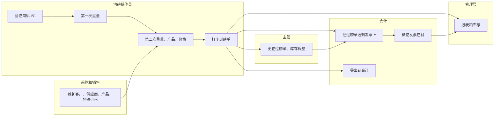
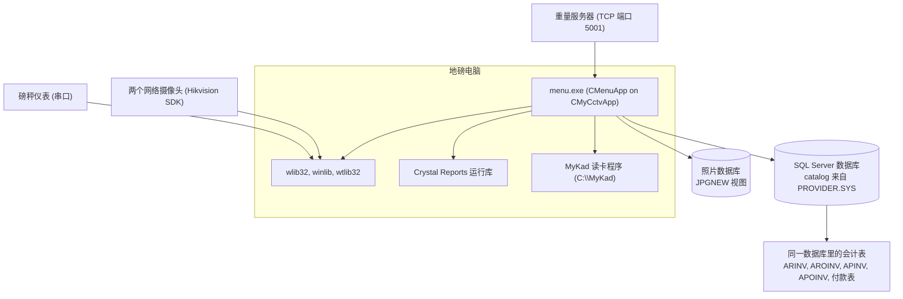
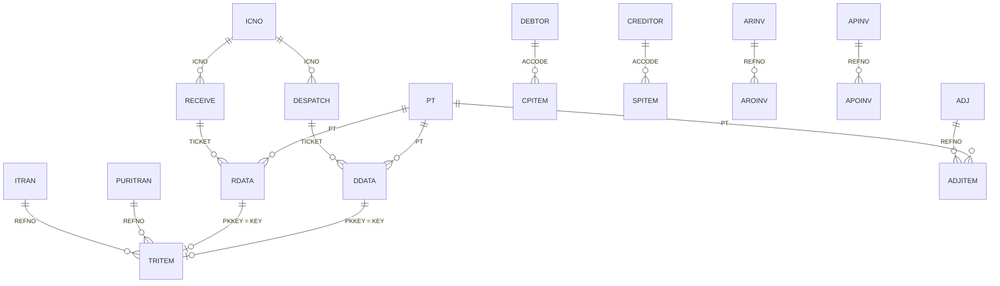
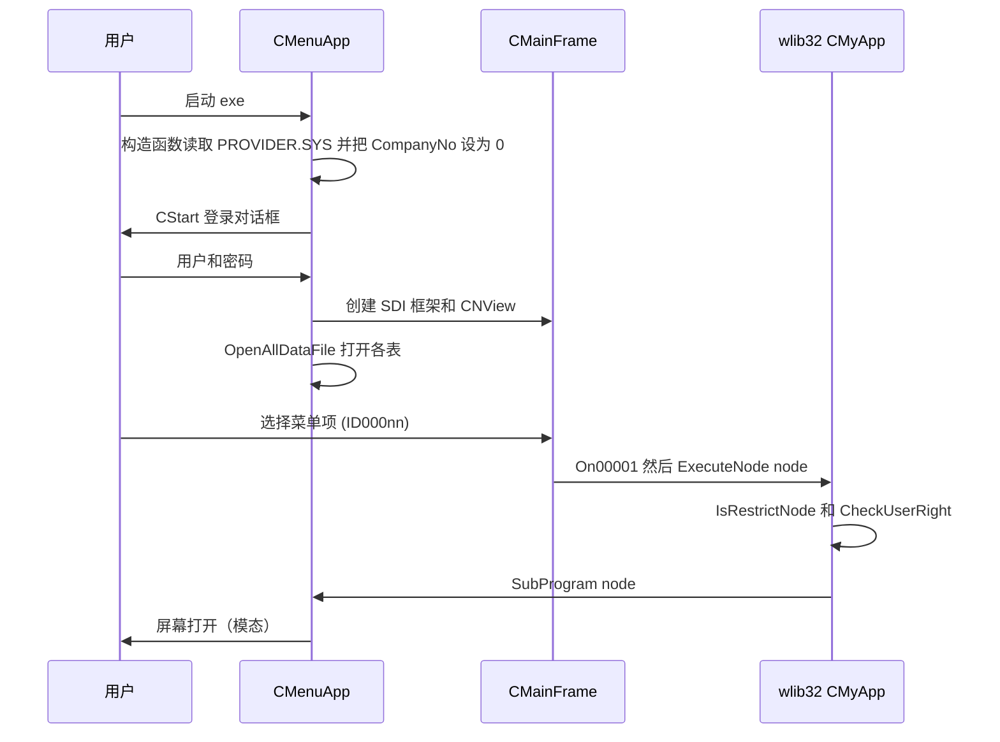
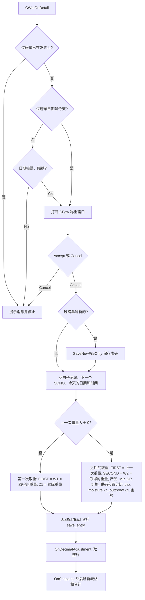
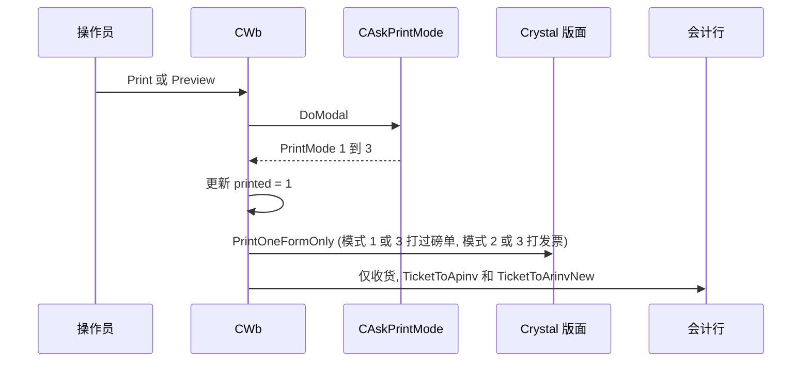
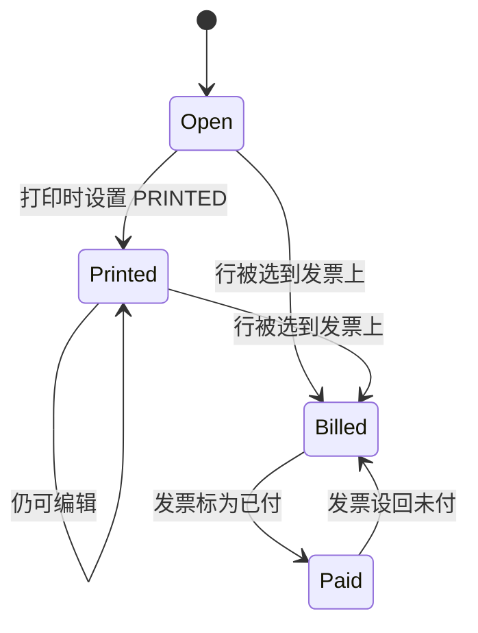
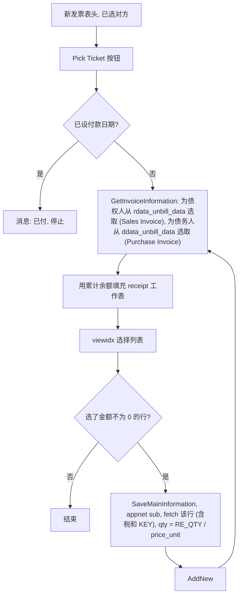
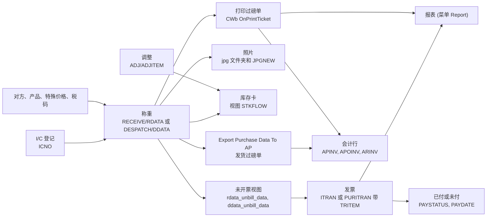

# Expert Plastic 地磅系统 - 模块参考

> 英文版为准。同步自英文版 commit 908014f（2026-10-28）。

这是本程序唯一的参考文档。**第一部分**用通俗的话讲解怎样使用程序，写给不了解它的人。**第二部分**说明每样东西在代码里的位置，写给程序员和技术支持。程序不大（共 45 个编译的源文件），所以只用一个文件。

- 仓库：`Domain-Application/Application_Expert_Plastic`，默认分支 `main`。**没有数据库结构仓库**（没有 `SQL_Expert_Plastic`），仓库里也没有 `.sql` 文件（`.gitignore` 列出了 `*.sql`），所以表和列的类型只能标为提示或未核实，见 [2.3](#23-主数据目录)。
- 最后核对的 commit 为 `bc639ea`（"first commit"，2026-02-25）。
- 翻译状态：英文版见 [MODULE_REFERENCE.md](MODULE_REFERENCE.md)；本中文版同步于 2026-10-28（commit 908014f）。
- 规则：任何改变行为、表、字段、屏幕、报表或计算的修改，都必须在同一个 commit 里更新本参考文档。
- 仓库里没有 `User_Guide`，也没有其他 `docs/` 文件，所以没有截图可链接，这里也没有编造任何截图。
- **系列关系：**本仓库与 `Application_WangLian` 有 82% 的源文件同名，但它是更老、也不同的代码线：没有电子发票、没有产品等级、没有拆分产品表单、没有"其他发票"、没有公共采购表，另外多了三块：I/C 登记（可读身份证）、通过 CCTV 基类拍的照片、带已付/未付状态的发票。本文件里的所有内容都对照本仓库自己的代码核对过；见 [与Application_WangLian的差异](#与application_wanglian的差异)。
- **构建状态：**已提交的源代码看起来不能直接编译，因为主窗口的消息映射在一个文件里被破坏了（见 [代码发现](#代码发现) 第 1 项）。在此说明，免得有人依赖这个 commit 的全新构建。

## 目录

- [菜单图和覆盖范围](#菜单图和覆盖范围)
- [第一部分：业务视图](#第一部分业务视图)
  - [1.1 简单说明](#11-简单说明)
  - [1.2 谁用什么](#12-谁用什么)
  - [1.3 一天的工作](#13-一天的工作)
  - [1.4 用户级别和审批](#14-用户级别和审批)
  - [1.5 实例演示](#15-实例演示)
  - [1.6 界面导览](#16-界面导览)
  - [1.7 这个数字从哪里来](#17-这个数字从哪里来)
  - [1.8 状态含义](#18-状态含义)
  - [1.9 如果发生以下情况](#19-如果发生以下情况)
  - [1.10 你可能看到的消息](#110-你可能看到的消息)
  - [1.11 该做和不该做](#111-该做和不该做)
  - [1.12 开始之前](#112-开始之前)
  - [1.13 词汇表](#113-词汇表)
  - [1.14 问AI](#114-问ai)
- [第二部分：技术视图](#第二部分技术视图)
  - [与Application_WangLian的差异](#与application_wanglian的差异)
  - [2.1 概览](#21-概览)
  - [2.2 架构和依赖](#22-架构和依赖)
  - [2.3 主数据目录](#23-主数据目录)
  - [2.4 子表层级](#24-子表层级)
  - [2.5 模块和处理流程](#25-模块和处理流程)
  - [2.6 端到端流程](#26-端到端流程)
  - [2.7 报表目录](#27-报表目录)
  - [2.8 集成](#28-集成)
  - [2.9 配置](#29-配置)
  - [2.10 维护](#210-维护)
- [休眠代码](#休眠代码)
- [用户权限](#用户权限)
- [尚未记录的内容](#尚未记录的内容)
- [代码发现](#代码发现)

## 菜单图和覆盖范围

菜单资源 `IDR_MAINMENU` 在 `menu.rc` 里（第 123 到 175 行）：5 个顶层项，**32 个菜单项**（3 + 3 + 17 + 1 + 8）。菜单 ID `ID000nn` 就是节点 `nn`；`CMenuApp::SubProgram`（MAIN.CPP:73）按节点分派。节点由 `enum menu {M_NORMAL=1, M_ADJ, M_CTRL, M_REPORT, M_OTHER}`（MAIN.CPP:19）生成，所以"Weighing"是 1x，"Adjustment/Invoicing"是 2x，"Table"是 3x，"Report"是 4，"Utility"是 5x；"Table"的两个子菜单是 38x 和 39x。菜单 ID 定义在 `resource.h`（例如 `ID00011`，第 335 行）。下面每个菜单项都在本文件里覆盖到了。项目只有一个构建目标（`Menu.dsw` 里的 `menu.dsp`，目标是 `menu.exe`）。

| 菜单路径（`menu.rc` 里的标题） | 节点 | 处理函数 | 记录位置 |
|---|---|---|---|
| 1. Weighing > 1. Receiving | 11 | `OpenAPData(); STCR=1; Receive_Capacity()` (MAIN.CPP:78-81) | [2.5.2](#252-收货和发货称重) |
| 1. Weighing > 2. Despatch | 12 | `OpenARData(); STCR=2; Despatch_Capacity()` (MAIN.CPP:83-86) | [2.5.2](#252-收货和发货称重) |
| 1. Weighing > 3. Public | 13 | `STCR=3; SingleWeighing()` (MAIN.CPP:88-90) | [2.5.3](#253-公共称重) |
| 2. Adjustment/Invoicing > 1. Adjustment Entry | 21 | `AdjustmentEntry()` (MAIN.CPP:92-93) | [2.5.4](#254-库存调整) |
| 2. Adjustment/Invoicing > 2. Purchase Invoice | 22 | `OpenAPData(); STCR=3; PurchaseInvoice()` (MAIN.CPP:95-98) | [2.5.5](#255-销售发票和采购发票) |
| 2. Adjustment/Invoicing > 3. Sales Invoice | 23 | `OpenARData(); STCR=2; SalesInvoice()` (MAIN.CPP:100-103) | [2.5.5](#255-销售发票和采购发票) |
| 3. Table > 1. Customer | 31 | `OpenARData(); CustomerMaintenance()` (MAIN.CPP:111-113) | [2.5.8](#258-控制表) |
| 3. Table > 2. Supplier | 32 | `OpenAPData(); SupplierMaintenance()` (MAIN.CPP:115-117) | [2.5.8](#258-控制表) |
| 3. Table > 3. Item | 33 | `Prodtype()` (MAIN.CPP:119-120) | [2.5.8](#258-控制表) |
| 3. Table > 4. I/C No. | 34 | `icno.Run()` (MAIN.CPP:122-123) | [2.5.8](#258-控制表) |
| 3. Table > 5. Driver | 35 | `AdminDb(&driver)` (MAIN.CPP:125-126) | [2.5.8](#258-控制表) |
| 3. Table > 6. Transporter | 36 | `AdminDb(&transp)` (MAIN.CPP:128-129) | [2.5.8](#258-控制表) |
| 3. Table > 7. Vehicle | 37 | `AdminDb(&lorry)` (MAIN.CPP:131-132) | [2.5.8](#258-控制表) |
| 3. Table > 8. more > 1. Payment Type | 381 | `AdminDb(&ptype)` (MAIN.CPP:134-135) | [2.5.8](#258-控制表) |
| 3. Table > 8. more > 2. Function Code | 382 | `AdminDb(&gst)` (MAIN.CPP:137-138) | [2.5.8](#258-控制表) |
| 3. Table > 8. more > 3. Reason | 383 | `AdminDb(&reason)` (MAIN.CPP:140-141) | [2.5.8](#258-控制表) |
| 3. Table > 8. more > 4. Tender | 384 | `AdminDb(&tender)` (MAIN.CPP:143-144) | [2.5.8](#258-控制表) |
| 3. Table > 8. more > 5. Gender | 385 | `AdminDb(&gender)` (MAIN.CPP:146-147) | [2.5.8](#258-控制表) |
| 3. Table > 8. more > 6. Nationality | 386 | `AdminDb(&nationality)` (MAIN.CPP:149-150) | [2.5.8](#258-控制表) |
| 3. Table > 8. more > 7. TType | 387 | `AdminDb(&ttype)` (MAIN.CPP:152-153) | [2.5.8](#258-控制表) |
| 3. Table > 8. more > 8. Bussiness Type | 388 | `AdminDb(&btype)` (MAIN.CPP:155-156) | [2.5.8](#258-控制表) |
| 3. Table > 8. more > 9. Risk Type | 389 | `AdminDb(&risktype)` (MAIN.CPP:158-159) | [2.5.8](#258-控制表) |
| 3. Table > 9. more2 > 1. Twin No | 391 | `AdminDb(&ticno)` (MAIN.CPP:161-162) | [2.5.8](#258-控制表) |
| 4. Report | 4 | `TableContainer("wbctn")` (MAIN.CPP:108-109) | [2.5.9](#259-报表) |
| 5. Utility > 1. Set Password | 51 | `ON_COMMAND(ID00051, OnPassword)` 在 `CMainFrame` 里 (MAINFRM.CPP:28)，库函数 `ChangeProgramPassword` | [2.5.10](#2510-工具) |
| 5. Utility > 2. Company Profile | 52 | `ProfileData(&profile)` (MAIN.CPP:164-165) | [2.5.10](#2510-工具) |
| 5. Utility > 3. Operator Information | 53 | `SetUser()` (MAIN.CPP:167-168) | [2.5.10](#2510-工具) |
| 5. Utility > 4. Backup Data | 54 | `BackupProcess()` (MAIN.CPP:170-171) | [2.5.10](#2510-工具) |
| 5. Utility > 5. Create new image database | 55 | `CreateNewImageDatabase()` (MAIN.CPP:173-174，定义在 MAIN.CPP:9) | [2.5.10](#2510-工具) |
| 5. Utility > 6. Reset Data | 56 | `ResetDatabase()` (MAIN.CPP:176-177) | [2.5.10](#2510-工具) |
| 5. Utility > 7. Export Purchase Data To AP | 57 | `ExportPurchaseInvoiceTransactions()` (MAIN.CPP:179-180) | [2.5.7](#257-导出到会计) |
| 5. Utility > 8. Period Control | 58 | `PeriodControl(&period)` (MAIN.CPP:182-183) | [2.5.10](#2510-工具) |

没有节点 14（没有第二个公共称重项）、没有节点 24，也没有节点 25 的菜单项：`SubProgram` 里有一个 `case M_ADJ*10+5`，调用 `ExportInvoiceTransactions()`（MAIN.CPP:105-106），但没有对应的菜单项（见 [休眠代码](#休眠代码)）。文件变更的 case 1001 到 1005（MAIN.CPP:185-199）永远不会被触发，因为本仓库的报表选择器里没有"Object"项。`_inventory/Application_Expert_Plastic` 里生成的清单只作为线索：它的子表清单与代码一致，但它没有列出菜单，也漏掉了一些表的多行声明（例如 `driver`、`lorry`）。

---

# 第一部分：业务视图

## 1.1 简单说明

- 本程序运行 Expert Plastic Sdn Bhd 的**地磅**。这家公司买进和卖出塑料材料。货车运来材料（**收货**）、运走材料（**发货**），或者只是付费使用磅秤（**公共称重**）。
- 一辆货车会被称重不止一次。程序读磅秤、保存每次的重量、扣除杂质后算出净重、算出价格，并打印**过磅单**（也叫 docket）。地磅处的摄像头可以在每次称重时拍照，送货的人可以记录在 **I/C 登记**里（身份证或护照号码、姓名、地址、照片、风险类型），登记可以用读卡器读取马来西亚身份证（MyKad）来填写。
- 过磅单通过**发票**来收款。每张发票有**已付 / 未付**状态和付款日期。发票和过磅单数据还可以复制到**会计表**（采购发票行），供另一个会计程序使用。
- 客户、供应商、产品、货车、司机和 I/C 登记等清单保存在**控制表**里。客户或供应商可以对某个产品有自己的价格（**特殊价格**），税是 **SST**（程序在少数地方仍写 GST）。
- **报表**显示收货和发货、公共称重、库存、调整和发票的每日和每月清单与汇总。**库存**由收货过磅单、发货过磅单和库存调整算出。
- 如果日常工作被跳过，就会出现过磅单缺失或出错、发票迟开或被错误标为未付，报表和会计表也会过时。

## 1.2 谁用什么

| 部门 | 模块 | 主要任务 |
|---|---|---|
| 地磅操作员 | Weighing（Receiving、Despatch、Public）、I/C No. | 给货车称重、选择产品、登记司机的 I/C、打印过磅单 |
| 地磅主管 | Weighing、Table 菜单、Adjustment Entry | 更正过磅单、维护货车、司机和运输商、库存调整 |
| 采购 / 销售 | Table 菜单（Customer、Supplier、Item） | 维护客户、供应商、特殊价格、产品价格和税码 |
| 会计 / 财务 | Sales Invoice、Purchase Invoice、Export Purchase Data To AP、Report | 给过磅单开票、记录付款、把过磅单转到会计、月底报表 |
| 管理层 | Report、主窗口提醒 | 每日和每月合计、库存、未开票的过磅单 |
| IT / 管理员 | Utility | 公司资料、用户、密码、期间锁定、备份、照片数据库、重置 |

**从这里开始（每个部门一行）**
- 操作员：Weighing > Receiving 或 Despatch（或 Public）；I/C No. 用来登记新的人。
- 主管：在同一个 Weighing 屏幕里重新打开过磅单；库存更正用 Adjustment Entry。
- 采购 / 销售：Table > Customer 或 Supplier、Item。
- 会计：Adjustment/Invoicing > Sales Invoice 或 Purchase Invoice；Utility > Export Purchase Data To AP。
- 管理层：Report；主窗口上的"Unbill Sales Ticket"按钮。
- IT：Utility > Company Profile、Backup Data、Period Control。

每日、每周和月底的工作：

| 何时 | 谁 | 做什么 |
|---|---|---|
| 每次称重 | 操作员 | 称第一次重、称第二次重、核对产品和价格、打印过磅单 |
| 每天，下班前（一般） | 主管 | 在开票之前，检查手工输入重量的过磅单（以不同颜色显示） |
| 每周或按约定（一般） | 会计 | 用未开票的过磅单开发票、标记已付款的发票 |
| 月底（一般） | 会计 | 运行导出到会计、打印清单和汇总 |
| 月底（一般） | IT | 锁定已结束的期间（Period Control）、备份数据 |
| 照片数据库快满时 | IT | 创建新的照片数据库 |

## 1.3 一天的工作

早上：IT 或主管检查磅秤和公司资料（标准重量、磅秤连接）。白天：货车到达。操作员打开 **Receiving** 或 **Despatch**，输入车号、对方和司机的 I/C，给货车称重（第一次重量），货车卸货或装货，操作员再称重（第二次重量）。程序为每个产品算出净重和金额，摄像头在每次称重时拍照。操作员打印过磅单。晚上和周末：会计把未开票的过磅单选到发票上，收到款项时记录付款，并把过磅单导出到会计表。管理层打印报表。

整个流程的泳道图：



*图注：客户、供应商和价格清单供称重使用；打印出的过磅单流向主管更正、发票、会计表和报表；发票最后变为已付。*

## 1.4 用户级别和审批

每个用户有一个数字，叫**级别**。本程序里有意义的级别：

| 级别 | 允许做什么 |
|---|---|
| 任何用户 | 称重、打印、重印，以及修改过磅单（本程序里打印不会锁定过磅单），前提是它不在发票上、不在已锁定的期间里，并且在会计里还没有付款 |
| 低于 9 | 不能改发票日期（显示出来但被锁定） |
| 9 及以上 | 可以改发票日期 |
| 999 | 可以修改已经在会计表里的发票（正常用户没有这个级别） |

除了级别，每个用户还可以被用户记录上的一个清单禁止使用某些菜单项（见 [用户权限](#用户权限)），用户对每个表的权限（查看、编辑、添加、删除）则保存在库的权限表里。I/C 登记的"Scan IC"按钮只对不是仅查看的用户显示。Reset Data 和 Import 功能会要求输入一个程序里内置的单独密码。

## 1.5 实例演示

所有数值都是编造的。公司资料：价格单位是每 kg（本程序始终按 kg 计价），取整系数 50，收货设置了一个取整产品。供应商 S0001 "Sample Plastic Seller" 的税码是 NR（0%）。产品 PET01 "PET bottles (sample)" 的默认买入价是每 kg RM 1.000，供应商 S0001 对 PET01 有特殊价格每 kg RM 1.235。已登记车辆 WXY1234 和一位 I/C 号码是编造的司机。

**步骤 1 - 收货过磅单。**操作员打开 Weighing > Receiving，点 New。程序填入过磅单号 T000123、今天的日期和时间。操作员选车辆 WXY1234；因为这是一张新的收货过磅单，程序会提供同一辆车上一张已完成过磅单的拖车、集装箱、卖方、运输商、I/C 和 tender，然后是这辆车自己的运输商。操作员核对卖方 S0001。"Cash Bill"和"Auto Rounding"默认已勾选。

**步骤 2 - 第一次重量。**操作员按称重按钮。称重窗口显示磅秤的实时读数 12,000 kg（货车载货）。操作员按 Accept weight。保存第一行：1st weight 为 12,000，没有产品。如果打开了照片功能，两个摄像头各拍一张照片。

**步骤 3 - 第二次重量。**卸货后，操作员再次称重，窗口显示 5,000 kg。产品列表现在可用；操作员选 PET01。窗口显示价格 RM 1.235，取自供应商的特殊价格。输入 Outthrow 2（百分比）。Accept weight。

| 项目 | 值 | 怎么得来 |
|---|---|---|
| 1st weight | 12,000 kg | 过磅单上的上一次重量 |
| 2nd weight | 5,000 kg | 磅秤 |
| Gross | 7,000 kg | 12,000 减 5,000 |
| Outthrow | 140 kg | 7,000 x 2 / 100（不取整） |
| Net weight | 6,860 kg | 7,000 减 140 |
| Amount | RM 8,472.10 | 1.235 x 6,860 |
| Tax | RM 0.00 | 税码 NR 是 0% |
| Sub-total | RM 8,472.10 | 金额加税 |

**步骤 4 - 自动取整。**过磅单合计是 8,472.10。分的部分是 10，低于取整系数 50，所以程序向下取整，并为取整产品加一行取整行，金额 -0.10。过磅单总额是 RM 8,472.00。

**步骤 5 - 打印。**操作员点 Print。一个小窗口问是打印"Print Weiging Ticket"、"Print Invoice"还是两个都打；操作员选过磅单。过磅单打印出来，"Ticket Printed"被勾选。程序还会把过磅单复制到会计的采购行里（从代码读出，未实际运行）。

**步骤 6 - 发票。**会计打开 Adjustment/Invoicing > Sales Invoice（这个菜单项给收货方开票，见 [1.6](#16-界面导览) 里的说明），点 New，选 A/C code S0001 和付款类型。Pick Ticket 列出 S0001 未开票的行，并显示累计余额。会计选 PET01 那一行：出现一行发票行，过磅单 T000123、数量 6,860、价格 1.235、金额 8,472.10，税的各列从过磅单行复制。过磅单屏幕现在显示发票号和付款状态"Unpaid"。从此不能再往这张过磅单加称重行。

**步骤 7 - 付款。**供应商收到款项后，会计打开发票，输入付款日期，按 Update Payment Status 并回答 Yes。状态变为"Paid"并带该日期。在有人把它改回未付之前，这张发票及其过磅单不能再修改。

**发货的变化。**发货过磅单的做法相同，但价格来自买方的特殊价格（否则用产品的销售价），税码来自产品的销售税码，并且不对装载重量应用取整产品。它的过磅单在 Adjustment/Invoicing > Purchase Invoice 里开票，发货过磅单的月底导出是 Utility > Export Purchase Data To AP。

## 1.6 界面导览

仓库里没有截图；下面的描述来自屏幕定义和代码。

**命名说明。**在本程序里，菜单项 **Sales Invoice** 给*收货*过磅单开票并要求选*供应商*，菜单项 **Purchase Invoice** 给*发货*过磅单开票并要求选*客户*。名称与字面意思正好相反。这是从代码（选择列表和对方列表）里读出来的；依赖这些标签之前，请先问清现场用的是哪种意思。

### 主窗口

用途：它是一直开在所有屏幕后面的窗口。上面有三个大按钮，分别是 Receiving、Despatch 和 Public 称重（与前三个菜单项相同），一个按钮 **Unbill Sales Ticket (21 days rule)** 带一个天数框（由公司资料填入），还有两块预留给摄像头画面的图片区域。这个按钮会打开一个未开票发货行的浏览列表；天数会显示，但程序并不用它来筛选列表（见 [代码发现](#代码发现)）。

### 收货和发货过磅单（Weighing > 1 和 2）

用途：每次货车来访一张过磅单，每次称重一行。收货用于买进的材料（对方叫 **Seller**）；发货用于卖出的材料（对方叫 **Buyer**）。两个屏幕几乎一样。

| 字段 | 含义 | 必填？ | 值从哪里来 |
|---|---|---|---|
| Ticket No | 过磅单号 | 自动 | 程序计算（流水号） |
| Vehicle No | 货车 | 可选 | 输入，或从 Vehicle 列表选；选中后会从车辆带出运输商和 I/C，新的收货过磅单则先带出该车上一张已完成过磅单的值 |
| Trailer No, Container No | 额外的识别信息 | 可选 | 输入 |
| Seller / Buyer | 对方 | 可选，但价格和税取决于它 | 从 Supplier 或 Customer 列表选 |
| Transporter | 运输公司 | 可选 | 选择，或由货车带出 |
| Driver | 司机的 I/C 或护照号码（框的标签是 Driver） | 可选 | 从 I/C 登记里选；姓名显示在旁边 |
| Tender | 合同参考 | 可选 | 从 Tender 列表选 |
| Ticket Date, Ticket Time | 过磅单创建的时间 | 自动 | 系统日期和时间 |
| DO No, DO Date | 送货单号和日期 | 可选 | 输入 |
| Remarks (two lines) | 自由备注 | 可选 | 输入 |
| Ticket Printed | 过磅单已打印 | 自动 | 打印时设置；只读 |
| Cash Bill | 过磅单以现金支付 | 可选 | 收货默认勾选，发货默认不勾选 |
| Auto Rounding | 加一行取整行，凑成整数令吉 | 可选 | 默认勾选 |
| Pay By, Cheque No., Cheque Date | 付款类型、支票号码和日期 | 可选 | Pay By 从 Payment Type 列表选；其他项输入 |
| User | 创建过磅单的操作员 | 自动 | 来自登录 |
| Total Net Weight (kg), Total Amount, SST AMT | 各行的合计 | 自动 | 计算 |
| Invoice No., Pay Status | 这张过磅单所开的发票及其状态（Paid 或 Unpaid） | 自动 | 从发票查出 |
| A/C Amount, Variance (receiving) | 会计金额的框 | - | 屏幕上有，但本程序从不填写 |

行表格的列：No, Date, Time, Bales, 1st Wt, 2nd Wt, Gross Wt, Product, Description, Out throw, Nett Wt, U/Price, Trip, Amount, Tax Code, Inc Tax, %, SST, Sub Total。本程序里水分各列是隐藏的。第一次或第二次重量是手工输入、而不是从磅秤读取的行，会以不同颜色显示（见 [1.8](#18-状态含义)）。

按钮：
- New、Save、Delete、Print、Search：屏幕的标准记录按钮。另有第二个打印按钮，标题为 **Preview**，库还增加了过磅单的 PDF 导出。
- 称重按钮（加一行）：打开称重窗口，见下文。
- Wizard（手工编辑一行）：打开行表单，每一列都可以手工输入。
- Search：打开小窗口"Vehicle In Yard"：选一个日期，可以勾选"Unprint Only"，当天的过磅单会被列出；选一张即可打开。Advance 按钮打开普通搜索。
- **Last Transaction**（仅收货）：显示同一辆车上一张已完成的收货过磅单。
- **Export To A/C**：窗口设计里有，但被隐藏，也没有连接到任何动作。
- **View Snapshot**：这张过磅单拍过照片时出现；打开照片文件夹。

### 称重窗口

用途：读磅秤并接受一个重量。

| 字段 | 含义 | 值从哪里来 |
|---|---|---|
| Current Weight | 磅秤的实时读数，单位 kg | 磅秤（或重量服务器） |
| Last Weight | 这张过磅单上的上一次重量 | 上一行的第二次重量；如果第二次为空，就用它的第一次重量 |
| Product | 材料 | 从产品列表选（从第二次重量起）；"Select Product"打开浏览列表 |
| Moisture, Outthrow | 为水分和杂质扣除的百分比 | 输入（仅收货） |
| U/Price | 每 kg 单价 | 由特殊价格或产品价格填入，可以输入（仅收货） |
| Trip Expense | 加到这一行的额外金额 | 在这个版本里隐藏 |

按钮：Accept weight、Cancel。过磅单的第一次重量时，产品、价格和扣除各框是关闭的。程序不坚持要求读数稳定，也不要求磅秤回到零，所以操作员必须自己看读数。收货时，数据库里保存的百分比或固定公斤扣除，可以应用到每个取得的重量上（见 [1.7](#17-这个数字从哪里来)）。

### 行表单（Wizard）

用途：手工输入一行。字段：Date、Time、Product、Bales Qty、Out Throw (kg)、First Weight、Second Weight、Net Qty、U/Price、Trip Amt、Amount、Tax Code、Include Tax、Tax %、SST Amt、Sub-Total。本程序里水分各框和 Split Products 按钮是隐藏的。

### 公共称重（Weighing > 3）

用途：收费给货车称重，不涉及产品。公共称重只有一张表（没有分开的采购版和销售版）。

| 字段 | 含义 | 来源 |
|---|---|---|
| Ticket No, Ticket Date, Time | 过磅单号、日期、时间 | 自动 |
| A/C NAME | 对方 | 输入（自由文字，不是列表） |
| Vehicle No | 货车 | 输入或选择 |
| Gross Weight (kg), Tare Weight (kg) | 两个重量 | 两个 Capture Weight 按钮读取磅秤 |
| Net Weight (kg) | 净重 | 计算：毛重减皮重（不保存） |
| Charge | 过磅费 | 输入 |
| Tax Code, Inclusive Tax, Tax (%), Tax Amt, Total | 过磅费的税 | 税码选择，其余计算 |
| Remarks | 备注 | 输入 |

打印时给出公共称重清单的选项："Public Sales Invoice"和"Public Sales Ticket"。

### Adjustment Entry（库存调整）

用途：因损耗、盈余或盘点差异而更正库存。表头：Ref.no、Date、Reason（从 Reason 列表选）、Remarks。行：Item Code（选择）、Quantity (kg)、U/Price (kg)、Amount（计算，数量乘价格）。输入一个不存在的参考号不会创建条目（"Data Not found"）；请用 New 按钮。一旦有了行，日期就不能再改。

### Sales Invoice 和 Purchase Invoice

用途：把过磅单开票给某一个对方。Sales Invoice：供应商、收货过磅单。Purchase Invoice：客户、发货过磅单（见上面的命名说明）。

| 字段 | 含义 | 来源 |
|---|---|---|
| Invoice No | 发票号 | 自动 |
| Date of Invoice | 发票日期 | 系统日期；只有 9 级及以上可以改 |
| Due Date | 付款到期日 | 输入 |
| A/C Code | 供应商（Sales Invoice）或客户（Purchase Invoice） | 选择 |
| Staff | 业务员 | 选择 |
| Terms | 信用天数 | 输入 |
| Remarks (two lines) | 备注 | 输入 |
| Payment Type | 付款方式 | 从 Payment Type 列表选 |
| Pay Status, Payment Date | 已付或未付，以及付款日期 | 由 Update Payment Status 按钮设置 |

按钮：**Pick Ticket** 列出对方未开票的过磅单行（带累计余额），把你选的那一行加成一行发票行，然后再次列出，直到你关闭列表。**Pick By Date** 询问日期范围，列出对方在该范围内的未开票行，确认后把它们全部加入（遇到第一行金额为 0 的就悄悄停止）。**Update Payment Status**（发票已付时标题变为 Set Unpaid Payment）在已付和未付之间切换。底部的合计：Total Qty、Total RM、Total SST。

发票行表格：No、Ticket No、D/O No、Date、Description、Qty(MT)、U/Price、Amount (RM)、Tax Code、Inc Tax、SST %、SST Amt、Sub Total。弹出的行表单显示 Ticket No、DO No、Date、Vehicle No、Product、Name、Qty、Price、Gross Amt、Tax Code、SST Inclusive、%、Tax Amt、Sub-Total。两个发票屏幕上都有一个隐藏的按钮"Export Sales Invoice To AR"，但它什么也不做。

### Customer 和 Supplier（Table > 1 和 2）

用途：对方的主资料。字段：A/C Code、Full Name、Short Name、Address（3 行）、四个电话号码、Fax No.、E-mail、Area、Service/Business Type、Currency、Salesman、Contact、Debtor 和 Creditor 总账账户、Payment Scheme、Terms（天）、Credit Limit、Balance Amt.、Open A/C Date、"Don't print monthly statement"、"Print zero balance statement"、Remarks（2 行）、SST register No.、Verify Date、Tax Code。新客户的税码起始为 SR，新供应商为 NR。

表格：**Special price data entry**：Item Code、Description、U/Price。产品对这个对方的价格；价格单位是 kg。

### Item（产品）

用途：产品主资料。字段：Product Code、Description、Category、Unit、Credit G.L Code（采购和销售总账）、Cash Bill G.L Code（采购和销售总账）、Cost price、Sales Price、Remarks、采购和销售的 Tax Code。Cost price 是默认买入价，Sales Price 是对方没有特殊价格时使用的默认卖出价。本程序里没有产品等级，也没有价格表格。

### I/C No.（身份登记）

用途：记录每一个送货或取货的人，用身份证或护照号码识别。字段：IC / Passport No、Name、Gender、Date Of Birth、Place Of Birth、Ethnicity、Citizenship、Religion、Residential Address（3 行）、Mailing Address（3 行）、Town、Post code、State、Date of Issue、Date of Expiry、Old IC Number、Contact No 1 和 2、Fax Number、Email Address、Bank、A/C No、Ttype、P/C Code、Occupation、Bussiness Type、Employer、Alert Message、Risk Type、Payment Type、Twin Code、Nationality、Remarks。按钮 **Same as mailling address** 把邮寄地址复制到居住地址。**Scan IC** 按钮（对不是仅查看的用户显示）启动读卡程序，等待卡的数据和照片，填好记录，并以 I/C 号码为名保存照片。记录也可以用它的第二个键（A/C No 列）找到。

### 其他控制表

| 菜单项 | 保存什么 |
|---|---|
| Driver | I/C No.、姓名和另外三行文字 |
| Transporter | 代码、名称、简称、电话、3 行地址、备注 |
| Vehicle | 车号、运输商、司机、皮重、黑名单标志（Y/N）、备注 |
| Payment Type | 代码、付款类型、备注 |
| Function Code | 一行 26 个数字（A 到 Z）。当前程序不使用（见 [休眠代码](#休眠代码)） |
| Reason | 代码、说明、备注（用于库存调整） |
| Tender | 代码、名称、简称、电话、3 行地址、备注 |
| Gender, Nationality, TType, Bussiness Type, Risk Type, Twin No | 代码、说明、备注：I/C 登记用的选择列表 |

### 报表

用途：从分组列表（Receiving、Despatch、Public Weighing、Adjustment、Inventory、Invoice）里选一个报表，设置日期范围和其他筛选条件，预览或打印。清单见 [2.7](#27-报表目录)。

### 工具

| 菜单项 | 做什么 |
|---|---|
| Set Password | 更改程序密码 |
| Company Profile | 公司注册号码、地址、采购发票前缀、标准（最小）重量、磅秤连接（直连，或 TCP/IP 加重量服务器名称）、分行、收货和发货的取整产品、取整系数、GST 注册号码、生效日期和版本、21 天提醒、摄像头照片开关、PDF 文件夹、I/C 照片文件夹 |
| Operator Information | 用户、级别和菜单权限 |
| Backup Data | 备份数据库 |
| Create new image database | 旧的照片数据库快满时，新建一个 |
| Reset Data | 输入重置密码后，删除交易数据和部分主数据 |
| Export Purchase Data To AP | 把某个日期范围内的发货过磅单复制到会计的采购行 |
| Period Control | 锁定会计期间：No、Date Begin、Date End、Status（L = 已锁定）；先要求输入程序密码 |

## 1.7 这个数字从哪里来

**一行的毛重** = 第一次重量减第二次重量，始终为正。例：12,000 和 5,000 得 7,000 kg。

**Outthrow kg 和 moisture kg**（收货）。如果你输入了百分比而把 kg 框留空，程序会填入：毛重 x 百分比 / 100。本程序里不取整。例：毛重 7,000 kg、2% 得 140 kg。如果你自己输入 kg，就保留你的数字。水分框在行表单和表格里是隐藏的，但称重窗口里仍有水分百分比，并且会被扣除。

**净重** = 毛重减 moisture kg 减 outthrow kg。没有第二次重量的行，净重为 0。

**一行的金额** = 单价 x 净重 + trip 金额。本程序始终使用价格单位 1（按 kg 计价）。例：价格每 kg 1.235，净重 6,860 kg：1.235 x 6,860 = 8,472.10。接受第二次重量时会尝试五仙取整，但紧接着又重新计算金额，所以没有效果（见 [代码发现](#代码发现)）。

**单价从哪里来。**在过磅单上选产品时，程序先看对方对这个产品的特殊价格（发货看客户表，收货看供应商表）。如果对方没有，就用产品的默认价格（发货用 Sales Price，收货用 Cost price）。如果行上的价格为空或等于产品的默认价格，特殊价格会取代它；你输入的不同价格会保留。

**一行的税。**收货时，税码是供应商的税码（空白则为 NR）；发货时是产品的销售税码。百分比来自 Tax Code 表。如果过磅单日期早于公司的 GST 生效日期，百分比为零。税不含在内时：税 = 金额 x 百分比 / 100；勾选"Inc Tax"时：税 = 金额 x 百分比 / (100 + 百分比)。小计在税不含在内时 = 金额 + 税，含税时 = 金额。在发票行和公共称重屏幕上，只有日期在生效日期之后才会填入百分比。

**过磅单合计。**Total Net Weight、Total Amount（各小计之和）和 SST AMT 是各行之和。

**小数（自动）取整。**如果勾选了"Auto Rounding"，程序把除取整产品外所有行的金额相加，看分的部分，然后为取整产品（公司资料里的收货或发货代码）写一行取整行。如果分的部分等于或大于取整系数，取整行把总额提高到下一个整数令吉；否则降到整数令吉。总额低于 RM 0.50 不取整。例：总额 8,472.10、系数 50：分的部分 10 低于 50，所以取整行是 -0.10，总额是 8,472.00。总额 1,234.56：取整行是 +0.44，总额是 1,235.00。

**对取得重量的扣除（仅收货）。**数据库里可以保存一项扣除，一旦读数达到公司资料里的标准（最小）重量，程序就把它应用到 Receiving 屏幕上从磅秤读到的每个重量：百分比或固定公斤数，两者只能填一个。固定公斤数只有大于 10 才算。百分比以百分之一存储（500 表示 5%）。这两个值没有屏幕可设置，本程序也不创建它们：必须由 IT 在数据库里设置，否则不会扣除任何东西。

**公共称重。**净重 = 毛重减皮重（显示在屏幕上，不保存）。税按 Charge 计算：不含税时税 = charge x 百分比 / 100，总额 = charge + 税；含税时税 = charge x 百分比 / (100 + 百分比)，总额 = charge。

**库存调整行。**金额 = 数量 x 价格。

**发票行。**这一行从过磅单行复制，带着它的数量、价格、金额和税。数量是过磅单净重除以程序的价格单位（1）。如果你重新输入一行，金额变为数量 x 价格（价格单位为 1 时，数量乘以 1,000），税按上面的方法加上。

**库存结余。**入库 = 收货行的净重 + 调整数量。出库 = 发货行的净重。库存卡按日期列出它们并显示累计结余。

## 1.8 状态含义

程序的过磅单上没有状态列；下面是你会遇到的几种状态。

| 单据 | 状态 | 含义 | 谁或什么设置 | 还能编辑什么 |
|---|---|---|---|---|
| 收货或发货过磅单 | Open | 尚未打印 | 由操作员创建 | 所有内容 |
| 收货或发货过磅单 | Printed | "Ticket Printed"已勾选 | Print 按钮 | 每个用户仍可编辑（本程序没有打印锁定） |
| 收货过磅单 | Paid in accounting | 这张过磅单在会计里的采购发票已有付款 | 会计系统 | 什么都不能改（出现"Block"消息） |
| 过磅单（任何） | In a locked period | 过磅单日期在状态为 L 的期间里 | IT 在 Period Control 里设置 | 什么都不能改 |
| 过磅单行 | Typed by hand | 第一次或第二次重量是输入的，不是从磅秤读取的；行以不同颜色显示（第一次重量是输入的而还没有第二次重量时为洋红色，第二次重量是输入的时为偏红色） | Wizard 表单或表格编辑 | 只要过磅单不在发票上，所有内容 |
| 过磅单 | Changed mark | 过磅单上保存一个字母：* 第二次重量被改过，# 第一次重量被改过，m 水分被改过，o outthrow 被改过，@ 价格被改过 | 程序，在保存后编辑某一行时 | 只读标记 |
| 过磅单行 | Unbilled | 还不在任何发票上 | 程序 | 出现在 Pick Ticket 和 Unbill 按钮的列表里 |
| 过磅单行 | Billed | 已选到某张发票上 | Pick Ticket | 这张过磅单不能再添加或保存行；删除行被拒绝 |
| 发票 | Unpaid | 创建时的默认值 | 程序 | 所有内容 |
| 发票 | Paid | 有付款日期 | Update Payment Status | 什么都不能改：不能加新行、不能选、不能编辑行 |
| 发票 | Posted to accounting | 会计发票表里有一行相同号码 | 会计一侧 | 999 级以下什么都不能改（"Invoice Already Post to ACC System, cannot edit"） |
| 期间 | Locked (L) | 日期在该期间内的过磅单不能编辑 | IT | 改变状态即可解锁 |

## 1.9 如果发生以下情况

- **一张错误的过磅单必须作废。**没有作废状态。更正各行，或用 Delete 按钮删除过磅单。如果过磅单已在发票上，程序会说"The invoice is exist. Press ok to continue."并问"Confirm delete ticket?"；删除某一行会被拒绝。先修正发票（删除发票行，或把发票设回未付）。
- **你又打印了一次。**允许把过磅单打印两次；记录上的打印计数会增加。打印不会锁定过磅单。
- **开票之后你编辑了过磅单。**不能添加或保存称重行（"The invoice is exist. Weighing process cannot be conducted"）。发票行保留从选取那一刻起自己的数量、价格和金额副本。要更正，先删除发票行，修正过磅单，再重新选取这张过磅单。如果发票已付，先把它设回未付。
- **你选错了供应商或买方。**开票前修改它；现有行的价格和税不会自动重新计算，所以要在每一行重新选产品或编辑该行。
- **称重时断电或断网。**每个被接受的重量都立刻保存，所以已接受的行是安全的。如果在 Accept 之前断掉，什么都没保存；请重新给货车称重并再加一行。如果磅秤是通过重量服务器读取的，而服务器连不上，窗口会一直显示最后收到的重量，所以接受之前要核对读数。如果磅秤信号丢失，窗口拒绝接受（"Weight signal lost"）。
- **同一张过磅单输入了两次。**过磅单号是自动的而且唯一。每条过磅单行只能在一张发票上。
- **加重量时过磅单上的日期不是今天。**程序问"Do you want to continue ?"，只有你说 yes 才继续。
- **第一次重量低于 10 kg。**窗口拒绝（"Please double confirm your weight!!"）。公司资料里的标准（最小）重量只用于收货扣除。
- **期间已锁定。**编辑该期间内的过磅单会显示期间已关闭的消息。请 IT 改变期间状态。
- **Reset Data。**删除收货、发货和公共称重过磅单、库存调整、客户和供应商的特殊价格、产品、司机、运输商、付款类型和旧的简单发票，并把每个流水号重设为 1。它保留客户、供应商、车辆、I/C 登记，以及用 Sales Invoice 和 Purchase Invoice 开的发票。只能叫 IT 做；先做备份。
- **何时叫 IT：**磅秤显示 0 或重量冻结、应该存在的号码出现"Data Not found"、期间被锁定、照片数据库已满、任何导出中断。

## 1.10 你可能看到的消息

| 消息 | 含义 | 怎么办 |
|---|---|---|
| Do you want to continue ? (title "Date error") | 过磅单日期不是今天 | 只有日期正确才选 Yes |
| The invoice is exist. Weighing process cannot be conducted | 过磅单已在发票上 | 先修正发票 |
| Please double confirm your weight!! (title "--- Weight too low ---") | 第一次重量低于 10 kg | 检查磅秤；只有正确时才再按 Accept |
| Weight signal lost. Please check indicator/cable/computer com port!! (title "Signal Lost") | 磅秤没有读数 | 检查线缆，叫 IT |
| Goods Despatch / Second weight must greater than first weigh. Click yes to exit, Click no to continue (title "Incorrect weighing step") | 发货时第二次重量低于第一次 | Yes 返回屏幕，No 保留这个重量 |
| Goods receiving / Second weight must less than first weigh. Click yes to exit, Click no to continue | 收货时第二次重量高于第一次 | 同上 |
| Please key in product (title "Data Incompleted") | 在第二次重量上没有产品就按了 Accept | 选择产品 |
| Block | 这张过磅单的采购发票在会计里已有付款 | 不能在这里编辑 |
| The invoice is exist. Press ok to continue. / Confirm delete ticket? | 删除一张已在发票上的过磅单 | 只有确实要删除才选 Yes |
| The invoice for this ticket has already paid. Ticket cannot be deleted. | 删除一条其过磅单已在发票上的行（措辞说已付，但任何发票都会触发） | 先修正发票 |
| Confirm Delete Ticket? | 删除过磅单行或发票行 | Yes 即删除 |
| Ticket without ticket no cannot be added | 没有过磅单号的发票行 | 使用 Pick Ticket |
| This invoice already paid. New ticket are not able to add. | 在已付发票上加行 | 先把发票设为未付 |
| This invoice already paid, cannot pick ticket. | 在已付发票上用 Pick Ticket 或 Pick By Date | 同上 |
| This invoice already paid. Please change to unpaid to edit the ticket | 双击已付发票上的一行 | 同上 |
| Confirm update payment status to PAID? | 对未付发票用 Update Payment Status | Yes 标为已付 |
| Confirm set payment status to UNPAID? | 对已付发票用 Update Payment Status | Yes 重新打开 |
| Cannot update invoice with empty ticket | 把没有行的发票标为已付 | 先选取过磅单 |
| Invoice Already Post to ACC System, cannot edit | 发票已在会计里 | 不能更改 |
| Database not open | 某个表打不开 | 叫 IT |
| Data Not found | 你输入了不存在的号码，而且新增被阻止 | 使用 New 按钮 |
| Can not create pdf file | PDF 导出失败 | 检查公司资料里的 PDF 文件夹 |
| Please key in reset password: (Reset Data window) / Incorret password | 重置密码错误 | 问 IT |
| Reset database completed | Reset Data 已完成 | 无 |

## 1.11 该做和不该做

**称重**
- 要在第一次称重之前核对车号、对方和司机的 I/C。
- 要在货车离开后马上打印过磅单。
- 读数还在跳动时，不要接受重量。
- 打印之后，除非主管同意，否则不要编辑重量（过磅单上会留下标记）；程序不会拦你。

**发票**
- 要只把过磅单选到正确对方的发票上。
- 要在收到款项时才把发票标为已付；这会冻结发票及其过磅单。
- 发票过账到会计之后，不要再编辑它。

**主数据**
- 要维护客户和供应商的特殊价格以及产品的默认价格，否则价格会变成零。
- 不要删除已在过磅单上用过的产品。

**工具**
- 要在 Reset Data 或更改期间之前备份。
- 不要分享重置密码或导入密码。

## 1.12 开始之前

- 公司资料已填好：公司号码、地址、标准重量、磅秤连接、GST 号码和生效日期、取整产品和系数。
- 磅秤已连接并设置好（PC 上的串口连接，或资料里指定的重量服务器）。
- 如果需要照片：公司资料里的摄像头开关已打开，两个摄像头可以连通，照片数据库有空间。
- 产品已存在，带总账代码、税码和默认价格；有特殊价格的客户和供应商已有特殊价格。
- 客户和供应商已存在，带税码。
- 车辆、司机、运输商和 I/C 登记记录已存在（可选，但能加快过磅单的录入）。
- 如果过磅单和发票上使用付款类型，付款类型已存在。
- 税码已存在（销售用销项码，采购用进项码）；它们由会计程序维护，不在这里。
- I/C 选择列表（Gender、Nationality、TType、Bussiness Type、Risk Type、Twin No）已有代码。
- 用户已存在并带正确的级别（Utility > Operator Information）。
- 如果需要扣除，数据库里要有收货扣除所用的存储过程。

## 1.13 词汇表

| Term | English | Malay | Chinese |
|---|---|---|---|
| Weighbridge | Truck scale | Jambatan timbang | 地磅 |
| Ticket / docket | Weighing document | Tiket | 磅单 |
| Receiving | Goods bought in | Terimaan | 收货 |
| Despatch | Goods sold out | Penghantaran | 发货 |
| Public weighing | Weighing service for outsiders | Timbang awam | 公众过磅 |
| First / second weight | Weight in and out | Berat pertama / kedua | 第一次 / 第二次重量 |
| Gross | Weight difference of the two weighings | Berat kasar | 毛重 |
| Net weight | Weight after deductions | Berat bersih | 净重 |
| Outthrow | Rubbish deduction | Bahan buangan | 杂质 |
| Special price | Price of a product for one customer or supplier | Harga khas | 特价 |
| Tender | Contract reference | Tender | 招标 |
| DO | Delivery order | Pesanan penghantaran | 送货单 |
| Cash bill | Paid in cash at the weighbridge | Bil tunai | 现金单 |
| Invoice | Bill | Invois | 发票 |
| Paid / unpaid | Payment status of an invoice | Dibayar / belum dibayar | 已付 / 未付 |
| I/C, MyKad | Malaysian identity card | Kad pengenalan | 身份证 |
| Risk type | Risk class of a person in the I/C register | Jenis risiko | 风险类别 |
| Twin code | Second code that identifies the same person | Kod berkembar | 孪生代码 |
| Adjustment | Stock correction | Pelarasan | 调整 |
| Period lock | Closing a date range | Kunci tempoh | 锁定期间 |
| SST / tax code | Sales and service tax and its percent | Kod cukai | 税码 |
| Unbilled | Not yet on an invoice | Belum diinvois | 未开票 |

## 1.14 问AI

1. 怎样给送货的货车称重并登记司机的 I/C？
2. 为什么我的过磅单上价格是零？
3. Auto Rounding 选项做什么，取整行是怎么算出来的？
4. 怎样更正一张已经在发票上的过磅单？
5. 怎样给某个供应商未开票的过磅单开票，又怎样把发票标为已付？
6. 为什么程序说"The invoice is exist. Weighing process cannot be conducted"？
7. 月底我必须做什么，才能把过磅单转到会计？
8. 怎样锁定已结束的月份，让没人能改旧过磅单？
9. 标准重量和磅秤连接在哪里设置？
10. 怎样把身份证读进 I/C 登记？

---

# 第二部分：技术视图

## 与Application_WangLian的差异

从文件名看，本仓库属于 WangLian 系列，但它是**更老、不同的代码线**，不是稍作修改的副本。它的 51 个 `.cpp` 文件里，46 个在 `Application_WangLian` 里有同名文件，其中只有 16 个字节完全相同；30 个不同，而且 `menu.rc`、`menu.dsp`、`MENU.H` 和 `resource.h` 差别很大。`Application_WangLian` 的参考文档被用作模板；这里的每一条陈述都在本仓库里重新核对过。比较方法：对两个文件夹做字节比较（名称不区分大小写）、对有差异的文件做逐行 diff，然后阅读本仓库的代码。

**文件**

| 组别 | 文件 |
|---|---|
| 只在 WangLian 里（源代码） | `Exportacc.cpp/.h`（Export To Accounting）、`IREQ.CPP`、`Ireq.h`（其他发票和电子发票面板）、`SPLITPT.CPP/.H`（拆分产品）、`STAFF.CPP`、`PARENT----.CPP`（旧的库副本）；另外 124 个 `.rpt` 版面在 WangLian 的根目录、`docs/`、`CLAUDE.md`、`README.md`、`HQ.SYS`、`RUNBTN.dat` |
| 只在这里 | `ICNO.CPP/.H`（I/C 登记）、`NVIEW.CPP/.H`（主窗口）、`PURPICKBYDATE.CPP`、`PurPickByDate.h`、`SLIP_KS.CPP`、`ExpAR.cpp`、`EXPAR.H`、`Exp_AR.h`、`TRITEM.H`、报表文件夹 `report\`（120 个 `.rpt` 文件）、文件夹 `sql\`（只有两个 `.rpt` 文件，没有 SQL）、摄像头 SDK 的 DLL 和库（`HCNetSDK.*`、`HCCore.*`、`PlayCtrl.*`、`JCSDK.dll`、`JvClient.dll` 等）、`DeviceCfg.json`、`PURITRAN.set`、`swb.set`、`menu.scr`、`GRID.SCR`、`WBCTN_bak.SET/.GRP`、`HQ1 (2).SYS`、`USER_OLD.DBF`、`Update step 20230630.docx` |
| 两边相同 | 46 个 `.cpp` 中的 16 个（例如 `ADJITEM.CPP`、`AutoInv.cpp`、`CLIENT.CPP`、`FGFTP.CPP`、`FastSearch.cpp`、`Logerr.cpp`、`SIC.CPP`、`STKFLOW.CPP`、`Two.cpp`、`TRCV.CPP`、`PR.CPP`）和 29 个头文件中的 16 个 |
| 不同 | 其余 30 个 `.cpp`（所有业务模块）、`menu.rc`、`menu.dsp`、`MENU.H`、`resource.h`、`test.rc` |
| 在文件夹里但不在 `menu.dsp` 里（6） | `DoSnapshot.cpp`、`PR.CPP`、`REQITEM.CPP`、`ScrollDialog.cpp`、`TRCV.CPP`、`TableContainer.cpp`。项目还编译库文件 `..\..\..\wlib32\MYFRM.CPP`（menu.dsp）。`ICNO.CPP`、`NVIEW.CPP`、`PURPICKBYDATE.CPP`、`SLIP_KS.CPP`、`ExpAR.cpp` 会被编译 |

**菜单（32 项，WangLian 为 31）**

| 区域 | WangLian | 本仓库 |
|---|---|---|
| Weighing | 1 Receiving、2 Despatch、3 Purchase Public Weighting、4 Sales Public Weighting | 1 Receiving、2 Despatch、**3 Public**（一张表） |
| Adjustment/Invoicing | 21 Adjustment、23 Sales Invoice、24 Purchase Invoice、25 Export To Accounting、26 和 27 Other invoices | 21 Adjustment、**22 Purchase Invoice、23 Sales Invoice**；没有导出项（节点 25 的 case 存在，但没有菜单项），没有其他发票 |
| Table | Table 1（31-39）和 Table 2（40-42）：Customer、Supplier、Item、Payment Type、Driver、Transporter、Vehicle、Function Code、Reason、Tender、Product Grade、Product Unit | 31 Customer、32 Supplier、33 Item、**34 I/C No.**、35 Driver、36 Transporter、37 Vehicle、子菜单 **38 more**（Payment Type、Function Code、Reason、Tender、**Gender、Nationality、TType、Bussiness Type、Risk Type**）、子菜单 **39 more2**（**Twin No**）；没有 Product Grade，没有 Product Unit |
| Utility | 51-56、58（55 是 System Update）、59 E-Invoice Profile | 51-54、**55 Create new image database**、56 Reset Data、**57 Export Purchase Data To AP**（这里在菜单上，WangLian 里隐藏）、58 Period Control；没有 System Update，没有 E-Invoice Profile |

**公司身份。**`CompanyNo` 被强制为 0（MENU.CPP:63-65；WangLian 强制为 12），公司列表只有一项（MENU.CPP:51-54，源码注释"EXPERT PLASTIC SDN BHD"）。`price_unit` 始终为 1（MENU.CPP:67），所以所有价格都按 kg（WangLian 按公司号设置）。程序类派生自 `CMyCctvApp`（wlib32 里的摄像头支持），而不是 `CMyApp`，主窗口是 `CNView`（一个 CCTV 视图），而不是 `CMenuView`。

**数据模型（`MENU.H` 枚举、表）。**没有 `PTSUB`、`PRODGRADE`、`CATEGORY`（没有产品等级），没有 `PWB`，没有 `PITRAN`/`PTRITEM`（采购发票是 `PURITRAN`，**两种发票共用一个行表 `TRITEM`**），没有 `IREQ`/`SIREQ`/`REQITEM`/`SREQITEM`，没有 `SPLIT_PT`，没有 `CLASSIFICATION` 列，没有电子发票查找表（`malaysia_state`、`malaysia_city`、`postcode`、`tt`），没有 `profile_einv` 视图。新增：`ICNO`（37 列，`icno_imp` 是读卡导入缓冲区）、`GENDER`、`NATIONALITY`、`TTYPE`、`BTYPE`、`RISKTYPE`、`TICNO`。变化：`DESPATCH`/`RECEIVE` 有 `ICNO`、`CHEQUE`、`CQ_DATE`，而不是 `DRIVER` 和审核状态；`SWB` 有 14 列，用自由文字的账户名称而不是债务人，没有净重或损耗列；`SPITEM`/`CPITEM` 保存每个产品的价格，而不是每个等级的价格；`ITRAN`/`PURITRAN` 有 `PYTYPE`、`PAYSTATUS`、`PAYDATE`，没有前缀或期间列；profile 视图有 21 天提醒、GST 版本、照片、PDF 和 I/C 文件夹；`LORRY` 有 `ICNO` 列。

**`OpenAllDataFile`**（MENU.CPP:160-238）有 59 个打开调用（表、视图和 `receipt.rep` 缓冲区），**不运行启动时的修补 SQL**（WangLian 每次启动都会修改 `PROFILE` 并创建扣除存储过程），而 `SetDBRelations`（MENU.CPP:240-275）只设置打印标志和图标，没有 `sub` 链接。

**称重行为。**
- 不取整：由百分比算出的 moisture 和 outthrow kg 就是简单的 `gross x percent / 100`（DDATA.CPP:20-58；WangLian 取整到 10 kg）。
- 水分在表格和行表单里是隐藏的（修改注释日期为 2023-05-30，在 WB.CPP:166 和 207），但称重窗口仍然接受水分百分比。
- 称重窗口（FGW.CPP）没有视频捕获窗口；照片由摄像头 SDK 在 `CWb::OnDetail` 的末尾拍摄（WB.CPP:400、436-469），同时保存为文件和存入照片数据库。
- 没有打印锁定：`CWb::BlockByOtherCondition` 里的 99 级测试被注释掉了（WB.CPP:120-136）；打印过磅单不会阻止编辑。
- 已在发票上的过磅单不能新增或保存行（WB.CPP:310-317、DDATA.CPP:212-221），过磅单行也不能删除（DDATA.CPP:240-258）；删除过磅单表头要问两次（RECEIVE.CPP:183-201、DESPATCH.CPP:58-76）。
- 新增："Last Transaction"按钮和收货时的车辆预填（RECEIVE.CPP:73-92、133-167）、PDF 导出 `CWb::OnPDF`（WB.CPP:577-609）、Invoice No. 和 Pay Status 框（WB.CPP:243-268）。
- 没有拆分产品表单（按钮被隐藏，代码也不存在），没有 `WeighingMode`。
- 与 WangLian 相同：重量服务器客户端（CLIENT.CPP、FGFTP.CPP 字节完全相同）、收货扣除的分支（FGW.CPP:230-256，与 WangLian 比较过）、小数取整行（`CWb::OnDecimalAdjustment`，WB.CPP:64-107）。

**公共称重**是一张屏幕、一张表，版面不同（见 [2.5.3](#253-公共称重)）；`pswb_*` 针式打印例程没有接上。

**打印。**`CAskPrintMode` 有三个按钮（Print Weiging Ticket、Print Invoice、两个都打）；打印路径只有 Crystal（`report\despatch.rpt`、`report\despatch_inv.rpt`、`report\receive.rpt`、`report\receive_sr.rpt`，WB.CPP:611-653）。针式打印例程（`PRintReceiveSlip`、`PRintDespatchSlip`、`_AK`/`_KS` 变体）仍然被编译，但过磅单屏幕不再调用它们。现在打印收货过磅单时还会写会计行（WB.CPP:645-649）。

**开票。**没有电子发票（没有面板、没有 `SetTransactionType`、没有 `CLASSIFICATION`、没有 E-Invoices 按钮、没有菜单 59）。发票带付款类型和已付/未付状态及日期、一个可见的"Pick By Date"按钮，以及一个"Update Payment Status"按钮。销售的发票表头表是 `ITRAN`，采购是 `PURITRAN`；Sales Invoice 给收货过磅单开票，Purchase Invoice 给发货过磅单开票（与 WangLian 的命名相反）。发票行的小计遵循"Inc Tax"标志（TRITEM.CPP:88-98），而 WangLian 总是加上税。

**导出到会计。**`Exportacc.cpp`（四步月底导出）在这里不存在。存在的有：`CExpAP`（Utility 57：把一个日期范围内的发货过磅单写入会计采购行，EXPAP.CPP:49-85）、打印收货过磅单时调用的 `TicketToApinv` 和 `TicketToArinvNew`（SLIP.CPP:239-327），以及休眠的旧例程（[休眠代码](#休眠代码)）。

**报表。**`WBCTN.SET` 有 37 项（WangLian 为 46），在 `wbctn.GRP` 里有 6 个分组（WangLian 为 7）；分组"Other Rcv"被两项使用，但不在分组列表里；没有"Object"/文件变更项；版面在 `report\` 里（`TableContainer` 读取 `report\`，MENU.CPP:84）。公共称重报表确实指明了 `swb` 表（WangLian 的没有）。

**工具和安全。**`PROVIDER.SYS` 有五个连接字符串（第 1、3、5、7、9 行；用的是第一个；它的 catalog 是 `EXPERT_PLASTIC_SDN_BHD`）；`HQ.SYS` 不存在，但 `HQ1.SYS`、`HQ1 (2).SYS` 和 `IFOLDER.SYS` 存在；`LOGIN.DBF`、`USER.DBF` 和摄像头文件 `DeviceCfg.json` 被纳入版本管理。Reset Data 和 Import 用同一个固定密码（ResetPassword.cpp:64、235）。没有 System Update，没有 `OnSystemUpgrade`。

**集成。**摄像头 SDK（Hikvision、JCSDK）和 MyKad 读卡程序；没有 `QR.exe`，没有 `DomainMail.exe`，没有电子发票存储过程；调用的存储过程只有 `dt_dwPercent` 和 `dt_dwWeight`（FGW.CPP:232-233），本仓库从不创建它们。

**休眠代码**也不同（见 [休眠代码](#休眠代码)）：针式打印例程现在是休眠的，旧的 `CMenuView`、`CExpAR`、`purcinv` 各表和 `INV`/`PINV` 表是新增或变化的条目，而 `ExportPurchaseInvoiceTransactions` 在这里是在用的。

**代码发现。**WangLian 参考文档里的 18 项发现已重新核对：1 和 2 相同（已提交文件里的机密、固定密码），4、5 和 17 是同一段代码，3、9、11、13 和 15 不适用（没有电子发票、表的版面不同、没有 `Exportacc`），6、7、8 和 14 已修复或不同，12 不适用，16 已修复，10 部分存在，18 以新的措辞存在。新的发现列在 [代码发现](#代码发现)。

**怎样重新核对。**代码变更后，在本文件夹与 `Application_WangLian` 之间运行 `git diff --no-index --stat`，先看 `MENU.CPP`、`MAIN.CPP`、`MENU.H`、`menu.rc`、`menu.dsp`、`WB.CPP`、`RECEIVE.CPP`、`DESPATCH.CPP`、`DDATA.CPP`、`SWB.CPP`、`INV.CPP`、`PINV.CPP`、`TRITEM.CPP`、`SLIP.CPP`；把 `IDR_MAINMENU` 里的菜单项重新数一遍，对照 [菜单图](#菜单图和覆盖范围)；把 `MENU.H` 的 29 个枚举对照 [2.3](#23-主数据目录)（如果将来出现了本程序的结构脚本，就替换类型提示）；对照 [2.7](#27-报表目录) 重新解析 `WBCTN.SET` 和 `wbctn.GRP`；重新核对 [休眠代码](#休眠代码) 和 [代码发现](#代码发现) 的每一项；然后运行 `check_doc.py` 刷新行号。

## 2.1 概览

- **它是什么：**Expert Plastic Sdn Bhd（塑料）的地磅程序，是建立在共享库 wlib32、winlib 和 wtlib32 之上的 Visual C++ 6 / MFC 应用。主 exe 是 `menu.exe`，来自 `menu.dsp`（`Menu.dsw` 里的唯一项目；Release 构建用 `/MD`、`_AFXDLL`（menu.dsp:46），链接 `wlib32.lib` 和 `wtrlib32.lib`（menu.dsp:56）；Debug 链接 `dlib32.lib` 和 `wtdlib32.lib`（menu.dsp:83））。`menu.rc` 带文件版本 1.0.0.1（menu.rc:1994）。本程序里没有更新例程。
- **代码规模：**51 个 `.cpp` 文件（10,402 行），其中 45 个在 `menu.dsp` 里（7,890 行），外加库文件 `MYFRM.CPP`；35 个头文件；`menu.rc` 里 50 个对话框模板（3,147 行）；`MENU.H` 里 29 个枚举块外加 `enum menu`（MAIN.CPP:19）。没有被编译的 6 个文件是 `DoSnapshot.cpp`、`PR.CPP`、`REQITEM.CPP`、`ScrollDialog.cpp`、`TRCV.CPP` 和 `TableContainer.cpp`。
- **公司：**`CompanyNo` 由 `getCompanyNo()` 读取，然后被强制为 0（MENU.CPP:63-65）。公司表 `tcompany`（MENU.CPP:51-54）保存一个经过混淆的名称（源码注释"EXPERT PLASTIC SDN BHD"）。`price_unit` 是 1（MENU.CPP:67）。构造函数还设置 `m_manifest = TRUE`、`m_TableNameStyle = 1`（表名大写）和 `m_ReportFolder = "report\\"`（MENU.CPP:80-84），所以除非给出路径，Crystal 版面都在 `report\` 里找。
- **启动：**`CMenuApp::Domain`（MENU.CPP:105）显示登录对话框 `CStart`，带 `INIT_ROUND`、`INIT_CANNOTCREATENEWITEM`、`INIT_ADO_USER`、`INIT_ADO_PROGRAM_PASSWORD`、`INIT_LOCAL_REPORT`、`INIT_ADO_USER_WITH_CRYPT` 和 `INIT_ENCRYPT_PROGRAM_PASSWORD`（MENU.CPP:110-115），然后 `UserLogin`，再创建 SDI 框架：文档 `CMenuDoc`、框架 `CMainFrame` 和视图 `CNView`（MENU.CPP:120-125）。结尾处设置 `HideStaffMenu = 99990` 和 `m_useDropDownBtnInsteadSrollbar = TRUE`，Release 构建里还有 `level_Adoarange_Advance_Button = 99990`（MENU.CPP:136-141）。`CMenuApp::Profile` 设置 `AikhaPercent = 0` 和注册表键名（MENU.CPP:95-103）。
- **框架：**`CMainFrame`（MAINFRM.CPP:36）用公司标题和 profile 的分行构建窗口标题，当 `Pro_TCPIP` 关闭时设置 `bCommOpen = TRUE`（MAINFRM.CPP:51），并设置 `m_auto_purge_logfiles_after_days = 14`（MAINFRM.CPP:53）；`OnOpenOtherFiles` 打开 dBASE 屏幕文件 `one.scr` 和 `two.scr`（MAINFRM.CPP:56-60），`OnOpenSettingFiles` 用 `SetCommThread` 启动串口通讯线程（MAINFRM.CPP:62-69）。
- **主窗口：**`CNView`（NVIEW.CPP，基类是 wlib32 的 `CCctvView`），模板 `IDD_MENU_FORM`（NVIEW.H:34）：三个按钮，ID 就是菜单节点 11、12 和 13；按钮"Unbill Sales Ticket (21 days rule)"（`OnButton2`，NVIEW.CPP:95-119）；一个由 `Pro_ALERT21RULE` 填入的天数框（NVIEW.CPP:32）；以及两块图片区域。这里 `TotalCameras` 是 0（NVIEW.CPP:35），所以不启动预览。`OnInitialUpdate` 启动视频定时器和两个处理函数什么也不做的定时器（NVIEW.CPP:47-93）。旧的 `CMenuView`（MENUVIEW.CPP）被编译，但文档模板不使用它。
- **菜单分派：**`CMyFrame::OnCommand`（wlib32）把菜单 ID 变成节点 `ID - ID00000`；`CMyFrame::On00001` 调用 `CMyApp::ExecuteNode`，后者应用用户限制（`IsRestrictNode`，消息"no right"）和 `CheckUserRight`，然后调用 `CMenuApp::SubProgram`（MAIN.CPP:73）。应用框架自己只映射 `ID00051`（MAINFRM.CPP:28）；其他所有 ID 都走基类的映射。
- **打开数据：**`CMenuApp::OpenAllDataFile`（MENU.CPP:160-238）打开每个表；见 [2.3](#23-主数据目录)。`ado()` 完整打开一个表或视图用于查找；`tado()` 以事务模式打开它，带一个由屏幕来填的空游标。把字段查找到它的表是按列名：`GetMatchTable`（wlib32 MATCH.CPP）找出名称等于该列别名的已打开表，所以叫 `ICNO` 的过磅单列从 `icno` 表选取，列 `CREDITOR` 从 `creditor` 选取。
- **全局状态：**`STCR` 由菜单在屏幕打开前设置：1 为收货（MAIN.CPP:80），2 为发货和 Sales Invoice（MAIN.CPP:85、102），3 为公共称重和 Purchase Invoice（MAIN.CPP:89、97）。它决定 `FindTaxCode` 里的税码来源（DDATA.CPP:79）、`CWb::OnPrintTicket` 里的报表文件（WB.CPP:636、640、645）以及 `CMenuApp::SetTitleColor` 里的标题颜色（MENU.CPP:325-362：收货红色、发货蓝色、公共称重绿色）。`accode` 指向 `debtor` 或 `creditor`（`OpenARData`、`OpenAPData`，MENU.CPP:277-289），这两个函数还把 `taxcode` 表筛选为销项（`TAX_TYPE='O'`）或进项（`'I'`）税码。

## 2.2 架构和依赖



*图注：exe 直接或通过重量服务器读取磅秤，从两个摄像头拍照存入照片数据库，通过外部程序读取身份证，并使用同时保存会计表的一个 SQL Server 数据库。*

- **库：**wlib32（数据库类和按字段号访问、屏幕基类 `CStaff`、`CParent`、`CFEdit`、`CTio`、`CBrowse`、来自 `TICKETNO` 的过磅单编号、通讯线程、报表选择器用的表容器、备份、用户和密码对话框，以及带 Hikvision 和 JCSDK 封装的 CCTV 类 `CMyCctvApp`/`CCctvView`）、winlib，以及 wtlib32（`CConfirmWeight`，称重窗口的基类）。仓库把摄像头厂商的 DLL 和库放在 exe 源码旁边。
- **数据库：**SQL Server，由 `PROVIDER.SYS` 选定。该文件有五个连接字符串（第 1、3、5、7 和 9 行，每个后面跟一个空行）；wlib32 的 `GetSystemProviderString` 取第一个非空行，它的 catalog 是 `EXPERT_PLASTIC_SDN_BHD`；其他行写的是同一公司系列的其他主机和 catalog（其中一个是 `NU_GST`），说明该文件是从其他现场复制来的。里面的凭据是明文（见 [代码发现](#代码发现)）；这里不复制其值。**本程序没有结构仓库，也没有 `.sql` 文件**；`.gitignore` 排除了 `*.sql`。
- **照片数据库：**照片还存放在表 `JPGNEW` 里（这是一个视图，合并了由 Utility 55 创建的照片数据库 `<company word>_JPG<name>`）；过磅单行带键 `JPGKEY`，每个摄像头通过 `CMyJpg::textcopy` 写一个图片列（`jpg11`、`jpg12`）（WB.CPP:406-434）。
- **同一数据库里的会计表：**`ARINV`、`AROINV`、`APINV`、`APOINV` 由 `TicketToApinv`、`TicketToArinvNew` 和 `CExpAP` 写入；程序读取 `appaydat`、`apcrdat`、`arpaydat`、`arcrdat` 来检测付款（SLIP.CPP:253-261、298-306，RECEIVE.CPP:52）。付款、贷项通知单、总账和报表各表属于共用该数据库的会计程序；本程序还打开 `aripay`、`arpaydat`、`apipay`、`appaydat`（MENU.CPP:233-236），但只有休眠的 `TicketToArinv`（PDES_AK.CPP:74-150）写前两个。
- **报表：**Crystal `.rpt`（`report\` 里 120 个文件，其中 37 个在报表选择器里）、针式 `.FMT`/`.REP` 表格（旧的），没有 `.rdl`。
- **外部服务：**经 TCP 的重量服务器（CLIENT.CPP:21、26）、串口磅秤（库的通讯线程，`GetCurrenctCommWeight(1)`，FGW.CPP:211）、两个网络摄像头（WB.CPP:15、444-466）、MyKad 读卡器（ICNO.CPP:114-126）、经 Crystal 的 PDF 导出（WB.CPP:577-609）。没有 MyInvois，没有电子邮件辅助程序，没有供应商 API。
- **硬件：**磅秤仪表（win.ini 的 `device=` 掩码，wlib32 的 `COMM.CPP`）、摄像头、MyKad 读卡器、LPT1 上的针式打印机（旧例程）和用于 Crystal 的 A4 打印机。

### 与其他应用和系统的关系

| 系统 | 关系 | 依据 |
|---|---|---|
| Application_WangLian, Application_Rakan_Kertas_WB, Application_Kent_Soon | 从文件名看同一系列；本仓库是更老的代码线，有自己的模块 | 上面的文件比较 |
| 会计程序（同一数据库） | 拥有付款、贷项通知单、总账；本程序写它所开票的发票行 | SLIP.CPP:253-306；`TicketToApinv`、`TicketToArinvNew` |
| 重量服务器 | 另一台读取仪表并回答 TCP 请求的电脑 | CLIENT.CPP:21-29（端口 5001，命令 `W1`，FGW.CPP:218） |
| Hikvision 摄像头 | 每个地磅两个摄像头，每次称重拍一张 | WB.CPP:15、444-466；`DeviceCfg.json` |
| MyKad 读卡器 | 把卡数据和照片写成文件的外部程序 | ICNO.CPP:114-126、194-299 |
| Crystal Reports | 所有打印的报表 | `.rpt` 文件，`WBCTN.SET` |
| ReportEngine / SSRS (`.rdl`) | 不使用 | 没有 `.rdl` 文件，没有 ReportEngine 调用 |

## 2.3 主数据目录

**本程序没有可用的结构（schema）。**下面的列清单依据 `MENU.H` 里的枚举和 `menu.rc` 里对话框的控件编号（对话框控件 `IDC_EDITn` 编辑字段 `n`）。当表和列在名称和位置上与姊妹程序一致时，类型作为提示给出，并在每个表的标题处标明：**类型取自 SQL_WangLian（姊妹程序），对 Expert_Plastic 未核实**。不一致时，类型为 `type: unverified`。仓库里的旧 `.dbf` 文件（`RECEIPT.REP`、`ONE.SCR`、`TWO.SCR`、`pswb_inv.DBF`、`SPITEM.DBF`）只给出打印缓冲区的版面，在用到的地方会点名。

大多数表共有的审计块（取自 SQL_WangLian，这里未核实）：`REC_STATUS`、`NEWUSER`、`NEWTIME`、`MODIFYUSER`、`MODIFYTIME`、`Print Counter`。代码读取 `NEWUSER`（WB.CPP:243）和 `printed`（WB.CPP:627、FastSearch.cpp:80）。下面不再重复审计块。

**字段编号规则（wlib32）：**字段号就是该列在结果集中的位置，所以 `MENU.H` 里的枚举只有在表的列顺序一致时才有效。本仓库里已知的错位列在 [代码发现](#代码发现)。

程序打开的表的索引（`OpenAllDataFile`，MENU.CPP:160-238）：

| 表或视图 | 打开方式 | 作用 | 小节 |
|---|---|---|---|
| `receive`, `rdata`, `despatch`, `ddata` | `tado`，带 `init_receive`、`init_ddata`、`init_despatch` (MENU.CPP:178-182) | 收货和发货过磅单 | [2.4](#24-子表层级) |
| `swb` | `tado`，带 `init_swb` (MENU.CPP:178) | 公共称重过磅单 | [2.4](#24-子表层级) |
| `itran`, `puritran`, `tritem` | `tado`，带 `init_inv`、`init_purinv`、`init_tritem` (MENU.CPP:221-223) | 销售和采购发票及其共用的行 | [2.4](#24-子表层级) |
| `adj`, `adjitem` | `tado` (MENU.CPP:207-208) | 库存调整 | [2.4](#24-子表层级) |
| `inv`, `invitem`, `pinv`, `pinvitem`, `purinv` (table `purcinv`), `purinvitem` (table `purcinvitem`) | `tado` (MENU.CPP:213-218) | 旧的简单发票（只有重置代码、旧报表和休眠代码使用它们） | [休眠代码](#休眠代码) |
| `trcv`, `trdata` | `tado` (MENU.CPP:183-184) | "其他收货"表（屏幕未编译） | [休眠代码](#休眠代码) |
| `arinv`, `aroinv`, `apinv`, `apoinv` | `tado` (MENU.CPP:224-227) | 由过磅单例程写入的会计发票 | [2.5.7](#257-导出到会计) |
| `aripay`, `arpaydat`, `apipay`, `appaydat` | `tado` (MENU.CPP:233-236) | 会计付款表 | [2.5.7](#257-导出到会计) |
| `pt`, `unit` | `ado` (MENU.CPP:186, 177) | 产品主资料和单位查找 | 见下 |
| `debtor`, `creditor`, `cpitem`, `spitem` | `ado`，带 `init_customer`、`init_supplier`；`tado` (MENU.CPP:205-206, 209-210) | 对方主资料和特殊价格 | 见下 |
| `icno` | `ado`，带 `init_icno` (MENU.CPP:175) | I/C 登记 | 见下 |
| `gender`, `nationality`, `ttype`, `btype`, `risktype`, `ticno` | `ado` (MENU.CPP:193-198) | I/C 选择列表 | 见下 |
| `lorry`, `driver`, `transp`, `tender`, `ptype`, `gst`, `reason`, `taxcode`, `period_wb` | `ado` (MENU.CPP:187-190, 199-203, 211, 176, 230) | 其他主资料 | 见下 |
| `wbprofile` (as `profile`), `profile` (as `accpf`), `logo` | `ado` (MENU.CPP:162-171) | 公司设置 | 见下 |
| `staff`, `area`, `stype`, `status`, `glcode`, `glgroup` | `ado` (MENU.CPP:191-192, 202, 204, 212, 231) | 查找表和旧表 | 见下 |
| `logerr` | `tado` (MENU.CPP:219) | 审批日志 | 见下 |
| `receipt` | `dopen("receipt.rep")` (MENU.CPP:229) | 发票选择列表使用的内存工作表 | [2.5.5](#255-销售发票和采购发票) |
| `ticketno` | 由 wlib32 打开 | 流水号 | 见下 |
| `user`, `login`, `TableUserControl`, `FieldUserControl` | 由 wlib32 打开 | 用户和权限 | [用户权限](#用户权限) |
| `receive_completed`, `rdata_unbill_data`, `ddata_unbill_data`, `stkflow`, `jpgnew` | 通过 SQL 文本读取的视图 | 上一张已完成的过磅单、未开票的行、库存卡、照片；**定义不在本仓库里** | 用到的地方 |

`sg`、`currency`、`tscr`、`vtype`、`ldo`、`doitem`、`item`、`prefix` 已声明（MENU.CPP:23-42）但从未打开；对话框 `IDD_TAXCODE`、`IDD_GLCODE`、`IDD_GLGROUP`、`IDD_STAFF`、`IDD_AREA` 存在，但没有菜单项打开它们。

### PT（产品，"Item"）

- **用途：**买卖的产品。由采购或主管维护。
- **屏幕：**Table > Item，节点 33，对话框 `IDD_PT` "Product Data Entry"，类 `CProdtype`（`CStaff`，PRODTYPE.CPP:18），`Prodtype()` PRODTYPE.CPP:50。这个对话框上**没有子表格，也没有 Stock Flow 按钮**：`CProdtype::OnStockFlow`（PRODTYPE.CPP:45）绑定在 `IDC_BUTTON1` 上，而模板里没有这个控件，所以从这里到不了 `ViewStockFlow`。
- 类型：类型取自 SQL_WangLian（姊妹程序），对 Expert_Plastic 未核实（枚举和对话框在全部 13 个位置上都与姊妹表一致）。

| # | field (enum) | SQL column | type | key | meaning |
|---|---|---|---|---|---|
| 1 | `PT_ITEM` | CODE | nvarchar(11) NN | PK | 产品代码 |
| 2 | `PT_DES` | NAME | nvarchar(60) | | 说明 |
| 3 | `PT_CAT` | CATEGORY | nvarchar(5) | lookup | 类别（没有打开 `CATEGORY` 表；这个框是自由输入） |
| 4 | `PT_UNIT` | UNIT | nvarchar(6) | lookup `unit` | 单位；这里不用于计价（价格单位固定为 1） |
| 5 | `PT_GLCODE_PURCHASE` | GLCODE1 | int | lookup `glcode` | 贷方总账，采购（对话框"Credit G.L Code" > Purchase Glcode） |
| 6 | `PT_GLCODE_SALE` | GLCODE2 | int | lookup `glcode` | 贷方总账，销售 |
| 7 | `PT_GLCODE_CASHPURCHASE` | GLCODE3 | int | lookup | 现金单总账，采购 |
| 8 | `PT_GLCODE_CASHSALE` | GLCODE4 | int | lookup | 现金单总账，销售 |
| 9 | `PT_BUY` | COST | float | | 默认买入价，每 kg（对话框"Cost price"） |
| 10 | `PT_SALE` | PRICE | float | | 默认卖出价，每 kg（对话框"Sales Price"） |
| 11 | `PT_REM` | REMARKS | nvarchar(40) | | 备注 |
| 12 | `PT_TAXCODE1` | TAXCODE1 | nvarchar(10) | lookup `taxcode` | 采购税码 |
| 13 | `PT_TAXCODE2` | TAXCODE2 | nvarchar(10) | lookup `taxcode` | 销售税码；与姊妹程序不同，启动时没有任何东西把它填成 `SR` |

被谁使用：每条过磅单行（`RDATA.PT`、`DDATA.PT`）、调整明细、发票行。公司资料里指定的产品（`Pro_RA`、`Pro_RA2`）是取整产品，必须在这里存在。

### UNIT, TAXCODE, PERIOD_WB

| 表 | 屏幕（菜单） | 列 | 备注 |
|---|---|---|---|
| `UNIT` | 无（由 `ado` 打开，MENU.CPP:177；`IDD_UNIT` 只是一个常量） | CODE, UNIT, REMARKS, PRICE_UNIT（类型取自 SQL_WangLian，对 Expert_Plastic 未核实：nvarchar(6)、nvarchar(12)、nvarchar(12)、int） | 不用于计价：`price_unit` 是常量 1 |
| `TAXCODE` | 无（没有代码打开对话框 `IDD_TAXCODE`）；`OpenARData`/`OpenAPData` 按 `TAX_TYPE` 和 `ISNULL(INACTIVE,0)<>1` 筛选后重新打开它（MENU.CPP:277-289） | CODE nvarchar(10), DESCRIPTION, PERCEN（读作 `taxcode.val(3)`）, TAX_GRP, REMARK, GLCODE, TAX_TYPE（`O` 销项，`I` 进项）, GST03, INACTIVE, TAXTYPE, EXEMPT_RATE（类型取自 SQL_WangLian，对 Expert_Plastic 未核实） | 由会计程序维护 |
| `PERIOD_WB` | Utility > Period Control (58)，`PeriodControl(&period)`（MAIN.CPP:45-51）：用 `CAskPassword` 询问程序密码，然后 `AdminDb`；对话框 `IDD_PERIOD`（menu.rc:434-451） | NO nvarchar(2), D1 smalldatetime, D2 smalldatetime, STATUS nvarchar(1)（`L` = 已锁定）；类型取自 SQL_WangLian，对 Expert_Plastic 未核实 | `Receive_Capacity` 和 `Despatch_Capacity` 把 `period`、`fldPeriod = D_DATE` 和列号传给屏幕（RECEIVE.CPP:240-244、DESPATCH.CPP:35-39）；wlib32 的 `CStaff::IsOldPeriodLock` 拒绝编辑已锁定的行。只有收货和发货使用它 |

### DEBTOR（客户）和 CREDITOR（供应商）

- **用途：**过磅单和发票上的对方；`DEBTOR` 用于发货（在这里也用于 Purchase Invoice），`CREDITOR` 用于收货（在这里也用于 Sales Invoice）。版面相同。由采购或销售维护。
- **屏幕：**Table > Customer (31) / Supplier (32)，对话框 `IDD_DEBTOR` "DEBTOR DATA MAINTENANCE"，类 `CSpitem`（`CParent`，SPITEM.CPP），`CustomerMaintenance()`（SPITEM.CPP:78）和 `SupplierMaintenance()`（SPITEM.CPP:86）；两者打开同一个对话框 `IDD_DEBTOR`，区别在子表（`cpitem` / `spitem`）。钩子：`init_customer` 和 `init_supplier`（CUSTOMER.CPP:44、50）：新客户的税码是 `SR`（CUSTOMER.CPP:26-33），新供应商是 `NR`（CUSTOMER.CPP:35-42），修改简称会运行 `GetShortName`（CUSTOMER.CPP:16-24）。按钮 View Balance 和 Outstanding Invoice 存在但被隐藏。没有电子发票按钮。
- **列的位置来自对话框，而不是枚举。**这个对话框在控件 11 处比姊妹对话框多一个电话框，所以从"Fax No."往后的控件编号比 `BU_*` 枚举成员大 1（`BU_FAX` = 11，但"Fax No."是控件 12，`BU_AREA` = 13，但"Area"是控件 14，依此类推）。位置 1 到 10 一致。

| # (dialog) | field | meaning | type |
|---|---|---|---|
| 1 | `BU_CODE` CODE | 账户代码 | nvarchar(6) NN PK (hint) |
| 2 | `BU_NAME` NAME | 全名 | nvarchar(60) (hint) |
| 3 | `BU_SNAME` SNAME | 简称 | nvarchar(20) (hint) |
| 4-6 | `BU_ADD1`..`BU_ADD3` | 地址行 | nvarchar(40) (hint) |
| 7-11 | `BU_TEL0`, `BU_TEL1`, `BU_RESTEL`, `BU_HTEL` and one more box | 四个有标签的电话框（控件 11 的框没有标签） | 7-10 nvarchar(15) (hint)；11：type: unverified |
| 12 | `BU_FAX` | 传真 | type: unverified |
| 13 | `BU_EMAIL` | 电子邮件 | type: unverified |
| 14 | `BU_AREA` | 区域，查找 `area` | type: unverified |
| 15 | `BU_TYPE` | 服务 / 业务类型（查找 `sg`，从未打开） | type: unverified |
| 16 | `BU_CURRENCY` | 货币 | type: unverified |
| 17 | `BU_STAFF` | 业务员，查找 `staff` | type: unverified |
| 18 | `BU_CONTACT` | 联系人 | type: unverified |
| 19-20 | `BU_GLCODE`, `BU_GLCODE2` | 债务人和债权人总账账户 | type: unverified |
| 21 | `BU_SCHEME` | 付款方案 | type: unverified |
| 22-23 | `BU_PREFIX`, `BU_TERMS` | 前缀和信用天数（框 22 是前缀查找，框 23 是天数） | type: unverified |
| 24-26 | `BU_LIMIT`, `BU_BAL`, `BU_ODATE` | 信用额度、结余、开户日期 | type: unverified |
| 27-28 | `BU_STATEMENT`, `BU_ZERO` | 对账单标志 | type: unverified |
| 29-30 | `BU_REM`, `BU_REM2` | 备注 | type: unverified |
| 47 | `GST_NO`（按名称读取：`GetDbFieldNo(accode,"GST_NO")`，SLIP.CPP:56-59、SLIP_AK.CPP:31-34） | SST 注册号码，打印在过磅单上 | type: unverified |
| 48 | `TAXCODE`（按名称读取，DDATA.CPP:81） | 默认税码 | type: unverified |
| 49 | verify date | 对方被核实的日期 | type: unverified |

子表：`CPITEM`（给 `DEBTOR`）和 `SPITEM`（给 `CREDITOR`），见 [2.4](#24-子表层级)。枚举里还有 `BU_CUST_BAL`（30），休眠的导出代码按枚举值读取 `BU_PREFIX` 和 `BU_STAFF`（Exp_inv.cpp:100-101、EXP_AP.CPP:90-91），位置偏低一位（见 [代码发现](#代码发现)）。被谁使用：过磅单表头（`DESPATCH.DEBTOR`、`RECEIVE.CREDITOR`）、发票表头、价格查找、打印版面。

### ICNO（I/C 登记）及其选择列表

- **用途：**每个用身份证或护照号码识别的人一条记录：从 MyKad 读出的身份数据、地址、银行、职业、业务类型、雇主、风险类型、提醒消息。由操作员维护；用在过磅单（"Driver"框）、车辆表和打印版面里。
- **屏幕：**Table > I/C No. (34)，`icno.Run()`（MAIN.CPP:122-123）→ `icno_AdminDb` → `AdminDbicno`（ICNO.CPP:302-323），它先打开 `icno_imp`，再打开对话框 `IDD_ICNO` "ICNO"，类 `Cicno`（`CStaff`，ICNO.H，ICNO.CPP:29）。`init_icno`（ICNO.CPP:382-394）设置照片文件夹 `ic`、`TwinField = 26`（键搜索失败时，wlib32 的 `sp_search.cpp` 退而搜索第 26 位的列）和 `NodeNo = 55`。
- **读卡：**当 `RIGHT_POWER != 3`（不是仅查看，ICNO.CPP:36-39）时，工具栏标题"Scan IC"出现。`Cicno::OnInternalMail`（ICNO.CPP:114-126）删除 `c:\MyKad\mykaddata.txt` 和 `c:\MyKad\mykadpicture.bmp`，启动 `c:\MyKad\mykad.exe` 并设置定时器 1。`Cicno::OnTimer`（ICNO.CPP:194-299）等待数据文件和照片，通过 `OnImportData`（ICNO.CPP:153-192：按字段顺序的制表符分隔值，日期用 `Cdate` 转换）把制表符分隔的文本读入 `icno_imp`，新增记录或更新记录，用 `Dib2Jpg` 把照片转成 `ic\<IC no>.jpg`，并且当 profile 列 `WEBPHOTOFOLDER` 存在时，把它复制到该列指定的文件夹。如果卡号已存在，就显示该记录并立即返回（ICNO.CPP:227-230）；写在这个 `return` 之后的照片刷新代码（ICNO.CPP:231-258）永远不会运行，所以已有的人的照片不会被替换。
- 类型：每一列都是 **type: unverified**（没有结构；下面的枚举来自 ICNO.CPP:17-24，对话框控件在全部 37 个位置上都与枚举一致，menu.rc:212-322）。

| # | field (enum) | dialog label | note |
|---|---|---|---|
| 1 | `ICNO_CODE` | IC / Passport No | 键 |
| 2 | `ICNO_NAME` | Name | |
| 3 | `ICNO_GENDER` | Gender | 查找 `gender` |
| 4-8 | `ICNO_DOB`, `ICNO_POB`, `ICNO_ETHNICITY`, `ICNO_CITIZENSHIP`, `ICNO_RELIGION` | Date Of Birth, Place Of Birth, Ethnicity, Citizenship, Religion | |
| 9-11 | `ICNO_RADD1..3` | Residential Address | |
| 12-14 | `ICNO_ADD1..3` | Mailing Address | "Same as mailling address"按钮会复制它 |
| 15-17 | `ICNO_TOWN`, `ICNO_POSTCODE`, `ICNO_STATE` | Town, Post code, State | |
| 18-19 | `ICNO_JOIN`, `ICNO_EXPIRY` | Date of Issue, Date of Expiry | |
| 20-24 | `ICNO_OLDIC`, `ICNO_TEL`, `ICNO_TEL2`, `ICNO_FAX`, `ICNO_EMAIL` | Old IC Number, Contact No 1 and 2, Fax Number, Email Address | |
| 25-26 | `ICNO_BANK`, `ICNO_ACNO` | Bank, A/C No | 位置 26 是孪生（第二搜索）字段 |
| 27 | `ICNO_TTYPE` | Ttype | 查找 `ttype` |
| 28 | `ICNO_PCCODE` | P/C Code | |
| 29 | `ICNO_POSITION` | Occupation | |
| 30 | `ICNO_BTYPE` | Bussiness Type | 查找 `btype` |
| 31 | `ICNO_EMPLOYER` | Employer | |
| 32 | `ICNO_ALERTMSG` | Alert Message | 已存储；本仓库没有代码显示它 |
| 33 | `ICNO_RISKTYPE` | Risk Type | 查找 `risktype` |
| 34 | `ICNO_PTYPE` | Payment Type | 查找 `ptype` |
| 35 | `ICNO_TICNO` | Twin Code | 查找 `ticno` |
| 36 | `ICNO_NATIONALITY` | Nationality | 查找 `nationality` |
| 37 | `ICNO_REMARKS` | Remarks | |

选择列表 `GENDER`、`NATIONALITY`、`TTYPE`、`BTYPE`、`RISKTYPE`、`TICNO`（屏幕 `IDD_GENDER`、`IDD_NTLY`、`IDD_TTYPE`、`IDD_BTYPE`、`IDD_RISKTYPE`、`IDD_TICNO`，都由 `AdminDb` 打开，MAIN.CPP:146-162）：每个三列，Code（键）、Description、Remarks（type: unverified）。导入缓冲区 `icno_imp` 按需打开（ICNO.CPP:309）；辅助函数 `IsValidPhoneNumber`（ICNO.CPP:343-362）存在但没有被调用。

### LORRY, DRIVER, TRANSP, TENDER, PTYPE, REASON, GST

类型：当表同名、对话框的控件相同时，类型取自 SQL_WangLian（姊妹程序），对 Expert_Plastic 未核实；否则 type: unverified。

| Table (screen, node) | Columns (type, key) | Notes |
|---|---|---|
| `LORRY` (Vehicle, 37; `AdminDb`, `CStaff`, `IDD_LORRY`) | `Lo_LORRY` LORRY nvarchar(15) PK; `Lo_TRANSP` TRANSP nvarchar(5); `Lo_DRIVER` DRIVER nvarchar(10); `Lo_TARE` TARE float; `Lo_BLACKLIST` BACKLIST char(1)（姊妹列名里的拼写错误）；`Lo_REMARKS`/`REMARK2`/`REMARK3` nvarchar(50)；`Lo_ICNO`（位置 9）：type: unverified，对话框上没有控件 | 在过磅单上选车辆时，会复制名称相同的列（`tell_receive`，RECEIVE.CPP:155-159） |
| `DRIVER` (Driver, 35; `IDD_DRIVER`) | 对话框控件 1、2、4、5、6：I/C No.（键）、Name、另外三个文字框（标签为地址）：4-6 type: unverified（姊妹表：NRIC nvarchar(14)、NAME nvarchar(25)、NERIC、REMARKS） | 过磅单的"Driver"框从 `icno` 选取，不是从这个表；针式打印例程在这里查姓名（SLIP.CPP:46、SLIP_AK.CPP:38） |
| `TRANSP` (Transporter, 36; `IDD_TRANSP`) | CODE nvarchar(5) PK; NAME nvarchar(40); SNAME nvarchar(20); TEL nvarchar(15); ADD1..ADD3 nvarchar(60); REMARKS nvarchar(30) | |
| `TENDER` (Tender, 384; `IDD_TENDER`) | CODE nvarchar(5) PK; NAME; SNAME; TEL nvarchar(10); ADD1..ADD3 nvarchar(30); REMARKS | |
| `PTYPE` (Payment Type, 381; `IDD_PTYPE`) | CODE nvarchar(5) PK; DECRIBE nvarchar(30)（姊妹列名里的拼写错误）；REMARKS nvarchar(30) | 用在过磅单表头、发票表头和 I/C 登记 |
| `REASON` (Reason, 383; `IDD_REASON`) | CODE nvarchar(5) PK; DESCRIPT nvarchar(50); REMARK nvarchar(200) | 库存调整使用 |
| `GST` (Function Code, 382; 没有自己的对话框 ID) | MODULE nvarchar(10); A..Z float (26 columns) | 只被 `CFgw::OnGw`（FGW.CPP:252）读取，而且在一个无法运行的分支里（见 [休眠代码](#休眠代码)） |

### PROFILE 和公司视图

- 打开了两次：作为 `profile`，来自视图 `WBPROFILE`（MENU.CPP:165-172）；作为 `accpf`，来自完整的表 `PROFILE`（MENU.CPP:162-164）。`ProfileData(&profile)`（MAIN.CPP:33-43，节点 52）在 `CStaff` 里以单记录方式编辑视图行，对话框 `IDD_PROFILE` "Company Profile"（menu.rc:964-1020）。`SetStdCompanyLogo`（MENU.CPP:149-158）每次启动都把名称和地址复制到 `logo` 行。
- 类型：位置 1 到 12 与姊妹视图一致（提示）；位置 13 到 21 不同：**type: unverified**。

枚举 `profile`（MENU.H:157-162）及对话框标签：

| # | field (enum) | dialog label | type | meaning |
|---|---|---|---|---|
| 1 | `Pro_CODE` | Company Reg. No. | nvarchar(15) (hint) | 公司注册号码 |
| 2-4 | `Pro_ADD1`..`Pro_ADD3` | address boxes | nvarchar(60) (hint) | 地址 |
| 5 | `Pro_PREFIX` | Purchase Invoice Prefix | nvarchar(20) (hint) | 放在过磅单号前面、用来构成会计发票号的前缀（SLIP.CPP:247-248、RECEIVE.CPP:47-50） |
| 6 | `Pro_WT` | Std. Weight | float (hint) | 标准（最小）重量，单位 kg，用于收货扣除（FGW.CPP:230） |
| 7 | `Pro_TCPIP` | Use TCP/IP capture weight. | bit (hint) | 勾选 = 通过重量服务器读取重量 |
| 8 | `Pro_WTSERVER` | Weight Server Name | nvarchar(40) (hint) | 重量服务器主机 |
| 9 | `Pro_BRANCH` | Branch | nvarchar(60) (hint) | 分行名称，附加在窗口标题后 |
| 10 | `Pro_RA` | Receiving Adj. code | nvarchar(11) (hint) | 收货取整产品 |
| 11 | `Pro_RA2` | Despatch Adj. code | nvarchar(11) (hint) | 发货取整产品 |
| 12 | `Pro_FACTOR` | Rounding Factor | decimal(2) (hint) | 取整系数（分的门槛） |
| 13 | `Pro_GSTNO` | GST Reg. No. | type: unverified | GST/SST 注册号码，会打印 |
| 14 | `Pro_GST_DTE` | GST Eff. Date | type: unverified | 已声明并显示；代码改从 `accpf`（`GST_DATE`）读取日期 |
| 15 | `Pro_GSTVER` | GST Version | type: unverified | 只存储 |
| 16 | `Pro_ALERT21RULE` | ALERT BEFORE 21 DAYS RULE | type: unverified | 主窗口上显示的天数（NVIEW.CPP:32） |
| 17 | `Pro_21RULE` | 21 DAYS RULE | type: unverified | 只存储 |
| 18 | `Pro_Snapshot` | Support Snapshot | type: unverified | 摄像头拍照开关（WB.CPP:438） |
| 19 | `Pro_Photo_Folder` | none | type: unverified | 已声明，没有控件，从未读取 |
| 20 | `Pro_Export_Pdf_Folder` | PDF Folder | type: unverified | 过磅单 PDF 的文件夹（WB.CPP:582） |
| 21 | `Pro_IC_Folder` | IC Picture Folder | type: unverified | 只存储；I/C 屏幕使用固定文件夹 `ic\` |

代码使用的其他 `PROFILE` 列：`GST_DATE`（按名称从 `accpf` 读取：DDATA.CPP:65-69、95-99，SWB.CPP:221-225，TRITEM.CPP:26-28）、`Percent` 和 `dw`（收货重量的扣除，通过存储过程 `dt_dwPercent` 和 `dt_dwWeight` 读取；没有屏幕）、`WEBPHOTOFOLDER`（ICNO.CPP:247、284）。`LOGO` 保存打印表头，如果存在，还保存 I/C 照片尺寸用的 `IC_WIDTH`/`IC_HEIGHT`（ICNO.CPP:132-137）。

### 查找表和旧表

| 表 | 用于 | 备注 |
|---|---|---|
| `AREA` | 客户区域查找 | 对话框 `IDD_AREA` 存在，没有菜单项 |
| `STAFF` | 对方和发票上的业务员 | 对话框 `IDD_STAFF` 存在，没有菜单项 |
| `GLCODE`, `GLGROUP` | 产品和对方上的总账查找 | 对话框存在，没有菜单项 |
| `STYPE`, `STATUS` | 已打开，没有可达的屏幕使用 | |
| `CURRENCY`, `SG`, `PREFIX` | 对方的货币、服务类型、前缀 | 已声明，这里从未打开 |

类型：type: unverified（姊妹程序里有 `AREA`、`STAFF`、`STATUS`、`GLCODE`、`GLGROUP` 的脚本，但这里没有枚举把位置与它们联系起来）。

### LOGERR（审批日志）

用 `tado(&logerr,"logerr")` 打开（MENU.CPP:219）。在核对用户 ID 和密码之后由 `CLogerr::OnOK`（Logerr.cpp:55）写入；只有休眠的导出函数会打开那个对话框（Exp_inv.cpp:175、EXP_AP.CPP:157）。枚举 `logerr`（MENU.H:199）：`LGR_DATE`、`LGR_CASHIER`、`LGR_ACCESS`、`LGR_TICKET`、`LGR_TIME`、`LGR_PASS_TYPE`、`LGR_PROGRAM`；类型取自 SQL_WangLian，对 Expert_Plastic 未核实：smalldatetime、nvarchar(5)、nvarchar(8)、nvarchar(9)、nvarchar(8)、nvarchar(40)、varchar(5)。

### TICKETNO（流水号和屏幕设置）

`df->m_strTicketNo` 是表名（`tado` 在 wlib32 的 DB_ADO.CPP 里设置它），所以 `receive`、`despatch`、`swb`、`itran`、`puritran`、`adj` 各有自己的 `TICKETNO` 行（`RecordSet` PK、`Next No`、`Prefix`、`Len`、`Suffix`、`CannotAdd`、`ActivePeriodLock`、`hotbar`、`JPGFolder` 以及屏幕选项；见库）。实际的前缀和长度是现场数据。一个被停用的辅助函数 `AUTOChangePrefix2`（RECEIVE.CPP:256-279，钩子在 RECEIVE.CPP:288 被注释掉）会把收货前缀改为 `SR` 加年和月，并每月从 1 重新开始。`CannotAdd` 就是 `df->m_CannotAdd` 读取的内容：输入一个未知的键时，会得到"Data Not found"而不是创建记录（`CAdj` 在代码里设置它，ADJ.CPP:25）。

## 2.4 子表层级

所有表头表及其树（细节见下）。每棵树都只到第一级：**本程序里任何地方都没有嵌套子表。**

```text
RECEIVE   (收货过磅单)                  link RDATA.TICKET = RECEIVE.TICKET
  RDATA   (称重行)                        PKKEY 是 TRITEM.KEY 的已开票标记 (Sales Invoice 一侧)
DESPATCH  (发货过磅单)                  link DDATA.TICKET = DESPATCH.TICKET
  DDATA   (称重行)                        PKKEY 是 TRITEM.KEY 的已开票标记 (Purchase Invoice 一侧)
SWB       (公共称重，一张表，没有子表)
ITRAN     (Sales Invoice 表头)          link TRITEM.REFNO = ITRAN.REFNO
PURITRAN  (Purchase Invoice 表头)       link TRITEM.REFNO = PURITRAN.REFNO
  TRITEM  (发票行，两个表头共用)
ADJ       (库存调整)                    link ADJITEM.REFNO = ADJ.REFNO
  ADJITEM
DEBTOR    (客户)                        link CPITEM.ACCODE = DEBTOR.CODE
  CPITEM  (每个产品的特殊价格)
CREDITOR  (供应商)                      link SPITEM.ACCODE = CREDITOR.CODE
  SPITEM
由过磅单例程写入的会计目标表：
ARINV - AROINV (REFNO)      APINV - APOINV (REFNO)
休眠：TRCV - TRDATA, INV - INVITEM, PINV - PINVITEM, PURCINV - PURCINVITEM
```



*图注：应用里的每一对父子关系；发票行通过 KEY 列指回过磅单行，这就是知道某条过磅单行已开票的办法。两个发票表头使用同一个行表。*

屏幕通过库（`SQL_Where(sub,1,df)`）按第一个字段把表头与它的行连接起来（表头的键等于子表的第一列）；`p1.sub` 的赋值在 ADJ.CPP:125（`adjitem`）、DESPATCH.CPP:27（`ddata`）、RECEIVE.CPP:232（`rdata`）、INV.CPP:346 和 PINV.CPP:352（`tritem`）、SPITEM.CPP:81（`cpitem`）和 SPITEM.CPP:89（`spitem`）；过磅单的 `e->chain` 是 `rdata`/`ddata`（RECEIVE.CPP:287、DESPATCH.CPP:84），调整的是 `adjitem`（ADJ.CPP:117）。因为这里没有结构，无法确认任何外键。由于 `ITRAN` 和 `PURITRAN` 有各自的流水号但共用 `TRITEM`，两个表头里都出现的发票号会把它们的行混在一起（有可能，未测试）。

### RECEIVE 和 DESPATCH（过磅单表头）

- **用途：**每次货车来访一行。`RECEIVE` 是买进的材料；`DESPATCH` 是卖出的材料。
- **屏幕：**Weighing > Receiving (11)，对话框 `IDD_WB`（menu.rc:1022-1133）；Weighing > Despatch (12)，对话框 `IDD_DESPATCH`（menu.rc:1135-1239）；类 `CWb`（`CParent`，WB.H/WB.CPP:28），收货用它的子类 `CReceive`（RECEIVE.CPP:19）。枚举 `despatch`（MENU.H:128-132）用于两张表。
- 类型：位置 1-8 和 10-19 的类型取自 SQL_WangLian（姊妹程序），对 Expert_Plastic 未核实；位置 9、20 和 21 与姊妹表不同：type: unverified。9、20 和 21 的列名按枚举成员取。

| # | field (enum) | SQL column | type | key | meaning |
|---|---|---|---|---|---|
| 1 | `D_TICKET` | TICKET | nvarchar(10) NN | PK | 过磅单号（流水号） |
| 2 | `D_LORRY` | LORRY | nvarchar(10) | lookup `lorry` | 车号 |
| 3 | `D_TRAILER` | TRAILER | nvarchar(15) | | 拖车 |
| 4 | `D_CONTAINER` | CONTNO | nvarchar(50) | | 集装箱号 |
| 5 | `D_DATE` | DATE | smalldatetime | | 过磅单日期（期间锁定字段） |
| 6 | `D_TIME` | TIME | nvarchar(8) | | 时间（文字） |
| 7 | `D_DEBTOR` (= `D_CREDITOR`, MENU.H:225) | CREDITOR (receive) / DEBTOR (despatch) | nvarchar(6) | lookup | 对方 |
| 8 | `D_TRANSP` | TRANSP | nvarchar(5) | lookup `transp` | 运输商 |
| 9 | `D_ICNO` | ICNO | type: unverified | lookup `icno` | 司机的 I/C 或护照号码 |
| 10 | `D_TENDER` | TENDER | nvarchar(5) receive, nvarchar(6) despatch | lookup `tender` | tender |
| 11 | `D_DO` | DO | nvarchar(14) | | 送货单号 |
| 12 | `D_DODATE` | DODATE | smalldatetime | | DO 日期 |
| 13-14 | `D_REM`, `D_REM2` | REMARKS, REM2 | nvarchar(50) | | 备注 |
| 15 | `D_COMPLETED` | PRINTED | bit | | 已打印标志，由 `OnPrintTicket` 里的 SQL `update ... set printed=1` 设置（WB.CPP:626-630） |
| 16 | `D_MODIFY` | MODIFY | char(3) | | 修改标记 `*`、`#`、`m`、`o`、`@`（WB.CPP:509-530） |
| 17 | `D_CASHBILL` | CASHBILL | bit | | 现金单；`start_receive` 设为 `Y`（RECEIVE.CPP:173），`start_despatch` 设为 `N`（DESPATCH.CPP:54） |
| 18 | `D_RA` | RA | bit | | 自动取整开启；启动时为 `Y`（RECEIVE.CPP:174、DESPATCH.CPP:55） |
| 19 | `D_PTYPE` | PTYPE | nvarchar(5) | lookup `ptype` | 付款类型 |
| 20 | `D_CHEQUE` | CHEQUE | type: unverified | | 支票号码（对话框控件 20） |
| 21 | `D_CQ_DATE` | CQ_DATE | type: unverified | | 支票日期（对话框控件 21） |

嵌套子表：无。

### RDATA 和 DDATA（称重行）

- **用途：**过磅单的每个称重步骤一行。第一次取重时创建一个只有第一次重量的行（净重 0）；之后每次取重加一行，带产品。
- **屏幕：**过磅单屏幕的表格（`CWb::ShowInitFrame`/`ReplaceSubGrid`，WB.CPP:153-211）和弹出窗口 `IDD_DDATA` "Weighing item detail information"（menu.rc:662-741；钩子 `init_ddata`，DDATA.CPP:272）。取重窗口 `CFgw`（`IDD_FGW`）。
- **链接：**`RDATA.TICKET = RECEIVE.TICKET`，`DDATA.TICKET = DESPATCH.TICKET`；`e->chain` 和 `compute_weight`（RECEIVE.CPP:64-71）使用链接表的第一个列名。
- **基数：**一张过磅单有多行。接受重量时立即**保存**（`save_entry`，WB.CPP:396），如果过磅单还是新的，就先保存表头（`SaveNewFileOnly`，WB.CPP:343-347），弹出窗口用 OK 关闭时也保存；它们不随父记录的 Save 一起保存。**行号：**每张过磅单 `SQNO = max(SQNO) + 1`（`Find_SequenceNo`，WB.CPP:395）。每行还带 `JPGKEY`（照片键，WB.CPP:422-467）。
- 枚举 `rdata`（MENU.H:133-137）；类型取自 SQL_WangLian（姊妹程序），对 Expert_Plastic 未核实，全部 25 个位置都与姊妹表一致（`DDATA.MOISTURE` 和 `OUTTHROW` 在姊妹表里是 decimal(5)，在 `RDATA` 里是 decimal(8,2) / decimal(12,2)）。

| # | field (enum) | SQL column | type | key | meaning |
|---|---|---|---|---|---|
| 1 | `Wi_TICKET` | TICKET | nvarchar(10) | link | 过磅单号 |
| 2 | `Wi_SQNO` | SQNO | float | | 行号 |
| 3-4 | `Wi_DATE`, `Wi_TIME` | DATE, TIME | smalldatetime, nvarchar(8) | | 行日期和时间 |
| 5-6 | `Wi_FIRST`, `Wi_SECOND` | FIRST, SECOND | decimal(8,2) | | 第一次和第二次重量 |
| 7 | `Wi_PT` | PT | nvarchar(11) | lookup `pt` | 产品 |
| 8 | `Wi_BALES` | BALES | decimal(9) | | 包数（显示在表格里；行表单里可见的"BALES QTY"框是控件 22，见 [代码发现](#代码发现)） |
| 9 | `Wi_MP` | MP | decimal(2) | | 水分百分比（隐藏的框） |
| 10 | `Wi_MOISTURE` | MOISTURE | decimal(8,2) (`RDATA`), decimal(5) (`DDATA`) | | 水分 kg（隐藏的框） |
| 11 | `Wi_OP` | OP | decimal(2) | | outthrow 百分比（隐藏的框） |
| 12 | `Wi_OUTTHROW` | OUTTHROW | decimal(12,2) (`RDATA`), decimal(5) (`DDATA`) | | outthrow kg |
| 13 | `Wi_NETWT` | NETWT | decimal(8,2) | | 净重 |
| 14 | `Wi_PRICE` | PRICE | decimal(9,3) | | 每 kg 单价 |
| 15 | `Wi_TRIPAMT` | TRIPAMT | decimal(9,2) | | trip 金额 |
| 16 | `Wi_AMOUNT` | AMOUNT | decimal(13,2) | | 金额 |
| 17 | `Wi_TAXCODE` | TAXCODE | nvarchar(10) | | 税码 |
| 18 | `Wi_INCLUDE` | INCLUDED | bit | | 含税 |
| 19 | `Wi_PERCEN` | PERCEN | decimal(5,2) | | 税率百分比 |
| 20 | `Wi_TAXAMT` | TAXAMT | decimal(12,4) | | 税额 |
| 21 | `Wi_SUBTOTAL` | SUBTOTAL | decimal(13,4) | | 小计 |
| 22-23 | `Wi_W1`, `Wi_W2` | W1, W2 | decimal(6) | | 从磅秤读到的第一次和第二次重量（手工输入时为 0） |
| 24-25 | `Wi_Z1`, `Wi_Z2` | Z1, Z2 | decimal(6) | | 扣除之前的同样重量（磅秤的实际重量） |
| 26 | - | PKKEY | int NN | PK | 代理键，不在枚举里；已开票标记 `TRITEM.KEY` 指向它 |

嵌套子表：无。

### SWB（公共称重）

- **用途：**一张表，没有行。
- **屏幕：**Weighing > 3（`IDD_SWB`，menu.rc:614-660）；`CSwb`（`CStaff`，SWB.CPP:21），由 `SingleWeighing`（SWB.CPP:283）通过 `swb_AdminDb`（SWB.CPP:231）打开。枚举 `swb`（MENU.H:180-181）。
- 类型：type: unverified（姊妹的 `SWB` 表有 23 列，名称不同；只有 `TICKET` 一致）。

| # | field (enum) | dialog label | meaning |
|---|---|---|---|
| 1 | `Sw_TICKET` | Ticket No | 过磅单号（流水号，键） |
| 2 | `Sw_DATE` | Ticket Date | 日期 |
| 3 | `Sw_TIME` | Time | 时间 |
| 4 | `Sw_ACNAME` | A/C NAME | 对方名称，自由文字 |
| 5 | `Sw_LORRY` | Vehcile No | 车辆 |
| 6 | `Sw_NET` | Gross Weight (kg) | **保存的是毛重**（按钮 1 写入，SWB.CPP:60-72） |
| 7 | `Sw_TYPE` | Tare Weight (kg) | **保存的是皮重**（按钮 2，SWB.CPP:288-300） |
| 8 | `Sw_CHARGE` | Charge | 费用 |
| 9 | `Sw_TAXCODE` | Tax Code | 税码 |
| 10 | `Sw_INCLUSIVE` | Inclusive Tax | 含税标志 |
| 11 | `Sw_PERCEN` | Tax (%) | 税率百分比 |
| 12 | `Sw_TAXAMT` | Tax Amt | 税额 |
| 13 | `Sw_SUBTOTAL` | Total | 总额 |
| 14 | `Sw_REM` | Remarks | 备注 |

框 `IDC_NW` 里显示的净重由 `CSwb::ShowInformation`（SWB.CPP:32-39）算出，是字段 6 和 7 的差的绝对值，不保存。

### ITRAN 和 PURITRAN（发票表头），TRITEM（发票行）

- **用途：**由过磅单生成的发票表头和行；每张发票有已付/未付状态。
- **屏幕：**Adjustment/Invoicing > Sales Invoice（23，`IDD_INV`，类 `CInv`，INV.CPP；表 `ITRAN`）和 Purchase Invoice（22，`IDD_PINV`，类 `CPurInv`，PINV.CPP；表 `PURITRAN`）。行弹出窗口 `IDD_INVITEM` "Sales Information" 和 `IDD_PINVITEM`。`SalesInvoice()`（INV.CPP:342）和 `PurchaseInvoice()`（PINV.CPP:348）都设置 `p1.sub = &tritem`。
- **链接：**`TRITEM.REFNO = ITRAN.REFNO` 或 `PURITRAN.REFNO`。**已开票标记：**`TRITEM.KEY` 保存来源行的 `PKKEY`（由 `fetch` 从未开票视图复制，因为工作表 `receipt.rep` 有 `KEY` 字段）；视图 `rdata_unbill_data`（Sales Invoice）和 `ddata_unbill_data`（Purchase Invoice）列出尚未开票的行。视图定义不在本仓库里。
- **保存：**表头先由 `OnCreateNewInvoice` 里的 `SaveMainInformation` 保存（INV.CPP:260、PINV.CPP:265），每个选取的行用 `AddNew` 立即写入。**行号：**`SQNO`。**表头编号：**来自 `TICKETNO` 行 `itran` 和 `puritran` 的流水号。
- 枚举 `itran`（MENU.H:204-205）和 `puritran`（MENU.H:207-208）。类型：`REFNO`、`DATE`、`DUE` 与姊妹的 `ITRAN`/`PITRAN` 一致（提示：nvarchar(9) / nvarchar(13)、smalldatetime、smalldatetime）；其他位置不同：type: unverified。

| # | field (enum) | meaning | type |
|---|---|---|---|
| 1 | `IQ_REFNO` / `PIQ_REFNO` | 发票号 | nvarchar(9) (`ITRAN`) / nvarchar(13) (`PITRAN`) NN PK (hint) |
| 2 | `IQ_DATE` | 发票日期（9 级以下只读，INV.CPP:198-207） | smalldatetime (hint) |
| 3 | `IQ_DUE` | 到期日 | smalldatetime (hint) |
| 4 | `IQ_CREDITOR` (`ITRAN`: supplier) / `PIQ_DEBTOR` (`PURITRAN`: customer) | 对方 | type: unverified |
| 5 | `IQ_STAFF` | 业务员 | type: unverified |
| 6 | `IQ_TERMS` | 信用天数 | type: unverified |
| 7 | `IQ_TAX` | 税率百分比（框隐藏） | type: unverified |
| 8-9 | `IQ_REM1`, `IQ_REM2` | 备注 | type: unverified |
| 10 | `IQ_PYTYPE` | 付款类型，查找 `ptype` | type: unverified |
| 11 | `IQ_PAYSTATUS` | `Unpaid`（创建时设置，INV.CPP:193）或 `Paid`；只读框 | type: unverified |
| 12 | `IQ_PAYDATE` | 付款日期；空表示未付；只读框 | type: unverified |

`TRITEM`（行）。枚举 `tritem`（MENU.H:200-203）从 3 开始，因为第 1 和第 2 列是 `REFNO` 和 `SQNO`。类型：位置 1-16 取自 SQL_WangLian（姊妹程序），对 Expert_Plastic 未核实；姊妹表在 17 处有 `CLASSIFICATION`，本表没有（枚举在 17 处是 `Tr_KEY`）。

| # | field (enum) | SQL column | type | meaning |
|---|---|---|---|---|
| 1-2 | - | REFNO, SQNO | nvarchar(9), float | 发票号、行号 |
| 3 | `Tr_TICKET` | TICKET | nvarchar(10) | 过磅单号 |
| 4 | `Tr_DO` | DO | nvarchar(14) | DO 号 |
| 5 | `Tr_DATE` | DATE | smalldatetime | 过磅单日期 |
| 6 | `Tr_VEHICLE` | LORRY | nvarchar(8) | 车辆 |
| 7 | `Tr_PT` | PT | nvarchar(11) | 产品 |
| 8 | `Tr_NAME` | NAME | nvarchar(60) | 说明 |
| 9 | `Tr_QTY` | QTY | decimal(9,3) | 数量（净重除以价格单位 1；标题写的是 MT） |
| 10 | `Tr_PRICE` | PRICE | decimal(9,3) | 单价 |
| 11 | `Tr_AMOUNT` | AMOUNT | decimal(10,2) | 金额 |
| 12-16 | `Tr_TAXCODE`, `Tr_INCLUDE`, `Tr_PERCEN`, `Tr_TAXAMT`, `Tr_SUBTOTAL` | TAXCODE nvarchar(10), INCLUDED bit, PERCEN decimal(5,2), TAXAMT decimal(12,2), SUBTOTAL decimal(13,2) | 税的各列 |
| 17 | `Tr_KEY` | KEY | type: unverified | 已开票标记 = 来源行 `PKKEY` |
| 18 | `Tr_PKKEY` | PKKEY | type: unverified | 代理键 |

嵌套子表：无。

### ADJ 和 ADJITEM（库存调整）

- **屏幕：**Adjustment/Invoicing > Adjustment Entry（21，`IDD_ADJ` menu.rc:517-548，类 `CAdj` `CParent`，ADJ.CPP:19）；行弹出窗口 `IDD_ADJITEM`（menu.rc:550-566）。`AdjustmentEntry()` ADJ.CPP:122。
- **链接：**`ADJITEM.REFNO = ADJ.REFNO`；`e->chain = &adjitem`（ADJ.CPP:117）。**保存：**行由表格编辑弹出窗口保存。**行号：**`SQNO`。浏览列表用 `ReplaceAdjGrid`/`SetAdjGridTitle`（ADJ.CPP:87-98）显示原因说明。
- 枚举 `adj`（MENU.H:188）和 `adjitem`（MENU.H:189-190），在所有位置上都与姊妹表一致；类型取自 SQL_WangLian（姊妹程序），对 Expert_Plastic 未核实。

| Table | # | field (enum) | SQL column | type | meaning |
|---|---|---|---|---|---|
| `ADJ` | 1 | `Aj_REFNO` | REFNO | nvarchar(10) NN PK | 参考号 |
| `ADJ` | 2 | `Aj_DATE` | DATE | smalldatetime | 日期，有行之后锁定（`tell_adj`，ADJ.CPP:74-85） |
| `ADJ` | 3 | `Aj_REASON` | REASON | nvarchar(5) | 原因，查找 `reason` |
| `ADJ` | 4 | `Aj_REMARKS` | REMARKS | nvarchar(200) | 备注 |
| `ADJITEM` | 1-2 | `ADJ_REFNO`, `ADJ_SQNO` | REFNO nvarchar(10) NN, SQNO float | link | |
| `ADJITEM` | 3 | `ADJ_ITEM` | PT | nvarchar(11) | 产品 |
| `ADJITEM` | 4 | `ADJ_QTY` | QTY | decimal(10,3) | 数量（kg，可以为负） |
| `ADJITEM` | 5 | `ADJ_PRICE` | PRICE | decimal(10,3) | 价格 |
| `ADJITEM` | 6 | `ADJ_AMOUNT` | AMOUNT | decimal(10,2) | 计算：数量 x 价格（ADJITEM.CPP:8-18） |
| `ADJITEM` | 7 | `ADJ_PKKEY` | PKKEY | int NN PK | 代理键 |

嵌套子表：无。

### CPITEM 和 SPITEM（每个产品的特殊价格）

- **用途：**某个产品对一个客户（`CPITEM`）或供应商（`SPITEM`）的价格。链接 `CPITEM.ACCODE = DEBTOR.CODE`，`SPITEM.ACCODE = CREDITOR.CODE`。表格在对方屏幕上（弹出窗口 `IDD_SPITEM` "Special price data entry"，menu.rc:469-482；表格列 No、Item Code、Description、U/Price，SPITEM.CPP:50-63）；`p1.sub = &cpitem` / `&spitem`（SPITEM.CPP:81、89）。价格标签按 `price_unit` 读作"Price (RM)/MT"或"/kg"（SPITEM.CPP:65-72），这里始终是 kg。
- 枚举 `spitem`（MENU.H:187）：`Sp_CUSTOMER`、`Sp_SQNO`、`Sp_ITEM`、`Sp_PRICE`。姊妹表有的是等级列而不是价格，所以除前三个外类型未核实（提示：ACCODE nvarchar(6)、SQNO float、PT nvarchar(11)）。仓库里有一个旧的 `SPITEM.DBF`，列不同（CUSTOMER、ITEM、DATE、PRICE、MINP、PERCENT），没有使用。

| # | field (enum) | meaning | type |
|---|---|---|---|
| 1 | `Sp_CUSTOMER` | 对方代码（链接） | nvarchar(6) (hint) |
| 2 | `Sp_SQNO` | 行号 | float (hint) |
| 3 | `Sp_ITEM` | 产品 | nvarchar(11) (hint) |
| 4 | `Sp_PRICE` | 每 kg 价格 | type: unverified |

嵌套子表：无。

### 由过磅单例程写入的会计表

`ARINV`/`APINV`（表头）和 `AROINV`/`APOINV`（行）由 `TicketToApinv`、`TicketToArinvNew` 和 `CExpAP` 填写（[2.5.7](#257-导出到会计)）。枚举 `arinv`（MENU.H:210-213）和 `oinv`（MENU.H:220-223）命名所用的列：表头 `EIV_BILLNO` .. `EIV_CONTRAREF`（代码设置号码、对方、类型 `I`、货币 `RM`、汇率 1、备注 `Purchase` 或 `Sales`，以及 `EIV_TOTAL`），行 `Oiv_REFNO`、`Oiv_GLCODE`、`Oiv_NAME`、`Oiv_QTY`、`Oiv_PRICE`、`Oiv_AMT`、`Oiv_VAT`、`Oiv_INCLUDE`（`T` 或 `F`）。链接 `AROINV.REFNO = ARINV.REFNO` 和 `APOINV.REFNO = APINV.REFNO`。类型：type: unverified。嵌套子表：无。

## 2.5 模块和处理流程

### 2.5.1 启动和菜单分派



*图注：从启动到打开屏幕，每个菜单项在 `SubProgram` 打开屏幕之前，都经过同样的 wlib32 检查。*

- **部门：**所有用户。**读取的表：**`user`、`profile`/`wbprofile`，以及 `OpenAllDataFile` 里的所有表。**流水号：**无。**报表：**无。

### 2.5.2 收货和发货称重

- **功能（菜单、按钮、热键）：**
  - 菜单 11 `Receive_Capacity()`（RECEIVE.CPP:229）和菜单 12 `Despatch_Capacity()`（DESPATCH.CPP:24）以模态方式在 `receive` / `despatch` 上打开 `CReceive` / `CWb`，设置 `sub = &rdata` / `&ddata`、`IDD_SUB = IDD_DDATA`、`m_WinPrint = FALSE`、`ReqitemStatus = 2`、`m_PrintOneFormOnly = TRUE`、`m_PreviewCrystalReport = FALSE`、`bWtInc`（收货为 FALSE，发货为 TRUE）、期间锁定（`period`、`fldPeriod = D_DATE`、`Prd_D1`、`Prd_D2`、`Prd_STATUS`）和 `iRA = Pro_RA` 或 `Pro_RA2`（RECEIVE.CPP:229-246、DESPATCH.CPP:24-42）。
  - 工具栏按钮是 `CParent` 的库按钮：New、Save、Delete、Print、Search 和行按钮。`CWb::OnDetail` 是加行按钮，`CWb::OnWizard` 打开行弹出窗口（`CParent::OnDetail`，WB.CPP:484-491），`CWb::OnSearch` 打开 `CFastSearch` "Vehicle In Yard"（WB.CPP:471-482、FastSearch.cpp:59-95），`CWb::OnButton2` 打开照片文件夹（WB.CPP:47-62）。`CWb::OnExport`（WB.CPP:532-540）不在消息映射里（`ON_BN_CLICKED(IDC_BUTTON1, OnExport)` 这一行被注释掉了，WB.CPP:301），所以隐藏的"Export To A/C"按钮什么也不做。`CReceive::OnButton1` 绑定在 **Last Transaction** 按钮 `IDC_BUTTON3` 上（RECEIVE.CPP:38）。构造函数设置 `csPrint2 = "Preview"` 和 `m_Print2 = TRUE`（WB.CPP:43-44），这会增加由 `OnPressPrint2` 处理的第二个打印按钮（WB.CPP:700-707）；`SetDBRelations` 在两张过磅单表上设置 `m_pdf`（MENU.CPP:250），启用由 `CWb::OnPDF` 处理的 PDF 按钮。
  - 钩子由 `init_receive`（RECEIVE.CPP:282）和 `init_despatch`（DESPATCH.CPP:77）通过 `init_wb`（RECEIVE.CPP:214）接上：`start`、`tell`、`save`、`initial`、`Delete`、表格回调、`chain`；只有发货有 `prec = PRintDespatchSlip`（DESPATCH.CPP:82），过磅单屏幕自己的打印例程并不调用它。
- **表头默认值：**`start_receive`（RECEIVE.CPP:169）和 `start_despatch`（DESPATCH.CPP:50）设置日期、时间、`CASHBILL`（收货 `Y`，发货 `N`）和 `RA`（`Y`）。`tell_receive`（RECEIVE.CPP:133-167），两个屏幕都挂了它：在**新的收货**过磅单（键以 `NEW` 开头）上，`D_LORRY` 改变时，它从视图 `receive_completed` 里读一个 `LORRY` 等于所输入车辆的过磅单号（没有 `ORDER BY`），加载那张过磅单，并复制拖车、集装箱、对方、运输商、I/C 和 tender（RECEIVE.CPP:143-154）；然后，在两个屏幕上，`fetch(df,&lorry)` 复制车辆里名称相同的列（RECEIVE.CPP:155-159）。`WB_initial`（RECEIVE.CPP:123）把 `D_MODIFY` 和 `D_COMPLETED` 设为只读。**Last Transaction**（RECEIVE.CPP:73-92）选出同一辆车除当前这张之外上一张已完成的过磅单，并显示在浏览列表里（`IDD_BROWSE`）。
- **称重窗口 `CFgw`**（FGW.CPP，基于 wtlib32 `CConfirmWeight` 的类，对话框 `IDD_FGW` "Weight monitor"）：
  - `OnInitDialog`（FGW.CPP:104-150）：读取 Scroll Lock 状态（关闭时 `percent = 0`，FGW.CPP:108-111），用 `FindLastWeight` 算出 `lastwt`（FGW.CPP:152-170：最后一条非取整行的 `second`，否则取它的 `first`），用所有产品代码填充产品列表（FGW.CPP:132-135），当 `lastwt` 为 0 时关闭选择按钮、价格、trip 和两个组合框，并且只列出"**None**"（FGW.CPP:123-131）；发货（`bWtInc` 为 TRUE）时隐藏 moisture、outthrow、价格和 trip（FGW.CPP:136-143）；当 `price_unit == 1` 时，价格标题变成"(RM / kg)"（FGW.CPP:144-146）。
  - `OnGw`（FGW.CPP:208-268）：当 `Pro_TCPIP` 关闭时读取 `GetCurrenctCommWeight(1)`（`DirectRead`，FGW.CPP:210-212），否则用 `ClientRequest(server,"W1",...)` 并取全局变量 `tcpWeight`（不检查返回码，FGW.CPP:218-219）。收货（`bWtInc == FALSE`）且重量达到或超过 `Pro_WT` 时，应用扣除分支（FGW.CPP:230-256）。
  - `OnOK`（FGW.CPP:282-322）：信号丢失消息（FGW.CPP:286-289）；第一次取重低于 10 kg 时显示"Please double confirm your weight!!"（FGW.CPP:290-294）；之后的取重检查方向（发货：第二次不能低于第一次；收货：第二次不能高于第一次；Yes = 离开，No = 继续，FGW.CPP:299-310）；产品必须存在（"Please key in product"，FGW.CPP:311-316）；如果价格为 0，就用 `SetSpitem` 重新查找（FGW.CPP:317-319）。
  - **收货重量的扣除**（FGW.CPP:230-256），与姊妹程序相同：`iPercent = dt_dwPercent`，`iWeight = dt_dwWeight`（存储过程，返回 `PROFILE.Percent` 和 `PROFILE.dw`，或 -1；**本仓库不创建它们**）。如果 `iPercent > 0` 且 `iWeight == -1`，则 `percent = iPercent / 100`（整数除法），`weight *= 1 - percent/100`，按 `radix` 取整。如果 `iPercent == -1` 且 `iWeight > 10`，则 `weight -= iWeight`（不低于 0）。否则，落到最后的分支，它用 `AikhaPercent`（0），并在 `fgkey` 非零时用 `gst` 表里按字母的值；`fgkey` 只会被设为 0（FGW.CPP:225），所以那个分支什么也不扣。
  - `SetSpitem`（FGW.CPP:183-206）：发货价格 = `cpitem` 里 `accode` 为买方且 `pt` 为该产品的 `price`，否则 `PT_SALE`；收货价格 = 卖方在 `spitem` 里的 `price`，否则 `PT_BUY`；"否则"由 `openrs_rows == 0` 决定。
- **`CWb::OnDetail`**（WB.CPP:310-404），流程：



*图注：每个被接受的重量都变成新的一行；过磅单的第一次取重是没有产品、净重为 0 的一行，之后的取重带产品和金额；已在发票上的过磅单不能再加行。*

- **行钩子** `tell_ddata`（DDATA.CPP:166-202）：`Wi_TIME` 默认为现在；`Wi_MOISTURE` 运行 `FindWBMoistWt`，`Wi_OUTTHROW` 运行 `FindWBOutthrowWt`（DDATA.CPP:20-58：百分比取自前一列，kg 只在为空时填入，**不取整**，净重 = 毛重减这两个 kg）；`Wi_PT` 运行 `FindTaxCode` 然后 `FindSpecialPrice`；`Wi_PRICE` 运行 `FindSpecialPrice`；`Wi_TAXCODE` 运行 `FindPecen`；`Wi_TAXAMT`、`Wi_AMOUNT`、`Wi_SUBTOTAL` 被跳过；然后总是运行 `SetSubTotal`。`FindSpecialPrice`（DDATA.CPP:104-134）只在价格为 0 或等于产品默认的 `PT_BUY`/`PT_SALE` 时才替换价格，对名称以 `D` 开头的表选 `cpitem`，否则选 `spitem`。`FindTaxCode`（DDATA.CPP:74-102）：收货（`STCR == 1`）取供应商的 `TAXCODE`（空白则为 NR），否则取产品的 `PT_TAXCODE2`；百分比是 `taxcode.val(3)`，当过磅单日期早于 `accpf` 的 `GST_DATE` 时设为 0。`SetSubTotal`（DDATA.CPP:136-164）：`amount = price x net / price_unit + trip`，税按含税标志，含税时 `subtotal = amount`，否则 `amount + tax`。`ddata_save`（DDATA.CPP:212-239）在过磅单已在发票上时拒绝保存并立即返回，所以它后面的零重量确认和清除税的循环永远不会运行。
- **编辑标记：**`CWb::OnSubModifyCompleted`（WB.CPP:509-530）在 `MODIFY` 里保存一个字母：`*` 第二次重量改过，`#` 第一次重量改过，`m` 水分，`o` outthrow，`@` 价格（先匹配到的优先），然后重新运行取整并更新表头。
- **表格颜色：**`CWb::ReplaceSubGrid`（WB.CPP:181-211）在第二次重量为 0、第一次重量大于 0 且 `W1` 为 0 时，把第一次重量涂成 RGB(255,0,200)；在第二次重量大于 0 且 `W2` 为 0 时，把第二次重量涂成 RGB(255,0,100)。表格标题（WB.CPP:153-179）省略了姊妹程序里的空白间隔列，而 `ReplaceSubGrid` 仍然在税的各列之前写一个空单元格（WB.CPP:209）；见 [代码发现](#代码发现)。
- **取整：**`CWb::OnDecimalAdjustment`（WB.CPP:64-107）：需要 `iRA`、过磅单的 `D_RA` 标志，并且取整产品要在 `PT` 里存在；把其他行的 `amount` 相加（`amt < 0.5` 就返回）；`intamt` = 分；与 `profile.lval(Pro_FACTOR)` 比较；删除上一条取整行，在调整不为 0 时加一条新的。在 `OnDetail`、`OnWizard` 和 `OnSubModifyCompleted` 的末尾调用。另有第二种逐行的五仙取整（`RoundingAdj`，wlib32 DTOA.CPP，最后一位分是 1 或 6 得 -0.01，2 或 7 得 -0.02，3 或 8 得 +0.02，4 或 9 得 +0.01），在 `OnDetail` 里加上，除非 `CompanyNo == 9`（WB.CPP:377-385），但 `SetSubTotal` 在下一行又重新计算金额（WB.CPP:386），把它覆盖掉了。
- **锁定：**`CReceive::BlockByOtherCondition`（RECEIVE.CPP:43-60）：统计 `appaydat` 里 `invoice` = profile 前缀 + 过磅单号的行数；如果有，就显示"Block"。姊妹程序的打印锁定（99 级）被注释掉了（WB.CPP:120-136）。期间锁定来自 wlib32 的 `IsOldPeriodLock`；库还会拒绝状态位被设置的记录（"The record ... have been locked"）。过磅单在发票上时，添加或保存行被拒绝（WB.CPP:310-317、DDATA.CPP:212-221）；删除行被拒绝（DDATA.CPP:240-258）；删除表头要问两次，然后才删除（RECEIVE.CPP:183-201、DESPATCH.CPP:58-76）。
- **打印：**`CWb::OnPrint`（WB.CPP:694-698）设置 `m_hasPrintButton` 并调用 `OnPrintTicket`（WB.CPP:611-653）。除非 `CompanyNo == 15`，它会显示 `CAskPrintMode`（IDD_AskPrintMode，menu.rc:324-336），其按钮设置全局变量 `PrintMode`（OK = 1 "Print Weiging Ticket"，按钮 2 "Print Invoice"，按钮 3 "Print Weiging Ticket and Invoice"；AskPrintMode.cpp:50-72；第四个按钮的处理函数存在，但模板里没有这个按钮）。然后它用 SQL 写 `printed = 1`（WB.CPP:626-630），刷新屏幕，打印，并在设置了 `autoaddprintcounter` 时增加打印计数，收货时（`STCR == 1`）调用 `TicketToApinv` 和 `TicketToArinvNew`（WB.CPP:643-649）。



*图注：在打印对话框里选的按钮变成 `PrintMode`，由它选择 Crystal 版面；打印收货过磅单时还会写会计行。*

| 对话框按钮 | `PrintMode` | 收货（`STCR` 1） | 发货（`STCR` 2） |
|---|---|---|---|
| Print Weiging Ticket (OK) | 1 | `report\receive.rpt` | `report\despatch.rpt` |
| Print Invoice | 2 | `report\receive_sr.rpt` | `report\despatch_inv.rpt` |
| Print Weiging Ticket and Invoice | 3 | 上面两个都打 | 上面两个都打 |

Print 按钮直接打印（两张过磅单表的 `m_PreviewCrystalReport` 都是 FALSE，MENU.CPP:256-257）；Preview 按钮强制这一次打印为预览（WB.CPP:700-707）。**PDF：**`CWb::OnPDF`（WB.CPP:577-609）构造文件名 `<table>_MIX.RPT`；如果 profile 里有 PDF 文件夹（`Pro_Export_Pdf_Folder`），就导出 `<folder>\<ticket>.pdf` 并打开它（失败时出现"Can not create pdf file"），否则显示预览。`receive_mix.rpt` 在 `report\` 里；`despatch_mix.rpt` 只在 `sql\` 里（见 [代码发现](#代码发现)）。

- **旧的针式打印例程**（`PRintReceiveSlip` SLIP.CPP:328、`PRintDespatchSlip` PDES.CPP:21、`_AK` 和 `_KS` 变体 SLIP_AK.CPP:48、PDES_AK.CPP:152、SLIP_KS.CPP:19）被编译了，但过磅单屏幕不调用它们（收货的 `prec` 被注释掉了，RECEIVE.CPP:285，`CWb::OnPrint` 也不使用它）；见 [休眠代码](#休眠代码)。
- **照片：**`Pro_Snapshot` 打开时，`CWb::OnSnapshot`（WB.CPP:436-469）对 `TotalCameras = 2`（WB.CPP:15）循环：`app->OnSnapshot(1+i, "final.jpg", 50, 255)`（wlib32 `CMyCctvApp` 里的摄像头 SDK），创建 `jpg\receiving\<ticket>` 或 `jpg\despatch\<ticket>`，把文件移到第一个空闲的 `NNN.jpg`（`LastFileName2`，MENU.CPP:312-322，最多 99），并通过 `OnJpg2Db` 把图片存进照片数据库（WB.CPP:406-434：行上的 `JPGKEY`，图片列 `jpg11` 和 `jpg12`）；`sub->SqlUpdate()` 保存这个键（WB.CPP:467）。`CWb::OnTimer` 里的定时器路径（WB.CPP:542-575，定时器 99）移动稍后出现的 `final.jpg`。
- **发票和付款框：**`CWb::ShowInformation`（WB.CPP:221-297）显示用户（`NEWUSER`），显示或隐藏 View Snapshot，对收货（名称以 `R` 开头）和发货（`D`）从 `top 1 refno from tritem where ticket = ...` 填 Invoice No.，从 `itran`（收货，WB.CPP:260-268）或 `puritran`（发货，WB.CPP:249-258）填 Pay Status，然后返回；它后面的代码（为 A/C Invoice、A/C Amount 和 Variance 查 `apinv`，WB.CPP:270-296）永远不会运行，所以这些框一直是空的。
- **读写的表：**读取 `receive`/`despatch`、`rdata`/`ddata`、`pt`、`cpitem`、`spitem`、`debtor`、`creditor`、`icno`、`taxcode`、`profile`、`lorry`、`ptype`、`period_wb`、`user`、`tritem`、`itran`、`puritran`、`appaydat`、视图 `receive_completed`；写入 `receive`/`despatch`、`rdata`/`ddata`、照片表；打印例程写 `apinv`、`apoinv`、`arinv`。关键字段类型：`TICKET` nvarchar(10)（提示）、`PKKEY` int、`SQNO` float。
- **流水号：**`TICKETNO` 行 `receive` 和 `despatch`。
- **状态转换：**



*图注：过磅单打印后从 Open 变为 Printed；每条过磅单行在被选到发票上时变为已开票，发票则是已付或未付；已开票的过磅单不能再加新行。*

- **依赖：**发票读取未开票的行；报表选择器读取所有内容。**部门：**地磅操作员和主管。

### 2.5.3 公共称重

- **功能：**菜单 13 `SingleWeighing()`（SWB.CPP:283）调用 `swb_AdminDb`（SWB.CPP:231），后者以模态方式打开 `CSwb`（CStaff），`m_WinPrint = FALSE`。按钮：两个 Capture Weight 按钮（`OnCaptureWeight`，SWB.CPP:60-72，和 `OnButton2`，SWB.CPP:288-300）打开 `CFgftp`（FGFTP.CPP:44，对话框 `IDD_FGFTP` "Weight monitor"），它读取 `GetCurrenctCommWeight(1)` 或重量服务器（FGFTP.CPP:44-68）；被接受的重量进入 `Sw_NET`（毛重框）或 `Sw_TYPE`（皮重框）。模板里有一个"Indicator No."列表，代码不读取它。
- **钩子：**`init_swb`（SWB.CPP:275-281）：`start_swb`（SWB.CPP:211-229：日期和时间为现在；税码留空，因为 `SR` 默认值在 SWB.CPP:217 被注释掉了，所以百分比来自一个空的税码记录），`tell_swb`（SWB.CPP:239-273：税码改变时，如果过磅单日期在 `GST_DATE` 之后，就从 `taxcode` 复制百分比，SWB.CPP:243-254；然后按 `Sw_CHARGE` 重新计算税和总额：含税时 `tax = charge x percent / (100 + percent)`，总额 = charge；否则 `tax = charge x percent / 100`，总额 = charge + tax）。`CSwb::ShowInformation`（SWB.CPP:32-39）显示净重 = |毛重 - 皮重|。
- **打印：**`swb.m_PrintOneFormOnly` 和 `swb.m_PreviewCrystalReport` 为 TRUE（MENU.CPP:252-259），`swb.set` 列出"Public Sales Invoice"（`swb_inv.rpt`）和"Public Sales Ticket"（`swb.rpt`）；针式例程 `PrintSingleWeighingTicket` 和 `PrintSwbTicket`（SWB.CPP:146-209）存在，但 `prec` 被注释掉了（SWB.CPP:278）。通过库的打印选择流程是从 `swb.set` 推断的，没有追踪。
- **表：**`swb`、`lorry`、`taxcode`、`profile`、`logo`。**流水号：**`TICKETNO` 行 `swb`。**报表：**上面两个版面，以及选择器分组"Public Weighing"（`prws.rpt`、`prsum.rpt`，两者都指明 `swb` 表）。**部门：**地磅操作员。

### 2.5.4 库存调整

- **功能：**菜单 21 `AdjustmentEntry()`（ADJ.CPP:122）打开 `CAdj`（`IDD_ADJ`），子表 `adjitem`（`IDD_ADJITEM`），`m_OpenLpt = FALSE`。`CAdj` 的构造函数设置 `df->m_CannotAdd = TRUE`（ADJ.CPP:25），所以输入一个未知的参考号会得到"Data Not found"；请用 New 按钮。
- **流程：**表头 `start_adj`（ADJ.CPP:106：日期为今天）→ `tell_adj`（ADJ.CPP:74-85：当该参考号已有 `adjitem` 行时，日期被跳过，通过 `IsAdjStable`，ADJ.CPP:64-72）→ 在表格弹出窗口里输入各行，带 `tell_adjprodtype`（ADJITEM.CPP:8-18：金额 = 数量 x 价格）。
- **对库存的影响：**视图 `STKFLOW`（定义不在本仓库里；在姊妹程序的结构里，它把每个产品的调整行、发货净重和收货净重合并起来）供给报表"Stock Card"和"Monthly Stock Report"。`ViewStockFlow`（STKFLOW.CPP:17-35，与姊妹程序字节完全相同）到不了，因为 Item 屏幕没有 Stock Flow 按钮。
- **表：**写入 `adj`、`adjitem`；读取 `pt`、`reason`。**流水号：**`TICKETNO` 行 `adj`。**报表：**"Stock Adjustment Detail Listing Report"（`adjdtl.rpt`）、"Stock Card"（`stkflow.rpt`）、"Monthly Stock Report"（`mthstk.rpt`）。**部门：**主管。

### 2.5.5 销售发票和采购发票

- **功能：**菜单 23 `SalesInvoice()`（INV.CPP:342）打开 `CInv(IDD_INV,&itran,1)`，子表 `tritem` / `IDD_INVITEM`；菜单 22 `PurchaseInvoice()`（PINV.CPP:348）打开 `CPurInv(IDD_PINV,&puritran,1)`，子表 `tritem` / `IDD_PINVITEM`。两者都设置 `m_WinPrint = TRUE`、`m_PrintOneFormOnly = TRUE`；构造函数设置 `m_LoopPrint = TRUE`。菜单先运行 `OpenARData` / `OpenAPData`（税码和对方表）并设置 `STCR`（Sales Invoice 为 2，Purchase Invoice 为 3）。
- **表头钩子：**`init_inv`（INV.CPP:209）用于 `itran`（以及 `inv`、`pinv`），`init_purinv`（PINV.CPP:213）用于 `puritran`：`start`（`PAYSTATUS` = `Unpaid`，`FldDefault(2)`：INV.CPP:191-196、PINV.CPP:194-199）、`initial`（只读：`PAYSTATUS`、`PAYDATE`，以及 9 级以下的 `DATE`：INV.CPP:198-207、PINV.CPP:201-211）。行钩子 `init_invitem` 和 `init_purinvitem` 只是让 `DO` 字段成为选择项（INV.CPP:178-189、PINV.CPP:180-192）。与姊妹程序不同，这里没有复制前缀和付款期限的对方钩子。
- **Pick Ticket 流程：**



*图注：每次选取后选择列表都会重建，所以被选的过磅单行会消失，因为它的 `KEY` 现在已在发票上。*

  `GetInvoiceInformation`（INV.CPP:222-242、PINV.CPP:226-248）为表头的对方从视图里选取，并填充内存表 `receipt`（版面 `RECEIPT.REP`：TICKET、DO、DATE、LORRY、PT、NAME、AMOUNT、BAL、QTY、PRICE、TAXCODE、INCLUDED、PERCEN、TAXAMT、SUBTOTAL、KEY），带累计余额。`OnCreateNewInvoice`（INV.CPP:244-273、PINV.CPP:250-278）把选中的行复制到发票行（`fetch(sub,&receipt)`），设置 `QTY = RE_QTY / price_unit` 并添加；金额、税和 `KEY` 来自视图。
- **Pick By Date：**`CInv::OnPickByDate`（INV.CPP:354-366）保存表头并打开 `CPickByDate`（对话框 `IDD_EXEAR`，PICKBYDATE.H:24）；`CPurInv::OnPurPickByDate`（PINV.CPP:360-371）打开 `CPurPickByDate`（`IDD_EXEAP`，PurPickByDate.h:24）。`OnOK`（PICKBYDATE.CPP:49-86、PURPICKBYDATE.CPP:49-87）拒绝已付的发票，选出对方在该日期范围内的未开票视图行，显示同样的选择列表，如果选了某一行，就用 `DoExportTicketToAR` / `DoExportTicketToAP`（PICKBYDATE.CPP:88-103）添加**所有**行，遇到第一行金额为 0 的就悄悄停止。
- **付款状态：**`OnUpdatePayStatus`（INV.CPP:274-311、PINV.CPP:279-315）：对未付的发票，它问"Confirm update payment status to PAID?"，要求 `tritem` 里这张发票至少有一行（"Cannot update invoice with empty ticket"），然后把 `PAYSTATUS = Paid`，`PAYDATE` 设为 Payment Date 框（`m_d1`）里的日期，并更新表头；对已付的发票，它问"Confirm set payment status to UNPAID?"并清除这两项。`ShowInformation`（INV.CPP:116-140、PINV.CPP:119-142）在 Total RM 里显示各行的 `sum(amount)`，并在 `PAYDATE` 有值时把按钮标题改成"Set Unpaid Payment"。已付的发票拒绝新增一行（`OnDetail`，INV.CPP:92-115、PINV.CPP:94-117）、拒绝 Pick Ticket，也拒绝在表格上双击（INV.CPP:312-331、PINV.CPP:317-336）。
- **行钩子：**`tell_tritem`（TRITEM.CPP:11-102），两种发票共用：产品改变时设置名称、从 `PT_SALE` 取价格，并且当发票日期在 `GST_DATE` 之后时，设置税码（总是取自产品的 `PT_TAXCODE2`，因为在发票屏幕上 `STCR == 1` 的分支永远不成立，TRITEM.CPP:30-37）和百分比；税码改变时重新填入百分比（TRITEM.CPP:48-61）。然后 `amount = quantity x price`，当 `price_unit` 为 1 时数量乘以 1000（TRITEM.CPP:64-68）；逐行取整的代码块被注释掉了（TRITEM.CPP:76-83）；`taxamt` 遵循含税标志，含税时 `subtotal = amount`，否则 `amount + taxamt`（TRITEM.CPP:88-98）。`save_ticket` 拒绝没有过磅单号的行（TRITEM.CPP:153-162）。`DeleteTicket`（TRITEM.CPP:104-152）问"Confirm Delete Ticket?"并拒绝已付发票的行。
- **编辑锁定：**`IsCannotEdit`（INV.CPP:70-90 对应表 `arinv`，PINV.CPP:72-92 对应表 `apinv`）：除非 `UserLevel() >= 999`，有相同 `refno` 的行会给出"Invoice Already Post to ACC System, cannot edit"。因为程序是以过磅单号而不是发票号写会计发票的，这个锁很少触发。
- **打印：**选择清单 `ITRAN.set`（"Invoice" `itran.rpt`、"Tax Invoice" `itran2.rpt`）和 `PURITRAN.set`（"Purchase Invoice" `puritran.rpt`），`itran` 和 `puritran` 设为一张表单，带 Crystal 预览，并打印视图 `lp_itran` 和 `lp_puritran`（MENU.CPP:242-248、261-264）。针式例程 `Pitran`（PITRAN.CPP:56-89）没有接上（INV.CPP:214、PINV.CPP:218）。
- **表：**写入 `itran`/`puritran`、`tritem`；读取视图 `ddata_unbill_data`、`rdata_unbill_data`、`taxcode`、`pt`、`debtor`、`creditor`、`arinv`/`apinv`（锁）、`user`。关键类型：`REFNO` nvarchar(9)/(13)（提示）、`KEY` int。**流水号：**`TICKETNO` 行 `itran`、`puritran`。**部门：**会计。
- **隐藏或失效的按钮：**"Export Sales Invoice To AR"（`IDC_BUTTON2`）在两个模板里都被隐藏和禁用，也没有处理函数；`OnAutoCreateInvoice`（INV.CPP:332-340、PINV.CPP:337-346）不在消息映射里（INV.CPP:55、PINV.CPP:57）。

### 2.5.6 其他发票

本程序里没有：没有"其他采购/销售发票"的屏幕、表、钩子或电子发票面板（姊妹程序把它们放在 `IREQ.CPP` 里）。

### 2.5.7 导出到会计

- **功能：**Utility 57 `ExportPurchaseInvoiceTransactions()`（EXPAP.CPP:72-85）检查会计 profile 里有采购总账代码（`qd(accpf.dat[APF_PURCHASE],&glcode)`；消息"Purchase G/L CODE At ACC Profile Not Found."会显示，但 `return` 被注释掉了，EXPAP.CPP:74-80），然后打开 `CExpAP`（`IDD_EXEAP` "Export Purchase Ticket To AP"，两个日期选择器、GO 按钮、进度条）。`CExpAP::OnOK`（EXPAP.CPP:49-70）打开该日期范围内的**发货**过磅单（`select * from [despatch] where date >= ... and date <= ...`），对每一张调用 `TicketToApinv`（EXPAP.CPP:87-90），然后关闭。本程序里没有发票的月底导出。
- **`TicketToApinv`**（SLIP.CPP:239-282）：发票键是 profile 前缀加过磅单号（过磅单写在键的偏移 1 处，所以假定前缀是一个字符）；如果该键在 `apinv` 里已存在，当 `appaydat` 或 `apcrdat` 里有这张发票时它就停止，否则它删除该键在 `aroinv` 和 `apinv` 里的行（第一个删除写的是 `aroinv`，不是 `apoinv`），然后插入表头（对方 = `D_DEBTOR`、类型 `I`、货币 `RM`、汇率 1、备注 `Purchase`）并调用 `ExportApInvoiceItem(df,&ddata)`（SLIP.CPP:128-182）：该过磅单的每一条小计不为零的 `ddata` 行写一条 `apoinv` 行，总账取自产品的采购总账（否则取 profile 的采购总账），名称取自总账，`AMT` = 小计，`VAT` = 税，`QTY` = 净重，`PRICE` = 小计 / 净重，`INCLUDE` 为 `T`/`F`；最后更新表头总额和一条带产品代码的备注。
- **`TicketToArinvNew`**（SLIP.CPP:284-327）：对 `arinv` 用同样的模式（对方 = `D_CREDITOR`，备注 `Sales`），但它的行是由 `ExportApInvoiceItem(df,&rdata)`（SLIP.CPP:326）写的，也就是写进 `apinv` 当前键下的 `apoinv`。它在打印收货过磅单时（WB.CPP:645-649）在 `TicketToApinv` 之后被调用，所以对一张打印的收货过磅单，结果（从代码读出，未实际运行）是：一个 `apinv` 表头，带这张过磅单的 `rdata` 行放在 `apoinv` 里，以及一个没有行的 `arinv` 表头。
- **休眠的旧例程：**`ExportInvoiceTransactions`（Exp_inv.cpp:162，节点 25，通过 `accinv`/`oinv` 复制旧的 `inv` 表，需要通过 `CLogerr` 取得 9 级批准）、`ExportPurchaseInvoiceTransactions2`（EXP_AP.CPP:144）、`InvToAp`（EXP_AP.CPP:218）、`InvToAr`（EXP_AR.CPP:90）、`ExportSalesInvoiceTransactions` 和 `CExpAR`（ExpAR.cpp:49-90，没有调用者）、`TicketToArinv`（PDES_AK.CPP:74，带付款收据的现金销售，没有调用者）。
- **表：**读取 `receive`/`despatch`、`rdata`/`ddata`、`pt`、`glcode`、`accpf`、`appaydat`、`apcrdat`、`arpaydat`、`arcrdat`；写入 `apinv`、`apoinv`、`arinv`、`aroinv`。**报表：**选择器里的发票清单读取发票表。**部门：**会计。

### 2.5.8 控制表

- **通用屏幕：**`AdminDb(DB*)`（MAIN.CPP:22-31）打开 `CStaff(df->ID,df,df->f[1].idx & 0x01)`，`m_WinPrint = TRUE`；用于 Driver、Transporter、Vehicle、Payment Type、Function Code、Reason、Tender、Gender、Nationality、TType、Bussiness Type、Risk Type 和 Twin No（MAIN.CPP:125-162）。它们都通过 wlib32 使用用户的表权限（`TableUserControl`）。表打不开时显示"Database not open"。
- **Item**（`Prodtype`，PRODTYPE.CPP:50）、**Customer** 和 **Supplier**（SPITEM.CPP:78、86）、**I/C No.**（`icno.Run`）：表头加表格或读卡器，如 [2.3](#23-主数据目录) 和 [2.4](#24-子表层级) 所述。
- **Company Profile**（`ProfileData`，MAIN.CPP:33-43）：在 `profile` 上以单记录模式用 `CStaff`；**Period Control**（`PeriodControl`，MAIN.CPP:45-51）：询问程序密码（`CAskPassword`），然后 `AdminDb`。
- **表：**见 [2.3](#23-主数据目录)。**部门：**采购和销售（对方、产品）、主管（车辆、司机、运输商）、操作员（I/C 登记）、IT（profile、期间）。

### 2.5.9 报表

- **功能：**菜单 4 调用 `TableContainer("wbctn")`（MAIN.CPP:108-109），即 wlib32 的报表选择器。它读取 exe 旁边的三个文件：`WBCTN.SET`（37 个报表项：`REFNO`、`NAME`、`REPORT`、`MODE`、`PREF`、`GROUP`、`FILETYPE`）、`wbctn.GRP`（6 个分组，带 `USER_LEVEL`、`ADD`、`EDIT`、`DELETE`）和每个用户一个的文件 `WBCTN.usr`（格式这里没有核实）。当前 `WBCTN.SET` 里的每一项类型都是 `Report`（Crystal `.rpt`，通过 `m_ReportFolder` 在 `report\` 里找到，MENU.CPP:84）。较旧的 `WBCTN_bak.SET`（43 项，带 `SubProgram` 处理的"Object"文件变更项 1001 到 1005）和 `WBCTN_bak.GRP`（7 个分组）不被读取。
- **本地副本：**仓库里的 `TableContainer.cpp` 和 `ScrollDialog.cpp` 是没有被编译的旧副本。
- **表：**[2.7](#27-报表目录) 里列出的报表视图和表。**部门：**管理层和会计。

### 2.5.10 工具

| 项目 | 处理函数 | 发生什么 |
|---|---|---|
| Set Password (51) | `CMainFrame` 里的 `ON_COMMAND(ID00051, OnPassword)`（MAINFRM.CPP:28） | wlib32 的 `ChangeProgramPassword` 更改程序密码（登录对话框是用 `INIT_ADO_PROGRAM_PASSWORD` 和 `INIT_ENCRYPT_PROGRAM_PASSWORD` 启动的） |
| Company Profile (52) | `ProfileData(&profile)` | 对 `wbprofile` 视图做单记录编辑 |
| Operator Information (53) | `SetUser()` (wlib32) | `user` 表里的用户、级别和菜单节点清单 |
| Backup Data (54) | `BackupProcess()` (wlib32) | 数据库备份对话框 |
| Create new image database (55) | `CreateNewImageDatabase()`（MAIN.CPP:9-14）→ 库 `CCreateNewPhotoDatabase` | 当照片数据库快满时（库检查现有图片数据库已用的空间），它询问名称，创建带 `JPGFILE` 表的数据库 `<first word of the title>_JPG<name>`，并把视图 `JPGNEW` 和 `JPGFILE` 重新指向这些数据库的并集；否则它说暂时不需要（按住 Ctrl 会强制出现确认提示） |
| Reset Data (56) | `ResetDatabase()`（ResetPassword.cpp:115-119） | `CResetPassword`（`IDD_RESET_DATABASE` "Reset all database"）：OK 检查一个固定的密码字面量（ResetPassword.cpp:64），然后按顺序删除 `DCOST`、`DDATA`、`RDATA`、`RECEIVE`、`DESPATCH`、`SWB`、`ADJITEM`、`ADJ`、`SPITEM`、`CPITEM`、`PT`、`DRIVER`、`TRANSP`、`PTYPE`、`INVITEM`、`INV`、`PINVITEM`、`PINV`（ResetPassword.cpp:60-101），把每个 `ticketno.[next no]` 设为 1，并显示"Reset database completed" |
| 同一对话框的 Import 按钮 | `CResetPassword::OnButton1`（ResetPassword.cpp:226-259） | 在"Do you want to import data?"和同一个固定密码（ResetPassword.cpp:235）之后，从 `IFOLDER.SYS` 里指定的文件夹导入 `cpitem.dat`、`spitem.dat`、`transp.dat`、`driver.dat`、`pt.dat`、`lorry.dat`、`wb.dat`、`dr.dat`、`itran.dat`、`puritran.dat`、`tritem.dat`（ResetPassword.cpp:240-256），然后 `FindTritemKey`（ResetPassword.cpp:262） |
| Export Purchase Data To AP (57) | `ExportPurchaseInvoiceTransactions()` | 见 [2.5.7](#257-导出到会计) |
| Period Control (58) | `PeriodControl(&period)` | 见 [2.3](#23-主数据目录) |

- **不会被重置的：**`DEBTOR`、`CREDITOR`、`LORRY`、`ICNO` 及其选择列表、`ITRAN`、`PURITRAN`、`TRITEM`、会计表、`UNIT`、`TAXCODE` 和 `PERIOD_WB` 不在删除清单里；`DCOST` 在本程序的其他地方都没有打开过。

### 2.5.11 屏幕类对照

| 类 | 基类 | 文件 | 被谁使用 |
|---|---|---|---|
| `CMenuApp` | `CMyCctvApp` | MENU.CPP, MENU.H | 应用对象：启动、`OpenAllDataFile`、`SubProgram` |
| `CMainFrame` | `CMyFrame` | MAINFRM.CPP | 主窗口和菜单命令 |
| `CNView` | `CCctvView` | NVIEW.CPP | 主窗口表单（`IDD_MENU_FORM`）；该文件已损坏，见 [代码发现](#代码发现) |
| `CMenuView` | `CFormView` | MENUVIEW.CPP | 旧的主窗口表单；文档模板不使用（它的辅助函数 `init_ddata_unbill_data` 仍被 `CNView` 使用） |
| `CWb` | `CParent` | WB.CPP | 收货和发货过磅单 |
| `CReceive` | `CWb` | RECEIVE.CPP | 收货过磅单（增加付款锁定和 Last Transaction） |
| `CFgw` | `CConfirmWeight` | FGW.CPP | 过磅单的称重窗口 |
| `CFgftp` | `CConfirmWeight` | FGFTP.CPP | 公共称重的称重窗口 |
| `CFastSearch` | `CDialog` | FastSearch.cpp | "Vehicle In Yard"搜索 |
| `CAskPrintMode` | `CDialog` | AskPrintMode.cpp | 打印选择 |
| `CComboWt` | `CComboBox` | COMBOWT.CPP | 称重窗口的产品组合框 |
| `CSwb` | `CStaff` | SWB.CPP | 公共称重 |
| `CAdj` | `CParent` | ADJ.CPP | 库存调整 |
| `CInv`, `CPurInv` | `CParent` | INV.CPP, PINV.CPP | 销售和采购发票 |
| `CPickByDate`, `CPurPickByDate` | `CDialog` | PICKBYDATE.CPP, PURPICKBYDATE.CPP | 两种发票上的 Pick By Date |
| `CProdtype` | `CStaff` | PRODTYPE.CPP | Item |
| `CSpitem` | `CParent` | SPITEM.CPP | Customer 和 Supplier |
| `Cicno` | `CStaff` | ICNO.CPP | I/C 登记 |
| `CExpAP` | `CDialog` | EXPAP.CPP | Export Purchase Data To AP |
| `CExpAR` | `CDialog` | ExpAR.cpp | 没有调用者 |
| `CResetPassword` | `CDialog` | ResetPassword.cpp | Reset Data 和 Import |
| `CTwo` | `CTio` | Two.cpp | 期间提示，只被休眠的旧导出使用 |
| `CAutoInv` | `CTio` | AutoInv.cpp | 到不了 |
| `CSic` | `CDialog` | SIC.CPP | 到不了（FIFO 成本核算） |
| `CLogerr` | `CDialog` | Logerr.cpp | 审批对话框，只被休眠代码使用 |
| `CProfile` | `CDialog` | Profile.h | 已声明；公司资料通过 `ProfileData` 使用 `CStaff` |
| `CTrcv` | `CParent` | TRCV.CPP（未编译） | 其他收货 |
| `CTableContainer`, `CDoSnapshot` | `CDialog` | TableContainer.cpp, DoSnapshot.cpp（未编译） | 改为链接库里的版本 |

本程序打开的库类：`CStaff`（通过 `AdminDb` 的通用主数据屏幕）、`CAskPassword`、`CStart`（登录）、`CConfirmWeight`（称重窗口的基类）、`CCreateNewPhotoDatabase`、`CMyJpg`。

## 2.6 端到端流程



*图注：主数据和价格供称重使用；过磅单行通过未开票视图开票；发票最后变为已付；打印收货过磅单和 Utility 导出都会写会计行；库存来自过磅单和调整。*

- **从称重到过磅单：**[2.5.2](#252-收货和发货称重)。
- **从过磅单到发票：**视图 `rdata_unbill_data` / `ddata_unbill_data` 列出 `PKKEY` 还不在 `TRITEM.KEY` 里的行；[2.5.5](#255-销售发票和采购发票)。
- **从过磅单到会计：**[2.5.7](#257-导出到会计)。
- **公共称重**在本程序里没有开票这一步：过磅单自己带税和总额，从公共称重清单打印。

## 2.7 报表目录

所有条目都来自 `WBCTN.SET`（37 行，类型全部是 Report，所有版面文件都在 `report\` 里），由 `wbctn.GRP` 分组（6 个分组，每个分组的用户级别是 1，add/edit/delete 为 `T`；有两项的分组"Other Rcv"不在分组列表里，所以这些项可能不显示；没有在库里核实）。"文件里指明的表"来自对 Crystal 版面的文本扫描，列出它数据字典里的表，所以可能包含没有任何字段用到的联接表；每个收货和发货版面还指明 `lorry`、`driver`、`transp`、`unit`、`icno`、`ptype`、`tender`、`area`、`staff` 和 `taxcode`，下面不再重复。

| REFNO | Name | File | Group | 文件里指明的主要表 |
|---|---|---|---|---|
| 000016 | Stock Card | stkflow.rpt | Stock | `pt`, `stkflow`, `unit` |
| 000018 | Monthly Stock Report | mthstk.rpt | Stock | `pt`, `stkflow`, `unit` |
| 000019 | Stock Adjustment Detail Listing Report | adjdtl.rpt | ADJ | `adj`, `adjitem`, `pt`, `unit` |
| 000020 | Sales Invoice Listing | arlist.rpt | Invoice | `itran`, `tritem`, `receive`, `creditor`, `pt` |
| 000021 | Purchase Invoice Listing | aplist.rpt | Invoice | `pinv`, `pinvitem`, `receive`, `creditor`（指明旧的 `pinv` 表，不是 `puritran`） |
| 000028 | Sales Invoice Summary | arsum.rpt | Invoice | `itran`, `tritem`, `despatch`, `creditor`, `debtor`, `pt` |
| 000029 | Purchase Invoice Summary | apsum.rpt | Invoice | `pinv`, `pinvitem`, `invitem`, `receive`, `creditor` |
| 000058 | Unbilled Sales Invoice Summary | ursum.rpt | Invoice | `itran`, `tritem`, `despatch`, `creditor`, `debtor`, `pt` |
| 000059 | Unbilled Purchase Invoice Summary | upsum.rpt | Invoice | `pinvitem`, `invitem`, `receive`, `creditor`, `debtor` |
| 000022 | Other Receive Detail Report | tdetail.rpt | Other Rcv | `trcv`, `trdata`, `creditor`, `pt` |
| 000023 | Other Receive Date Summary Report | tpsum.rpt | Other Rcv | `trcv`, `trdata`, `rdata`, `creditor`, `pt` |
| 000024 | Public Detail Listing | prws.rpt | Single | `swb`, `lorry`, `taxcode` |
| 000025 | Public Date Summary Report | prsum.rpt | Single | `swb`, `lorry`, `taxcode` |
| 000033 | Purchase Transaction summary (A/C CODE) | psum.rpt | Receiving | `receive`, `rdata`, `creditor`, `pt` |
| 000034 | Purchase Transaction Listing Report | detail.rpt | Receiving | 同上 |
| 000035 | Purchase Transaction Listing (Vehicle) | detailv.rpt | Receiving | 同上 |
| 000036 | Purchase Transaction Listing(Transport) | detailt.rpt | Receiving | 同上 |
| 000037 | Purchase Transaction Listing(Date) | detaild.rpt | Receiving | 同上 |
| 000038 | Purchase Transaction Listing(Driver) | detaildr.rpt | Receiving | 同上 |
| 000039 | Purchase Transaction Listing(Product) | detailpt.rpt | Receiving | 同上 |
| 000040 | Purchase Transaction Summary(Product) | psumpt.rpt | Receiving | 同上 |
| 000041 | Purchase Transaction Summary(Transport) | psumtran.rpt | Receiving | 同上 |
| 000042 | Purchase Transaction Summary(Date) | psumd.rpt | Receiving | 同上 |
| 000043 | Purchase Transaction Summary(Vehicle) | psumv.rpt | Receiving | 同上 |
| 000044 | Monthly Purchase WeighBridge Detail Report | monpur.rpt | Receiving | 同上 |
| 000005 | Sales Transaction Listing By A/C Code | ddws.rpt | Despatch | `despatch`, `ddata`, `debtor`, `pt` |
| 000006 | Sales Transaction Summary By A/C Code | dsum.rpt | Despatch | 同上 |
| 000045 | Sales Transaction Listing(Product) | ddwspt.rpt | Despatch | 同上 |
| 000046 | Sales Transaction Listing(Transport) | ddwstran.rpt | Despatch | 同上 |
| 000047 | Sales Transaction Listing(Date) | ddwsd.rpt | Despatch | 同上 |
| 000048 | Sales Transaction Listing(vehicle) | ddwsv.rpt | Despatch | 同上 |
| 000049 | Sales Transaction Listing(Ticket) | ddwst.rpt | Despatch | 同上 |
| 000050 | Sales Transaction Summary (Product) | dsumpt.rpt | Despatch | 同上 |
| 000051 | Sales Transaction Summary(Transport) | dsumtran.rpt | Despatch | 同上 |
| 000052 | Sales Transaction Summary(Date) | dsumd.rpt | Despatch | 同上 |
| 000053 | Sales Transaction Summary(Vehicle) | dsumv.rpt | Despatch | 同上 |
| 000054 | Monthly Sales WeighBridge Detail Report | monsale.rpt | Despatch | 同上 |

分组（`wbctn.GRP`）：Receiving（"Goods Receiving"）、Despatch（"Goods Despatching"）、Single（"Public Weighing"）、ADJ（"Adjustment"）、Stock（"Inventory"）、Invoice（"Invoice"）。较旧的 `wbctn_bak.GRP` 还有 Other Rcv（"Other Receiving"）。

其他输出文件：

| 输出 | 被谁使用 | 文件 |
|---|---|---|
| 收货和发货过磅单 | `CWb::OnPrintTicket` | `report\receive.rpt`, `report\despatch.rpt` |
| 收货和发货发票表单 | `CWb::OnPrintTicket` | `report\receive_sr.rpt`, `report\despatch_inv.rpt` |
| 过磅单 PDF | `CWb::OnPDF` | `receive_MIX.RPT` / `despatch_MIX.RPT`（后者只在 `sql\` 里） |
| 发票 | 发票屏幕 | `itran.rpt`, `itran2.rpt`, `puritran.rpt`（选择清单在 `ITRAN.set`、`PURITRAN.set`） |
| 公共称重 | 公共称重屏幕 | `swb_inv.rpt`, `swb.rpt`（选择清单在 `swb.set`） |
| 库存卡文字表单 | `ViewStockFlow`（到不了） | `stkflow.rep` |
| 旧的 FIFO 成本核算 | `CSic`（到不了） | `incost.rep` |
| 发票选择列表缓冲区 | `receipt` | `RECEIPT.REP` |
| 旧的针式版面 | 休眠的打印例程 | `slip_do.rep`, `slip.rep`, `slip_gst.rep`, `slip_ak.rep`, `slip_ks.rep`, `slipmain.rep`, `pdes.rep`, `pdes_cf.rep`, `pdes_gst.rep`, `pdes_ak.rep`, `pitran.rep`, `ksi.rep`, `pswb_inv.dbf` |

`report\` 里代码和 `WBCTN.SET` 都没有打开的版面（旧的或备用的）：大约还有 80 个 `.rpt`，包括 `Copy of ...rpt` 文件、`*_bak.rpt`、`detail1..3.rpt`、`inv*.rpt`、`pinv.rpt`、`uplist.rpt`、`urlist.rpt`、`upsum.rpt` 的变体、`swbdet.rpt`、`GLGROUP.RPT`、`debtor.rpt`、`creditor.rpt`、`Lorry.rpt` 等。

## 2.8 集成

| 触发 | 系统 | 数据内容 | 审计表 | 失败处理 |
|---|---|---|---|---|
| 称重窗口定时器 | 磅秤仪表（串口，wlib32 通讯线程） | 重量，单位 kg | 无 | 窗口保留最后一次读数；只有库报告 -99 时才出现"Weight signal lost" |
| 称重窗口，勾选 `Pro_TCPIP` | 重量服务器，TCP 端口 5001（`ClientRequest`，CLIENT.CPP:26） | 命令 `W1`，回复一个数字 | 无 | 错误文字会生成但被忽略；全局变量 `tcpWeight` 保留旧值 |
| 接受重量，`Pro_Snapshot` | 两个网络摄像头（通过 wlib32 的 Hikvision SDK） | `final.jpg` 被移到 `jpg\receiving\<ticket>\NNN.jpg` 或 `jpg\despatch\<ticket>\NNN.jpg`；图片存在 `JPGNEW`（列 `jpg11`、`jpg12`） | 行上的 `JPGKEY` | 功能开关；失败不报告 |
| I/C 登记，Scan IC | `c:\MyKad\mykad.exe`（外部读卡程序） | `mykaddata.txt`（制表符分隔的字段）和 `mykadpicture.bmp` | `icno_imp` 缓冲区，然后 `icno` | 定时器一直等到两个文件都存在；没有超时 |
| 打印 | Crystal Reports（A4） | `report\*.rpt` 版面 | `printed` 标志、打印计数 | 库会报告缺少版面 |
| 打印收货过磅单 | 同一数据库里的会计表 | `apinv`、`apoinv`、`arinv` 行 | 无 | 如果存在付款或贷项分配，就悄悄停止 |
| Utility 57 | 会计表 | 一个日期范围内的发货过磅单，作为 `apinv`/`apoinv` 行 | 无 | 每张过磅单同上 |
| 备份、新建图片数据库 | wlib32 `BackupProcess`、`CCreateNewPhotoDatabase` | 数据库备份、`CREATE DATABASE` | wlib32 | 窗口消息 |

本程序里没有电子发票、二维码、电子邮件或供应商 API。调用的存储过程：`dt_dwPercent` 和 `dt_dwWeight`（FGW.CPP:232-233，本仓库不创建）。摄像头设备清单在 `DeviceCfg.json` 里（设备标识、网络地址、端口、通道和一个登录；这个登录是凭据，见 [代码发现](#代码发现)）。

## 2.9 配置

- **win.ini：**仪表段的 `device=` 掩码（wlib32 `COMM.CPP`）和 `MYAPP.CPP` 读取的各段（`Program` 键，如 `Expiry`、`sqllog`、`SqlCmdTrace`、`SQl_Database`、`UserDefault`、`user`；`Files` 键 `Open`）。只写名称；本仓库没有 win.ini。
- **PROVIDER.SYS：**五个连接字符串（第 1、3、5、7、9 行），每个都有 `Provider`、`Password`、`Persist Security Info`、`User ID`、`Initial Catalog`、`Data Source`；用的是第一个（这里不复制值）。
- **HQ1.SYS、HQ1 (2).SYS、IFOLDER.SYS：**主机名或地址、端口和一个模式号（HQ 文件，每个三行），以及导入文件夹路径（IFOLDER.SYS）。`HQ.SYS` 不存在。只写名称。
- **DeviceCfg.json：**摄像头设备清单（仓库里是一个设备、一个通道）；`DemoLocalCfg.json` 是空的。
- **Profile 标志**（视图 `WBPROFILE`）：`Pro_TCPIP` 选择磅秤来源（不勾选 = 直接串口，勾选 = 重量服务器）；`Pro_WT` 标准重量（只是扣除的门槛）；`Pro_Snapshot` 照片；`Pro_RA`、`Pro_RA2`、`Pro_FACTOR` 取整；`Pro_GSTNO`、`Pro_GST_DTE`、`Pro_GSTVER` GST 数据；`Pro_PREFIX` 会计行的发票前缀；`Pro_BRANCH`；`Pro_ALERT21RULE` 主窗口上的天数；`Pro_Export_Pdf_Folder` PDF 文件夹。`PROFILE` 的列 `Percent` 和 `dw` 设置收货扣除，`PROFILE` 的 `GST_DATE` 设置税的起始日。
- **代码常量：**`CompanyNo = 0`（MENU.CPP:65）、`price_unit = 1`（MENU.CPP:67）、第一次重量最小 10 kg（FGW.CPP:291）、两个摄像头（WB.CPP:15）、每张过磅单最多 99 张照片（MENU.CPP:316）、日志文件 14 天后清除（MAINFRM.CPP:53）、默认重量服务器端口 5001（CLIENT.CPP:21）、针式过磅单的打印上限 8 行（SLIP.CPP:70）。
- **打印模式：**全局变量 `PrintMode`（WB.CPP:23）在每次新建 `CAskPrintMode` 时重设为 0（AskPrintMode.cpp:26）。
- **这里用到的 TICKETNO 列：**`RecordSet`、`Next No`、`Prefix`、`Len`、`Suffix`、`CannotAdd`、`ActivePeriodLock`、`JPGFolder`、`hotbar`；实际值是现场数据。
- **exe 旁边的文件夹：**`jpg\receiving\`、`jpg\despatch\`、`ic\`（I/C 照片）、`report\`（Crystal 版面）、`c:\MyKad\`（读卡器）、报表选择文件（`WBCTN.SET`、`wbctn.GRP`、`ITRAN.set`、`PURITRAN.set`、`swb.set`）、屏幕文件 `one.scr`、`two.scr`、打印缓冲区 `receipt.rep`、可选的 `bg.jpg`。文件 `runbtn.dat` 和 `capture.bat` 不被编译后的代码使用，并被 `.gitignore`（`*.dat`、`*.bat`）忽略。
- **构建：**VC6 项目 `menu.dsp`；Release 的 `menu.exe`（`/MD`），`menu.rc` 带文件版本 1.0.0.1。

## 2.10 维护

- **怎样更新本文档：**改动拥有该屏幕、表或报表的小节，并与代码放在同一个 commit 里。新增菜单项、表、枚举或报表项时，更新菜单图、[2.3](#23-主数据目录)、[2.4](#24-子表层级) 和 [2.7](#27-报表目录)。通过解析 `WBCTN.SET` 并扫描 `report\` 里的版面来重新生成报表表格。如果出现了本程序的结构脚本，就替换类型提示。提交前重新运行 `check_doc.py` 和 `check_mermaid.mjs`。
- **变更记录：**

| 日期 | Commit | 谁 | 改了什么 |
|---|---|---|---|
| 2026-10-19 | `bc639ea` | Claude（供审阅的草稿） | 模块参考的第一版，单个文件，依据 WangLian 的参考文档写成，并对照本仓库核实 |

- 最后核对的 commit 为 `bc639ea`。
- 翻译状态：zh-CN 已完成，同步于 2026-10-28。
- 仓库历史：只有一个 commit，`bc639ea` "first commit"（2026-02-25）。

## 休眠代码

已编译进 `menu.exe`（或放在仓库里），但从 `IDR_MAINMENU` 没有路径可以到达的代码。

- **没有菜单项的 `SubProgram` case：**`case M_ADJ*10+5` 调用 `ExportInvoiceTransactions()`（MAIN.CPP:105-106、Exp_inv.cpp:162）；case 1001 到 1005 调用 `FileChangeReport`（MAIN.CPP:185-199），它们只由报表选择器的"Object"项触发，而当前的 `WBCTN.SET` 没有这种项。现场仍可能通过在数据库表 `RUNBUTTON`/`MENUITEM` 里配置的额外按钮到达它们；本仓库无法判断。
- **已编译但到不了：**
  - `CAutoInv`（AutoInv.cpp，没有调用者）；`CSic` 和 `SetItemCost`（SIC.CPP:158，FIFO 成本核算，从未被调用）；整个 `CLogerr` 审批对话框（Logerr.cpp，只被休眠的导出调用）。
  - 针式打印例程：`PRintReceiveSlip`（SLIP.CPP:328）、`PrintStoreReceipt`（SLIP.CPP:115）、`CollectTicket`（SLIP.CPP:39）、`PRintReceiveSlipAikha`（SLIP_AK.CPP:48）、`PRintReceiveSlipKS`（SLIP_KS.CPP:19）、`PRintDespatchSlip`（PDES.CPP:21，在 DESPATCH.CPP:82 赋给 `prec`，但 `CWb::OnPrint` 不调用）、`PRintDespatchSlipAikha`（PDES_AK.CPP:152）、`PrintSingleWeighingTicket` 和 `PrintSwbTicket`（SWB.CPP:146-209）、`Pitran`（PITRAN.CPP:56，没有接上）、`PrintLogo`（MAIN.CPP:206，空的）。
  - 导出例程：`ExportPurchaseInvoiceTransactions2`（EXP_AP.CPP:144）、`InvToAp`（EXP_AP.CPP:218）、`InvToAr`（EXP_AR.CPP:90）、`IsGlcodeExists`（EXP_AR.CPP:15）、`IsPurcGlcodeExists`（EXP_AP.CPP:13）、`ExportSalesInvoiceTransactions` 和 `CExpAR`（ExpAR.cpp:72、49）、`TicketToArinv` 和三个参数的 `ExportArInvoiceItem`（PDES_AK.CPP:74、19）、两个参数的 `ExportArInvoiceItem`（SLIP.CPP:184），以及 `OnAutoCreateInvoice` 处理函数（INV.CPP:332、PINV.CPP:337）。
  - `AdminTicketDb`（MAIN.CPP:53，从未被调用）；`ChangePrice` 和 `FindProductPrice`（SPITEM.CPP:94-108，空的或没有用）；`CFgw::OnGw` 的 `Function Code` 分支（FGW.CPP:243-255：`fgkey` 从未被设为非零，`AikhaPercent` 为 0）和 Scroll Lock 测试（FGW.CPP:108-111、222-226）；`CWb::OnExport`（WB.CPP:532，不在消息映射里）；`ddata_save`（DDATA.CPP:226-238）、`CWb::ShowInformation`（WB.CPP:270-296）和 `Cicno::OnTimer`（ICNO.CPP:231-258）里提前返回之后的代码；`CNView::ShowInformation` 和 60 秒定时器处理函数（NVIEW.CPP:70-93，函数体为空）；`Cicno::OnSnapshotDoc`、`OnViewDoc`、`OnHistoryRecords`、`OnButton2`（ICNO.CPP:396-411，空的）和 `IsValidPhoneNumber`（ICNO.CPP:343）；`AUTOChangePrefix2`（RECEIVE.CPP:256，钩子在 RECEIVE.CPP:288 被注释掉）。
  - `CMenuView`（MENUVIEW.CPP）：文档模板使用 `CNView`；只有它的辅助函数 `init_ddata_unbill_data`（MENUVIEW.CPP:204）被调用。
- **在 MENU.H 里声明，但在仓库和库里都没有定义：**`PublicWeighing`、`ViewContractTicketListing`、`DetailGrossTareNetListingReport`、`PrintLoadingUnloadingForm`、`pslip1`、`tscr_flag`、`init_accode`、`init_creditor`、`init_do`、`init_doitem`、`init_driver`、`init_first`、`init_gst`、`init_item`、`init_lorry`、`init_product`、`init_vtype`。`init_pr`、`init_prdata` 和 `OtherReceive_Capacity` 只在 `menu.dsp` 不编译的文件（`PR.CPP`、`TRCV.CPP`）里定义。
- **已声明或已打开，但没有可达屏幕的表：**`inv`、`invitem`、`pinv`、`pinvitem`、`purinv`、`purinvitem`（表 `purcinv`、`purcinvitem`；只有重置代码、旧报表和休眠代码使用它们）、`trcv`、`trdata`（屏幕 `CTrcv` 没有编译；报表分组"Other Receiving"和报表 `tdetail.rpt`/`tpsum.rpt` 读取它们）、`staff`、`area`、`stype`、`status`、`glcode`、`glgroup`、`unit`、`taxcode`（给其他屏幕做查找）。`sg`、`currency`、`tscr`、`vtype`、`ldo`、`doitem`、`item`、`prefix` 已声明（MENU.CPP:23-42）但从未打开。
- **不在 `menu.dsp` 里的源文件（6）：**`DoSnapshot.cpp`、`PR.CPP`、`REQITEM.CPP`、`ScrollDialog.cpp`、`TRCV.CPP`、`TableContainer.cpp`。
- **没有东西打开的对话框模板：**`IDD_TAXCODE`、`IDD_GLCODE`、`IDD_GLGROUP`、`IDD_STAFF`、`IDD_AREA`、`IDD_VTYPE`、与 `IDD_SIC` 相关的旧表单（`IDD_SIC` 只被 `CSic` 打开）、`IDD_AUTOINV`（只有 `CAutoInv`）、`IDD_WB2` 和 `IDD_PICKBYDATE`（代码里哪里都没有提到：`CPickByDate` 使用 `IDD_EXEAR`）、`IDD_TRCV` 和 `IDD_DoSnapshot` 属于没有编译的类。

## 用户权限

- **菜单级别：**`CMyApp::ExecuteNode`（wlib32）在 `SubProgram` 之前调用 `IsRestrictNode(node)`。当节点号在用户的 `N01..N20` 或 `N101..N110` 列里时，该节点被阻止；`N31..N39` 里的节点号给出仅查看权限，`N41..N49` 里的给出仅编辑权限；被阻止的父节点（节点除以 10）会阻止它的子节点。显示的文字是标准的"no right"消息。`CMenuView` 本来还会隐藏旧主窗口里对应的按钮（MENUVIEW.CPP:96-123），但它不是这里正在使用的视图。
- **表级别：**通用主数据屏幕（`AdminDb`）读取 `TableUserControl`（每个表的 `ACCESS`、`VIEW`、`EDIT`、`ADD`、`PRINT`、`DELETE`、`FILTER`、`SEARCH`、`DUPLICATE`）和 `FieldUserControl`。I/C 屏幕只在 `RIGHT_POWER != 3` 时显示它的 Scan IC 按钮（ICNO.CPP:36）。
- **代码里的级别数字：**低于 9 时发票日期只读（`inv_initial`，INV.CPP:202；`purinv_initial`，PINV.CPP:205）；999 绕过"已过账"的发票锁定（INV.CPP:77、PINV.CPP:79）；9 是休眠的导出审批要求的级别（`p1.level = 9`，Exp_inv.cpp:176、EXP_AP.CPP:158；在 Logerr.cpp:72 检查）。姊妹程序的 99 级打印锁定被注释掉了（WB.CPP:120-136）；`WB_initial` 有一个空的 `level < 5` 分支（RECEIVE.CPP:127-128）。
- **密码：**程序密码（`INIT_ADO_PROGRAM_PASSWORD`、`INIT_ENCRYPT_PROGRAM_PASSWORD`）在登录时和 Period Control 里询问；用户密码由 `CLogerr::OnOK`（Logerr.cpp:55-77）按明文比较，并且已提交的 `LOGIN.DBF` 和 `USER.DBF` 被纳入版本管理。重置和导入密码是 ResetPassword.cpp 里同一个固定字面量（第 64 行和第 235 行）。
- **审批日志：**`CLogerr` 会在 `logerr` 里写一行（日期、用户、过磅单、用途文字、程序 ID）；本程序里只有休眠的导出会打开它。
- **期间锁定：**表 `period_wb`，见 [2.3](#23-主数据目录)；只应用于收货和发货。

## 尚未记录的内容

| 项目 | 原因 |
|---|---|
| wlib32 内部（通讯线程和仪表掩码、过磅单号算法、备份窗口、用户对话框、表容器、报表选择器、CCTV 类以及 Hikvision/JCSDK 封装、照片数据库的创建） | 属于共享库；只做了概述。见 `wlib32-kb` 文档 |
| 数据表的实际内容（TICKETNO 前缀、用户行、`WBCTN.usr` 里的报表用户清单、`PROVIDER.SYS`、`HQ1.SYS`、`IFOLDER.SYS`、`DeviceCfg.json`） | 现场数据，不属于代码；有些含有机密 |
| 每个表真实的列清单和类型 | 没有结构仓库，也没有 `.sql` 文件；[2.3](#23-主数据目录) 里的类型是来自姊妹结构的提示，或者是 `unverified` |
| 视图定义：`receive_completed`、`rdata_unbill_data`、`ddata_unbill_data`、`stkflow`、`jpgnew`、`wbprofile` | 不在本仓库里；只记录了调用位置和代码读取的列 |
| 存储过程 `dt_dwPercent` 和 `dt_dwWeight` | 这里调用，本仓库里哪里都没有创建 |
| 120 个 `.rpt` 文件的 Crystal 版面内部（字段、公式、参数） | 二进制文件；只给出名称和对表名的文本扫描 |
| 针式版面内部（`.FMT`、`.REP`、`.dbf` 打印版面） | 二进制或固定格式文件；只给出名称和填充它们的代码 |
| MyKad 读卡程序（`c:\MyKad\mykad.exe`）和摄像头 SDK DLL | 外部的；仓库里没有源码 |
| 会计程序的屏幕（付款、贷项通知单、总账、账龄） | 表是共用的，但本仓库没有代码使用它们 |
| 只由库或会计程序写入的表（`aripay`、`arpaydat`、`apipay`、`appaydat`、`glcode`、`glgroup`、`staff`、`area`、`stype`、`status`） | 这里看不出它们的用途 |
| 上面列出的休眠代码 | 从菜单到不了 |
| 不在 `menu.dsp` 里的文件（`DoSnapshot.cpp`、`PR.CPP`、`REQITEM.CPP`、`ScrollDialog.cpp`、`TRCV.CPP`、`TableContainer.cpp`） | 没有编译 |
| zh-CN 翻译 | 已完成，同步于 2026-10-28 |
| 截图 | 仓库里没有，编写本文档时也没有运行程序 |

## 代码发现

阅读代码时发现的问题（都没有修改）。"有可能"表示是从代码读出来的，但没有运行过。

1. **源文件已损坏。**NVIEW.CPP:18 里是声明 `extern void init_ddata_unbill_data(DB *df);`，同一行后面跟着一长串反引号字符，接下来几行是 `ON_WM_ERASEBKGND()`、`ON_BN_CLICKED(...)` 和 `END_MESSAGE_MAP()`（NVIEW.CPP:19-23）。`IMPLEMENT_DYNCREATE` 和 `BEGIN_MESSAGE_MAP` 这两行缺失，所以尽管这个文件在 `menu.dsp` 里（而且主窗口类 `CNView` 需要它），它也无法编译。
2. **登录信息被提交了。**`PROVIDER.SYS` 有五个连接字符串（第 1、3、5、7 和 9 行），它们使用内置的管理员登录（`sa`）和空密码；`DeviceCfg.json` 以明文保存了一个摄像头登录的用户和密码（第 15 和 16 行）；`HQ1.SYS` 和 `HQ1 (2).SYS` 写了一个外部主机和端口；`LOGIN.DBF` 和 `USER.DBF`（用户表）被纳入版本管理。应轮换凭据并把这些文件从仓库里移除（保留模板）。这里不复制其值。
3. **代码里有固定密码。**Reset Data 的密码是 ResetPassword.cpp:64 的一个字面量，Import 的密码是 ResetPassword.cpp:235 的同一个字面量。把它移到用户表，或者删除导入代码。
4. **重量服务器的失败被忽略。**`CFgw::OnGw` 和 `CFgftp::OnGw` 在 `ClientRequest` 之后取全局变量 `tcpWeight`，而不检查它的返回值（FGW.CPP:218-219、FGFTP.CPP:65-66），所以连不上服务器时，屏幕上会保留上一次的重量，并且可以被再次接受。
5. **收货扣除的隐患（有可能）。**`percent = iPercent / 100` 是整数除法（FGW.CPP:235）；如果 `Percent` 和 `dw` 都有值，就什么也不扣；扣除应用到 Receiving 窗口的每一次取重，第一次和第二次重量都一样；而且存储过程 `dt_dwPercent` 和 `dt_dwWeight` 不是由本仓库创建的（姊妹程序在启动时创建它们），所以在没有它们的数据库上，调用结果取决于库。
6. **会计行接线交叉（有可能）。**`TicketToApinv` 用 `ddata` 构建它的行（SLIP.CPP:281），却是为收货过磅单调用的（WB.CPP:645-647）；`TicketToArinvNew` 通过 `ExportApInvoiceItem` 把它的行写进 `apoinv`（SLIP.CPP:326）；`TicketToApinv` 在重建发票时从 `aroinv` 而不是 `apoinv` 里删除（SLIP.CPP:263），留下旧的 `apoinv` 行；而 Utility 57 把发货过磅单送进"采购"（AP）表（EXPAP.CPP:55-65）。结果是：对一张收货过磅单，有一个没有行的 AR 表头和 AP 行。请与现场确认预期的对应关系。
7. **菜单名称与数据相反（有可能）。**"Sales Invoice"给供应商的收货过磅单开票（`rdata_unbill_data`，对方字段 `creditor`，INV.CPP:222-230），"Purchase Invoice"给客户的发货过磅单开票（`ddata_unbill_data`，PINV.CPP:226-230）；税码筛选遵循菜单名称（`OpenARData`/`OpenAPData`），而不是过磅单类型。
8. **逐行的五仙取整没有效果（有可能）。**`OnDetail` 把 `RoundingAdj(total)` 加到金额上（WB.CPP:381-385），然后调用 `SetSubTotal`（WB.CPP:386），后者用价格、净重和 trip 重新计算金额，把它覆盖掉了（DDATA.CPP:145-147）。
9. **发票数量单位（有可能）。**发票表格的标题写 `Qty(MT)`，但选取的数量是过磅单净重除以 `price_unit` = 1（INV.CPP:266-267、PINV.CPP:271-272），也就是 kg（除非未开票视图返回的是吨，这一点无法核实）；`tell_tritem` 在 `price_unit` 为 1 时把输入的数量乘以 1000（TRITEM.CPP:64-68），所以重新输入已选取的行，可能使它的金额大 1,000 倍。
10. **删除处理函数在某些路径上没有返回值。**`DeleteReceive`（RECEIVE.CPP:183-201）、`DeleteDespatch`（DESPATCH.CPP:58-76）、`DeleteTicketData`（DDATA.CPP:240-258）和 `DeleteTicket`（TRITEM.CPP:104-152）在用户回答 No 或没有分支匹配时，会从非 void 函数的末尾掉出去；库收到的是一个未定义的值。`DeleteTicket` 还用 `strcmp(...)` 比较查到的发票号，并在字符串不同时运行该分支（TRITEM.CPP:119、135），读起来是反的。消息"has already paid"对任何发票都会显示（DDATA.CPP:248、TRITEM.CPP:131、147）。
11. **已在发票上的过磅单可以被删除。**在"The invoice is exist. Press ok to continue."和"Confirm delete ticket?"之后，表头被删除（RECEIVE.CPP:189-195、DESPATCH.CPP:64-70），留下指向不存在的过磅单的发票行。
12. **枚举和列的错位。**客户和供应商对话框比 `BU_*` 枚举多一个电话框，所以从"Fax No."往后的控件编号比枚举成员大 1（对比 MENU.H:148-154 和 menu.rc:769-857）；休眠的导出代码按枚举值读取 `BU_PREFIX` 和 `BU_STAFF`（Exp_inv.cpp:100-101、EXP_AP.CPP:90-91），偏低一列。枚举 `inv` 和 `purinv` 仍然列出 `OTHER_GLCODE`/`OTHERAMT` 列（MENU.H:191-192、195-196），休眠的导出读取它们（Exp_inv.cpp:36-45、EXP_AP.CPP:65-74）。
13. **第 22 列上的 Bales 框。**行表单里可见的"BALES QTY"框是控件 22（menu.rc:736-738），而枚举把第 22 列命名为 `Wi_W1`（从磅秤读到的重量，用来给手工输入的重量上色，WB.CPP:187-199），表格显示的是 `Wi_BALES`（第 8 列）。要么实际的表与枚举不同，要么输入包数会覆盖 `W1`。
14. **表格标题和数据列不一致（有可能）。**空白的间隔标题被注释掉了（WB.CPP:173），但 `ReplaceSubGrid` 仍然在税的各列之前写一个空单元格（WB.CPP:209），所以税的各列可能比它们的标题偏右一列，或者最后一列可能被截断。
15. **"21 days rule"按钮忽略它的天数。**`select ... where date < ...` 字符串被构建出来但从未使用；浏览打开的是整个视图 `ddata_unbill_data`（NVIEW.CPP:104-107、MENUVIEW.CPP:218-223）。框 `Pro_21RULE`、`Pro_GSTVER`、`Pro_Photo_Folder`、`Pro_IC_Folder` 和 `Pro_GST_DTE` 被存储但从未被读取。
16. **公共称重的细节。**枚举成员 `Sw_NET` 和 `Sw_TYPE` 保存的是毛重和皮重，净重不保存（SWB.CPP:32-39）；默认税码是空白的（SWB.CPP:217 被注释掉），所以除非选了税码，否则费用不带税；百分比只对 `GST_DATE` 之后的日期填入（SWB.CPP:247），而过磅单行是从 `GST_DATE` 当天就开始使用它（DDATA.CPP:97）。
17. **已有的 I/C 照片从不刷新。**`Cicno::OnTimer` 在卡号已存在时立即返回（ICNO.CPP:227-230），所以写在它后面的照片和网页文件夹复制代码（ICNO.CPP:231-258）是到不了的。
18. **会计总账检查不会阻止导出。**`ExportPurchaseInvoiceTransactions` 显示"Purchase G/L CODE At ACC Profile Not Found."但继续执行（EXPAP.CPP:75-80，`return` 被注释掉了），然后发票行就以空白总账写入。
19. **"上一张"过磅单没有排序（有可能）。**车辆预填读取 `receive_completed` 中按车辆筛选的一行，没有 `ORDER BY`（RECEIVE.CPP:145-147），所以复制的值可能来自这辆车任何一张过去的过磅单；Last Transaction 按钮只排除当前这张过磅单（RECEIVE.CPP:80）。
20. **发货 PDF 版面不在 `report\` 里。**`CWb::OnPDF` 找 `despatch_MIX.RPT`（WB.CPP:581），它只在 `sql\` 里；`receive_MIX.RPT` 在 `report\` 里。
21. **共用的发票行表。**两个发票表头都用 `tritem`，删除和付款检查针对两个表头查找 `tritem.REFNO`（TRITEM.CPP:108-117）；`ITRAN` 和 `PURITRAN` 里相同的发票号会把它们的行混在一起（有可能；流水号是分开的）。
22. **消息和标签里的拼写错误。**"The invoice is exist"、"Incorret password"、"Weiging"（打印对话框）、"Bussiness Type"、"mailling address"、"Vehcile No"、"Sucessful"、"Please key in unit price."、"Are you want to acceipt"（死代码）的措辞不一致；改动代码时一并修正。
